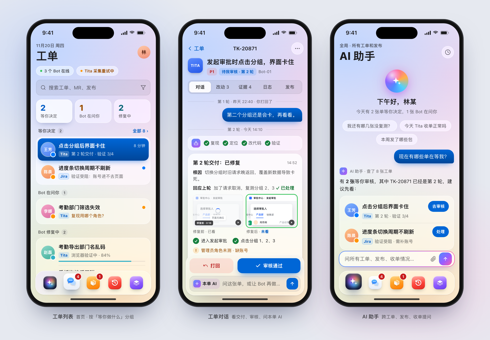

# 云匠（CLOUDCRAFT）· UI 设计与方案

「**云匠 / CLOUDCRAFT**」（一期聚焦 AI Bug 修复工作台）的设计与技术方案总览：**苹果系 · 毛玻璃 · 对话流**，覆盖 PC 和移动端，亮色和暗色两套。

**👉 直接双击打开 [`index.html`](index.html)**（项目唯一总览集合）：需求、方案与链路（含 `04` / `05` 全文）、设计主题、PC 界面、移动端、**技术设计（含 `06` 全文与架构/ER/状态机图）**、决策与后续，按步骤分成 7 个标签页，右上角可以切换亮色和暗色。以后新增的所有文档和设计图也统一汇入这一个 `index.html`。

| PC 亮色 | PC 暗色 |
|---|---|
|  |  |

| 移动端亮色 | 移动端暗色 |
|---|---|
|  |  |

- 其余全部页面（PC 44 张、移动端 11 张）：[reference/images/pages/](reference/images/pages/)，在 `index.html` 的 PC 和移动端标签页里可以直接看
- 应用图标和闪屏：[reference/images/logo/](reference/images/logo/)、[reference/images/splash/](reference/images/splash/)
- 登录：[PC-登录](reference/images/pages/PC-登录-亮色.png)、[移动端-登录](reference/images/pages/移动端-登录-亮色.png)（只有登录，用 Jira / GitLab 账号）
- 设计规范：[docs/01-设计主题.md](docs/01-设计主题.md)
- 已否掉的方向和协作约定：[docs/02-决策记录与禁区.md](docs/02-决策记录与禁区.md)
- 出图方法：[docs/03-出图流程.md](docs/03-出图流程.md)
- **链路流转（一张单从交给 AI 到上线，每步的开始、结果、界面和来源）**：[docs/05-链路流转.md](docs/05-链路流转.md)，总图在 `reference/images/flow/`
- 修复流转方案（技术设计输入：收单、分支与 MR 审核、tita build / release、回滚）：[docs/04-修复流转方案.md](docs/04-修复流转方案.md)
- **技术设计方案（架构、数据模型、状态机、收单、Bot、MR、发布与回滚）**：[docs/06-技术设计方案.md](docs/06-技术设计方案.md)（已汇入 `index.html` 的「技术设计」标签页）
- 产品需求原文：[docs/00-一期产品需求.md](docs/00-一期产品需求.md)
- Token：[tokens/theme.css](tokens/theme.css)

> 给 AI 的规则在 `CLAUDE.md`（`AGENTS.md` 是指向它的软链接）。
