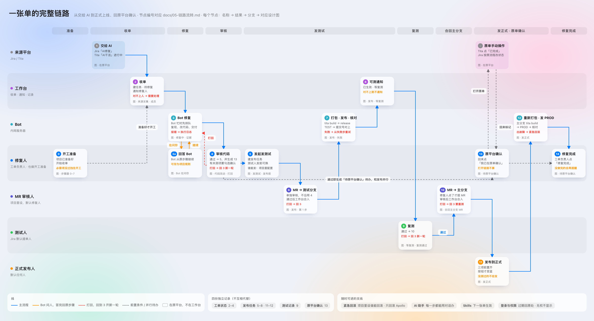
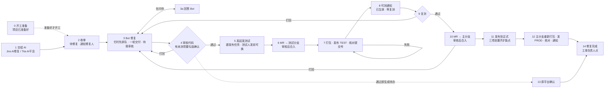

# 链路流转（一张单从进来到上线）

这份文档把**一张 Bug 单从交给 AI 到正式上线、回原平台确认**的全过程串成一条链路。每一步都写清：

- **开始**：什么条件下进入这一步、从哪里进；
- **谁做**：人还是 Bot，哪个角色；
- **做什么**；
- **结果**：状态怎么变、留下什么记录、下一步是谁；
- **分支**：失败、打回、提问、边界情况走向哪里；
- **界面**：对应的设计图（`reference/images/pages/` 下的文件名，亮色 / 暗色各一张）；
- **来源**：依据哪份文档哪一节，或用户哪天确认的。

> 给后续做设计、做开发的 AI：**以这份为链路的总索引（以下 0→14 为内置默认全功能预设流程；按「配置优先于内置写死」原则，所有节点顺序、是否走双环境/单主干、门禁开关及节点级专属 Skills 均可在项目「流程模板」自定义，界面实时读取 `round_node_runs / ticket_node_runs` 动态渲染）**。每一步的细节以「来源」里列的文档为准。

来源简称：

| 简称 | 文件 |
|---|---|
| 需求 §x | `docs/00-一期产品需求.md` |
| 设计 §x | `docs/01-设计主题.md` |
| 决策 | `docs/02-决策记录与禁区.md` |
| 流转 §x | `docs/04-修复流转方案.md` |
| 用户确认 | 设计评审时用户当面定的，日期写在后面 |

---

## 一、总图

图：`reference/images/flow/链路总图-亮色.png` / `-暗色.png`，源 `scripts/gen-flow.py`。横向是阶段，纵向是角色泳道；节点编号和下面第三节一一对应。

- 蓝色实线：主流程
- 橙色：Bot 停下来问人，回答后回到原步骤
- 红色：打回，回到第 3 步开新一轮
- 灰色虚线：前置条件、并行的待办

同一张图的文字版（给 AI 读）：

---

## 二、四份独立的记录

一张单身上有四条**分别记录、互不代替**的线（需求 §5.1 末段、§3）。界面上任何地方都不能用一条代替另一条，例如「审核通过」不等于「已上线」，「打开了原单链接」不等于「已在原单确认」。

| 记录 | 取值 | 由哪一步改 | 在哪里看 |
|---|---|---|---|
| 工单状态 | 待修复 → AI 修复中 ⇄ 需要协助 → 待我审核 → 打回重修 / 审核通过 → 修复完成 | 2、3、3a、4、14 | 工单头部胶囊、工单列表分组 |
| 发布任务（每次一条，测试 / 正式分开） | 发布前 → 发布中（5 步）→ 已生效 · 等复测 / 失败 · 某一步 → 已生效 | 5–8、11–12 | 工单「发布」标签、Dock「发布」 |
| 测试记录（绑定版本） | 等复测 → 通过 / 打回 | 9 | 发布详情右栏「测试记录」 |
| 原平台确认 | 待原平台确认 → 已确认（谁、何时） | 13 | 列表分组「待原平台确认」、工单右栏 |

列表分组按「等你做什么」排：**需要处理（红）→ 等你决定（蓝：待我审核 + 轮到你的发布/MR/复测）→ Bot 在问你（橙）→ Bot 修复中（青）→ 排队中（灰）→ 发布与复测中 → 待原平台确认（绿）→ 已完成（仅「全部」底部）**，空分组自动折叠，单单仅归 1 组且「我的」覆盖全部参与角色（设计 §3.3）。

---

## 三、逐步说明

### 0 开工准备（极简 4 步 · 权限与凭证明示，其余 AI 推测）

| 项 | 内容 |
|---|---|
| 开始 | 第一次登录工作台。工作区尚无在线执行器时，先走「选择执行环境（本机 / 自有与团队服务器 / 云端 Pro）」及对应接入路径；随后管理员且全局 AI 没接时走前置第 0 步「连接 AI」 |
| 谁做 | 个人 / 管理员（执行器、全局 AI 与公司共用连接器）、项目开发者（授权项目权限与环境账号）；每项由 Bot 实测 |
| 做什么 | **1. 连接器与鉴权**（自动筛出插件市场 `code_source / ticket_source` 类连接器完成 GitLab / GitHub / Gitee / 自定义 / 本机目录及可选 Jira / Tita 鉴权；管理员建好公司共用连接器后全员复用）→ **2. 授权项目与代码权限**（从已鉴权连接器按搜索/Group 主动挑选相关仓库，主列表仅保留已选仓库并切换 `仅查看 / 可修改` 或移出；分支、构建命令与仓库规范由 AI 扫仓自动推测，修单时 AI 自动匹配项目）→ **3. 环境与账号**（复现入口、密码/Cookie 与数据权限，纯代码单可跳过）→ **4. AI 体检并开工**（实测拉取、构建、只读隔离与试登录） |
| 结果 | 执行器在线、连接器鉴权通过、项目读写边界清晰，内置 Skills 与仓库规范默认生效，立即开工；跳过向导后随时在「设置 → 连接器 / 项目」补配，发布/回滚/主题/费用监控等扩展按需去左侧 Dock「插件市场」安装 |
| 分支 | 必需项没通过就挡住开工；跳过执行器或连接器配置时可先进入工作台，新单进入「等待执行器上线」或顶部轻引导；准备没完成时收进来的单先等着，不开工 |
| 界面 | `PC-选择执行环境`、`PC-执行器初始化`、`PC-连接团队服务器`、`PC-开通云端托管Pro`、`PC-步骤器-0-连接AI`、`PC-步骤器-1-连接器与鉴权`、`PC-步骤器-1-新建连接器鉴权`、`PC-步骤器-1-工单鉴权与触发条件`、`PC-步骤器-1-向导AI帮手`、`PC-步骤器-2-授权项目与代码`、`PC-步骤器-2-挑选仓库`、`PC-步骤器-2-微调配置`、`PC-首次使用步骤器`（第 3 步）、`PC-步骤器-3-添加账号`、`PC-步骤器-4-体检并开工`、`PC-步骤器-4-体检完整日志`、`PC-设置-连接器`、`PC-设置`、`PC-设置-全局AI`、`PC-设置-执行器`、`PC-插件市场`、`移动端-首次使用步骤器`、`移动端-插件市场与执行器` |
| 来源 | 需求 §4；流转 §0、§2、§4；设计 §10、§10.5、§11、§14、§15；技术方案 §2.4、§5.3a、§10.2、§12；决策「五、页面进度」 |

### 1 交给 AI（在原平台，人做）

| 项 | 内容 |
|---|---|
| 开始 | 测试在 Jira 提 Bug；线上问题进 Tita 工单管理 |
| 谁做 | Jira：经办人 / 测试；Tita：工单处理人 |
| 做什么 | Jira 把状态改为「AI修复」；Tita 工单进入「AI干活」节点且节点进行中（只满足整体「解决中」不收） |
| 结果 | 原单符合收单条件，等第 2 步采集 |
| 界面 | 无（在 Jira / Tita 里操作） |
| 来源 | 需求 §2、§7「Jira 收单」「Tita 收单」；流转 §1 |

### 2 收单

| 项 | 内容 |
|---|---|
| 开始 | 采集服务按来源定时轮询（每 2 分钟，新单 5 分钟内开始修并通知，超过 15 分钟没采到算采集异常；Jira 用只读账号 `bot-fix`，Tita 用令牌） |
| 谁做 | 工作台（系统） |
| 做什么 | 按各项目收单条件筛选 → 同一来源、同一张单、同一次交付只建一项任务 → 确定真人修复人（Jira 取经办人字段；Tita 取「AI干活」节点负责人，可以有多个，用户确认 2026-11-21）→ 匹配工作台成员 → 定复现环境（按来源统一设置，不读工单里的环境字段） |
| 结果 | 任务进入「待修复」，记下来源、编号、修复人、执行 Bot；通知修复人「接到新单」（只发一次） |
| 分支 | 采集失败：顶栏橙色胶囊「Tita 采集失败 · 重试中」+ 来源采集页红卡，恢复后补收漏单，不能说成「今天没 Bug」。修复人对不上（同名、缺失、多个候选）：保留工单，进列表「需要处理」和「成员与身份」顶部待处理，确认后补发通知。项目没准备好：单先等着 |
| 界面 | `PC-主界面`（顶栏、列表、手动建单 `+` 入口）、`PC-手动新建工单`（含未开工暂存与无仓边界）、`PC-空状态`（第一张单还没来：Bot 在等单）、`PC-设置-连接器`、`PC-设置-成员与身份`（含部门默认继承、邀请配置抽屉、选人确认与停用交接）、`PC-设置-通知`、`移动端-组织与成员` |
| 来源 | 需求 §2、§1.2、§7「网络或采集恢复」「身份和审核权限」；流转 §1；设计 §10.6、§10.7、§10.8 |

### 3 Bot 修复（AI 修复中）

| 项 | 内容 |
|---|---|
| 开始 | Bot 领到「待修复」任务；或打回/主干冲突后开新一轮。忙时按项目可配队列（默认 `P1 优先 → 同级打回重修在前 → 先来先到`，支持高权调整）。 |
| 谁做 | 执行器容器 / 本机安全沙箱（支持团队 WSS 出站或本机运行） |
| 做什么 | 从主分支按仓库 `branch_template`（默认 `fix/<项目>/<工单号>`）拉出分支 → 按项目「流程模板」绑定版本推进各个 **`execution` 有序节点**（默认包含：读材料 → 复现 → 定位改码 → 试构建与可配 Hard/Soft 机审门禁 → 验证策略如浏览器本地 `dist/` 动态替换或后端单测/接口探测 → 交付），**每个节点独立挂载专属 Skills、工具范围与行为指令并如实落库运行记录** |
| 结果 | 产出一轮结构化交付（或无需改码的 `no_code_fix` 诊断交付：含根因、改动、验证清单、证据、节点记录及宿主实时评定的 `L0-L2` 影响面）→ 状态「待我审核」，通知修复人 |
| 分支 | 缺资料/验证受阻/机审连败达上限（转「需要协助 · 机审未通过」）→ 第 3a 步；修复人点「我来接手」可切换本人本地修码推送（回交必过服务端校验与门禁）再进审核；持 `core:tickets:cancel` 权者可依法取消未上生产的工单归档为 `修复完成(cancelled)`；原单外部撤回时顶部亮预警但不静默强杀 Bot |
| 界面 | `PC-排队`、`移动端-审核与排队`、`PC-工单-修复中`（动态节点步骤条）、`PC-设置-项目-流程模板`（定制节点与挂载 Skills）、`PC-工作台-边界补全`（机审连败/豁免、人工接手交付、诊断直结、手动建单边界）、`PC-空状态-2`、`PC-执行日志报错`、`PC-证据`、`PC-主界面` |
| 来源 | 需求 §1.1、§3、§4、§5、§5.3；流转 §2、§4、§6、§7；设计 §3.4 |

### 3a 回答 Bot（需要协助 / Bot 在问你）

| 项 | 内容 |
|---|---|
| 开始 | Bot 遇到要人决定的事（例：复现用哪个角色），通知修复人「Bot 在问你」 |
| 谁做 | 修复人（PC 或手机） |
| 做什么 | 点预设答案或打字回答；可勾「存为项目规则」 |
| 结果 | Bot（或接手人）从原激活节点断点 `leaf_id` 续跑；存为规则的待启用后从下一轮（新单首轮或打回重修下轮）生效 |
| 界面 | `PC-Bot提问回复`、`移动端-代码与审核` |
| 来源 | 需求 §3「需要协助」、§4、§7 主场景；设计 §3.4 |

### 4 审核代码（待我审核）

| 项 | 内容 |
|---|---|
| 开始 | 收到「待我审核」通知，从 PC 或手机进工单 |
| 谁做 | 这张单的真人修复人（支持多人 `ticket_assignees`，具体认领/会签行为由项目 `assignee_claim_mode` 控制，默认 `'first_reviewer_claims'` 任一人先审过即锁定为主导人并消退其余 `auto` 候选人待办，打回开新轮未锁定时重放；管理员不能代审） |
| 做什么 | 看交付卡、代码改动（逐行；可切「相对上轮」）、证据；选中一行问本单 AI（注：本单 AI 发起「仅补测不改码」走同轮 `verify_only` 复用已有产物，不升 `round_no`） |
| 结果 | **通过**：记下审核的 `delivery_digest`、`review_rev` 与风险快照 → 「审核通过」；**仅当源工单平台插件声明 `requires_external_confirm` 能力时**同时生成「待原平台确认」（手动新建工单与无需确认连接器自动跳过第 13 步）；若为 `no_code_fix` 仅诊断交付则物理阻塞第 5～12 步直接进入第 13/14 步；其余按项目工作流推进交付段节点。**打回**：填意见/代码位置/截图，在**「回退到哪个节点」全节点下拉框**保留默认预设（如「定位与改码」）或改选模板中全部节点之一 → 若选回执行段/重审则开第 N+1 轮从选定节点起跑（上游跳过节点标 `skipped_inherited`）；若选交付后段且不改码，则留在当前过审轮次重跑 `ticket_node_runs(attempt_no+1)` |
| 分支 | 交付含「待人工复测」或 `Soft Gate` 告警时需同框勾选确认；默认 `L2` 高危锁定移动端 10 秒滑块（可配置允许手机逐行审完通过）。并发更新按 `rev` 拦截不覆盖 |
| 界面 | `PC-主界面`、`PC-代码改动`、`PC-完整文件与证据预览`、`PC-证据大图对照`、`PC-证据`、`PC-打回原因`、`PC-审核通过-有未测项`、`PC-边界状态`、`PC-第一次发布-配账号`、`移动端-代码与审核`、`移动端-完整文件与证据预览`、`移动端-审核与排队`、`移动端-运行态与异常补齐`（个人凭据弹窗 / 无权查看 / L2 锁） |
| 来源 | 需求 §3、§3.1、§1.2「双端同时审核」、§7「手机审代码」「手机打回与再审」「权限与状态一致」；设计 §3.4、§10.9 |

### 5 发起发测试

| 项 | 内容 |
|---|---|
| 开始 | 审核通过后，在工单「发布」标签点「发布到测试环境」，或对 AI 说「把这轮发到测试」 |
| 谁做 | 「发测试的人」，项目里配置（设置 → 项目）：默认工单修复人，可改成指定的人，也可设成「任何人」（用户确认 2026-11-20） |
| 做什么 | 核对轮次和提交、目标环境、测试人（Jira 默认提单人；Tita 没有，当场选）、这次包里还会带上的别人的提交 |
| 结果 | 建一条发布任务（如 `R-0418`），进入 5 步；重复点、换设备点都回到同一个任务 |
| 分支 | 只说「发布」没说环境时，AI 先问目标环境 |
| 界面 | `PC-发测试-发布前`（新）、`PC-工单-发布`、`PC-AI助手`、`移动端-审核与排队`（Jira 提单人找不到时换测试人） |
| 来源 | 需求 §5.1、§1.3；流转 §1「测试人」、§3；决策「单张工单的发布放在工单详情里」 |

### 6 MR → 测试分支（发布第 1 步）

| 项 | 内容 |
|---|---|
| 开始 | 发布任务建好 |
| 谁做 | Bot 提 MR `fix/<工单号>` → 该仓库的测试分支；「合入测试分支」审核人审核（默认工单修复人，项目里可改） |
| 做什么 | 按配置检查 `release_configs` 名单并提交 CR/MR（支持单主干项目按模板跳过测试分支直走第 10 步）；若测试分支存在别人未上线代码冲突，强制拉出轮次化分支 `port/<单号>-r<轮>-<试>-<测试分支>` 做真合并并重跑构建门禁，绝不把测试分支反向合入 `fix/`；通过后使用审批人本人 `personal_exec` 凭据合并（带乐观锁目标 SHA） |
| 结果 | 测试分支包含本单改动，记录精确 `merge_sha` 供第 7 步定点构建；支持工作流配置是否免去测试 MR 单独二次点击 |
| 分支 | 打回 → 第 3 步；需要先补个人代码源凭据 → 弹出就地配凭据抽屉（PC `PC-第一次发布-配账号` 语言 / 手机 `<PersonalCredentialPrompt>`） |
| 界面 | `PC-发布`、`PC-工单-发布`（5 步第 1 步「合入测试分支」）；审核时的样子和 `PC-合回主分支-MR审核` 一样（第 1 步橙色「等你审核 MR」、右卡「打回 / 通过并合入」） |
| 来源 | 流转 §2；决策「进测试分支和回主分支都要提 MR 审核」 |

### 7 打包 · 发布到测试 · 核对生效（发布第 2–4 步）

| 项 | 内容 |
|---|---|
| 开始 | 第 6 步合入成功 |
| 谁做 | Bot，在仓库根目录 |
| 做什么 | `tita build`（装依赖 → `npm run build-prod` → `dist/` 上传 OSS）→ `tita release --app <app> --env TEST`（更新 Apollo 配置：资源地址、版本号、`<CommitId>`）→ 读 Apollo TEST 的 `<CommitId>`，和本次构建的提交号比对 |
| 结果 | 测试环境版本变成本次版本（如 `2.18.0-fix.2`），提交号对上才进入第 8 步 |
| 分支 | 某一步失败：这一步标红，写命令、退出码和报错原文，后面的步骤「没执行」，测试环境「没变」，不发可测通知，通知发起人；点「从某一步重试」用已合入的代码重做，不重新提 MR。提交号对不上（被别的发布覆盖）：不通知，在单里说明。涉及多个仓库：按大包明细的顺序（组件 → 子项目 → 主站）推进，全部核实后才发整包可测通知 |
| 界面 | `PC-发布`、`PC-发布-失败`、`PC-大包明细`、`PC-第一次发布-配账号`、`移动端-发布`、`移动端-证据报错发布`、`移动端-大包与紧急回滚`、`移动端-运行态与异常补齐` |
| 来源 | 流转 §3、§5；需求 §5.1「查看结果或重试」、§5.2、§5.3、§7「发布失败与重复操作」「跨项目大包与断点续发」；决策「发布详情只有一套骨架」「发布失败也是同一套骨架」 |

### 8 可测通知（发布第 5 步）

| 项 | 内容 |
|---|---|
| 开始 | 第 7 步提交号对上 |
| 谁做 | 工作台（系统） |
| 做什么 | 给测试人发「可以复测」：工单、版本、测试入口、登录账号、改动摘要、复测步骤 |
| 结果 | 发布任务「已生效 · 等复测」 |
| 分支 | 之后同一环境被新发布覆盖：旧通知点开时提示版本已变 |
| 界面 | `PC-发布-等复测`、`PC-设置-通知`（通知样例）、`移动端-通知`（锁屏推送） |
| 来源 | 需求 §5.1「通知测试人」；流转 §3「发完怎么确认生效」 |

### 9 复测

| 项 | 内容 |
|---|---|
| 开始 | 测试人点开可测通知 |
| 谁做 | 测试人 |
| 做什么 | 按通知里的入口、账号、步骤在测试环境复测；在发布详情右栏「测试记录」点「通过」或「打回」（打回可附文字、截图、录屏，用和工单一样的打回窗口） |
| 结果 | **通过**：测试记录绑定这个版本，发正式的第 2 项前置打勾 → 第 10 步。**打回**：在全节点下拉保留默认预设（「定位与改码」回第 3 步开第 N+1 轮，在同 `fix/` 分支继续）或直接改选「发测试部署」等后段节点（`head_sha` 未变则不开新轮，原地追加 `ticket_node_runs` 尝试重跑）；支持在测试等复测期直接中途改派测试人（不重发包）；大包复测打回支持勾选问题仓单独重修 |
| 分支 | 不是测试人本人登录时只看到「等某某复测」 |
| 界面 | `PC-发布-等复测`、`PC-发布-复测通过`（通过后的样子）、`移动端-发布`、`PC-打回原因` |
| 来源 | 需求 §5.1「记录测试结果」；流转 §2「测试打回」；决策「复测不是单独页面」 |

### 10 MR → 主分支

| 项 | 内容 |
|---|---|
| 开始 | 第 9 步复测通过后，**修复人点「合回主分支」**（发布详情右栏「发布到正式环境」卡第三项旁边出现这个按钮），不自动提（用户确认 2026-11-20） |
| 谁做 | 修复人点 → Bot 提 MR `fix/<工单号>` → 主分支，正式发布任务从这一步开始；「合回主分支」审核人审核（项目里设，例：林某） |
| 做什么 | 审核人看「和测试时比」：本单改动是否和测过的一样，主分支上还会带上哪些别人的提交；通过后由工作台合入（同第 6 步） |
| 结果 | 主分支包含修复，发正式第 3 项前置打勾 |
| 分支 | 打回 → 第 3 步；代码变了就要重新测试（再走 4 → 9） |
| 界面 | `PC-发布-复测通过`（「合回主分支」按钮在哪）、`PC-合回主分支-MR审核`、`PC-发正式`（第 1 步已完成的样子） |
| 来源 | 流转 §2；需求 §5.2「测试与正式分别留痕」；决策「进测试分支和回主分支都要提 MR 审核」 |

### 11 发布到正式

| 项 | 内容 |
|---|---|
| 开始 | 三项前置都齐：代码审核通过、测试环境复测通过、合回主分支 MR 审核通过。发布详情右栏「发布到正式环境」按钮从灰变蓝 |
| 谁做 | 正式发布人（默认「任何人」，即有工作台权限的项目成员；项目里可改成指定的人） |
| 做什么 | 核对和测试时的差异、生效后通知谁，点「发布到正式环境」 |
| 结果 | 建一条正式发布任务，进入第 12 步 |
| 分支 | 前置没齐按钮不能点；没测过的版本不给发 |
| 界面 | `PC-发正式`、`移动端-发布` |
| 来源 | 流转 §3「发正式环境」；需求 §5.1「发正式环境」；决策（正式发布必须测试通过、默认任何人） |

### 12 主分支重新打包 · 发 PROD · 核对 · 通知

| 项 | 内容 |
|---|---|
| 开始 | 第 11 步点了发布 |
| 谁做 | Bot |
| 做什么 | 在主分支 `tita build`（一定重新打包，不复用测试包）→ `tita release --app <app> --env PROD`（必须显式带 `--env PROD`）→ 读 Apollo PROD `<CommitId>` 核对 → 通知修复人、测试人 |
| 结果 | 正式环境生效；工单里能同时看到测试、正式两个环境的版本、发起人和时间 |
| 分支 | 失败同第 7 步（同一套骨架）。上线后出故障 → 紧急回滚（见第四节） |
| 界面 | `PC-发正式`、`移动端-发布` |
| 来源 | 流转 §3；需求 §5.1、§7「一键提测与上线」 |

### 13 原平台确认（审核通过后并行）

| 项 | 内容 |
|---|---|
| 开始 | 第 4 步审核通过时按源连接器插件 `requires_external_confirm` 能力生成「待原平台确认」（手动新建与无需确认源自动跳过；默认按用户时区 `18:00` 可配开关汇总） |
| 谁做 | 修复人 |
| 做什么 | 点「打开 Tita / Jira 原单」，在原平台手动操作（Tita 点「已完成」完成当前节点；Jira 按原流程改状态），回工作台点「我已在原单确认」 |
| 结果 | 记下谁、何时确认；待办消失。打开链接不算确认；同一张单之后继续被采集也不会再开一轮 |
| 分支 | 原平台暂时打不开：待办保留 |
| 界面 | `PC-工单-待原平台确认`（新）、`PC-主界面`（右栏「我已在原单确认」） |
| 来源 | 需求 §3「原平台确认情况单独记录」、§6、§7「平台人工确认」 |

### 14 修复完成

| 项 | 内容 |
|---|---|
| 开始 | 工单负责人（真人修复人）认为这张单做完了 |
| 谁做 | 工单负责人，点工单右栏「修复完成」 |
| 做什么 | 点之前能看到正式环境是否已生效、原平台是否已确认；还有没做完的会再提醒一次，负责人确认后仍可完成（例如只修测试环境、不发正式的单） |
| 结果 | 工单状态「修复完成」，记下谁、何时；离开「我的」待办，在「全部」里可查；每一步的记录都能从这张单追溯 |
| 界面 | `PC-工单-待原平台确认`（右栏「修复完成 · 由你点」） |
| 来源 | 用户确认 2026-11-20：完成由工单负责人点「修复完成」，不按条件自动完成；需求 §7 主场景「各动作都能从同一张单追溯」 |

---

## 四、随时可以进入的支线

| 支线 | 开始 | 谁做 | 做什么 → 结果 | 界面 | 来源 |
|---|---|---|---|---|---|
| 紧急回滚 *(可选市场插件 · 启用时出现)* | 故障通知、首页「紧急回滚」或某条发布记录；不用先建 Bug | 项目里设的「谁能回滚」（默认同正式发布人，生产与非生产均纳入 RBAC 与可配策略，不写死角色名；未装隐藏、停用仅拦执行、历史只读可回看） | 选应用和环境 → 选历史发布 → 预览配置差异和连带变化 → 输入环境代码 `env_code` 确认 → 回滚配置 → 回读 → 业务入口验证。只回读成功时显示「配置已回退，业务恢复待验证」。可关联到工单让 Bot 查根因 | `PC-紧急回滚`、`移动端-大包与紧急回滚`、`PC-空状态-2`（没有可回滚的）、`PC-插件市场`（停用只读快照与运行态兜底卡） | 需求 §5.4；流转 §3「紧急回滚」 |
| AI 助手 | 任何时候，菜单第一个图标 | 当前登录的人 | 用对话完成上面任何一步（查、发测试、补充、问为什么失败），权限和界面完全一样（受 4 重 AND 门禁约束）；对象不明确先问 | `PC-AI助手`、`PC-空状态-2`（第一次打开） | 需求 §1.3、§1.4 |
| 本单 AI | 工单对话底部 | 当前登录的人 | 只管这张单：问原因、补资料（提问期明确区分答复提问 vs 仅问 AI 助手）、让 Bot 复测 | `PC-主界面`、`PC-代码改动` | 需求 §1.3；设计 §4 |
| Skills | Skills 页 | 持对应项目/工作流权限者 | 新建 / 导入（先是草稿，不启用）/ AI 起草 → 启用到项目或**流程模板指定 AI 节点**（退回旧版也是选中再启用）→ 从下一轮（新单首轮或打回重修下轮）生效，进行中的单沿用启动时版本 | `PC-Skills`、`PC-Skills-版本历史`、`PC-Skills-导入`、`PC-设置-项目-流程模板`、`移动端-Skills与设置` | 需求 §4；流转 §7 |
| 登录与权限 | 打开工作台、点通知/邀请链接或复制口令切回 | 任何人 | 支持 Deep Link (`cloudcraft://join`) 直唤 + **剪贴板邀请链接/ 12 位分组口令 (`#CC-XXXX-XXXX-XXXX#`) 智能识别** + 未认证脱敏预检 + 待加入邀请箱反悔找回；注册验证 OTP 后按待入驻邀请/企业域名（M2/M3）反孤岛加入；登录过期 → 登录后回原处；忘记密码 → 6 位码重设；免 SMTP 邀请链接 → 设密进部门工作空间；Core 核心域 + 动态插件权限 (`manifest.permissions`) 4 重 AND `ActionGate`（纯靠权限点+作用域，废除外包硬编码特判）、模板克隆与单键 Allow/Deny；我的账号聚合个人 `scope='user'` 凭据与外观语言；停用待办同事务交接；无权 → 提示无权查看 | `PC-登录`、`PC-注册`、`PC-已注册成员确认加入`、`PC-剪贴板识别邀请`、`PC-顶栏空间切换与邀请抽屉`、`PC-邀请失效与切号`、`PC-重置密码`、`PC-邀请加入`、`PC-设置-成员与身份`、`PC-设置-角色与权限`、`PC-设置-我的账号`、`PC-组织-部门默认设置`、`PC-组织-添加编辑成员`、`PC-组织-停用交接`、`PC-企业管理后台-蓝图`、`PC-企业管理后台-角色策略`、`移动端-登录`、`移动端-重设密码与邀请`、`移动端-剪贴板识别邀请`、`移动端-组织与成员`、`PC-边界状态` | 需求 §1.2；设计 §9、§10.7、§10.9、§10.14；技术 §2.3、§10.1、§12.2 |

---

## 五、这次补的设计图

梳理时发现以下几步没有对应的界面，已补图（2026-11-20 用户确认定稿，规范见设计 §12）：

| 步骤 | 新图 | 为什么要补 |
|---|---|---|
| 3 Bot 修复中 | `PC-工单-修复中` | 只有交付后的样子，没有 Bot 正在做时看到什么、中途补充是否被采纳（需求 §1.1、§4 末段） |
| 5 发起发测试 | `PC-发测试-发布前` | 发布详情只有发布中、失败、等复测，没有点「发布到测试环境」之前确认测试人和发布范围的样子（需求 §5.1 第 1 行） |
| 10 MR → 主分支 | `PC-合回主分支-MR审核` | 两次 MR 都要审核，但审核人在哪里审没有界面 |
| 9 → 10 点合回主分支 | `PC-发布-复测通过` | 合回主分支要修复人点，按钮在哪需要画出来 |
| 13 原平台确认 | `PC-工单-待原平台确认` | 只有右栏一个按钮，没有「去原单做什么、回来点哪里、点完变成什么」 |

## 六、还没定的（汇总）

第 5、6、10、14 步原来的 4 个问题已于 2026-11-20 由用户确认，写进了上面各步。剩下：

1. 需求 §8 第 1 条已定（2026-11-21）：Jira 修复人取经办人；Tita 节点多个负责人时任一负责人都能审，先审的算数。
2. 需求 §8 第 2 条已定（2026-11-21）：首批 Mac、Windows、iOS、Android；快捷录屏、系统分享不进一期（设计 §5.1）。
3. 需求 §8 第 3 条已定（2026-11-21）：新单 5 分钟内开始修并通知；Bot 忙时排队，先按优先级、同级打回重修在前、再按先后（见第 2、3 步）。
4. 需求 §8 第 4 条部分已定（2026-11-21）：允许带「待人工复测」提交审核，审核通过要勾「我知道有未测项」，未测项发测试时转给测试人重点测（第 4、8 步）；首批试点项目是审批、OKR、考勤。试点仓库、测试角色和验收用例还没给。
5. 需求 §8 第 5 条已定（2026-11-24 升级）：账号体系升级为独立邮箱注册与登录（私有部署支持仅邀请模式 + 免 SMTP 一次性邀请/重置密码链接），外部 Jira / Tita / GitLab 解耦为连接器与外部 ID 映射；工作空间管理员管全部，项目负责人管本项目成员、身份对应和待处理。
6. 需求 §8 第 6 条已定（2026-11-21）：测试人 Jira 默认提单人、发测试前可换，Tita 当场选；正式发布人默认任何人；谁能回滚默认同正式发布人；先后是复测通过 → 合回主分支 → 发正式；回退用 Apollo 回滚。
7. 需求 §8 第 7 条（用真实大包链路评审）还没做。
