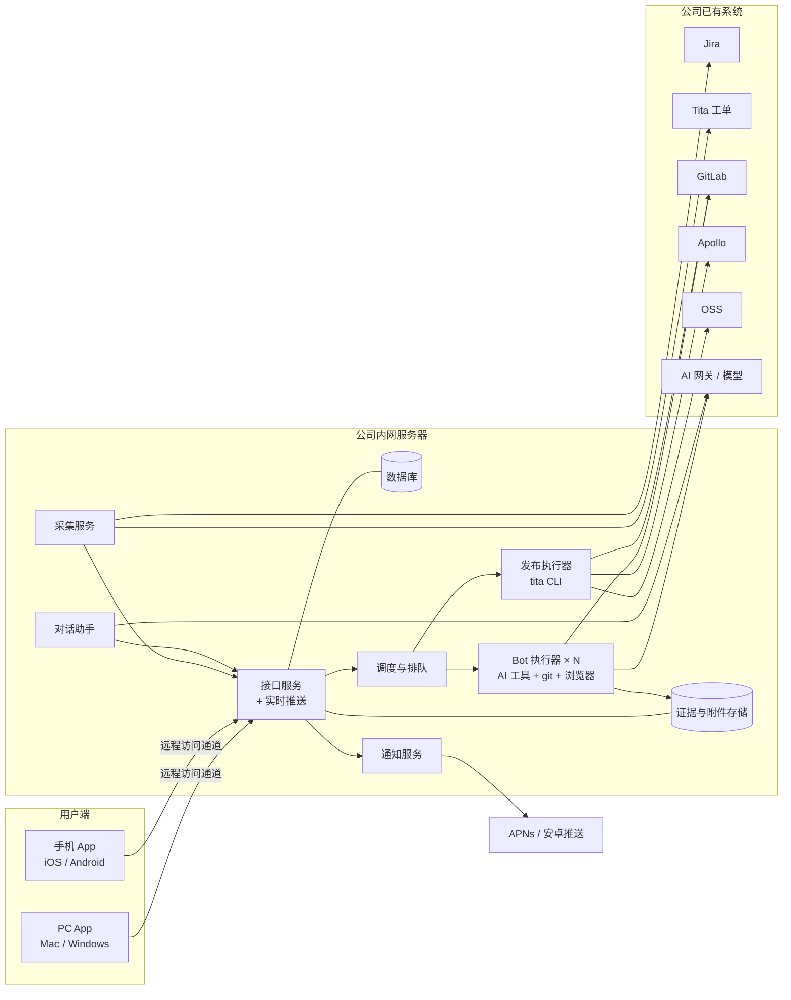
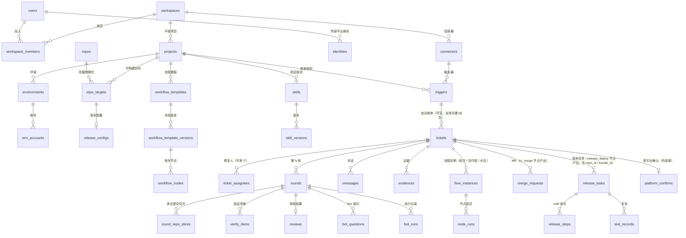
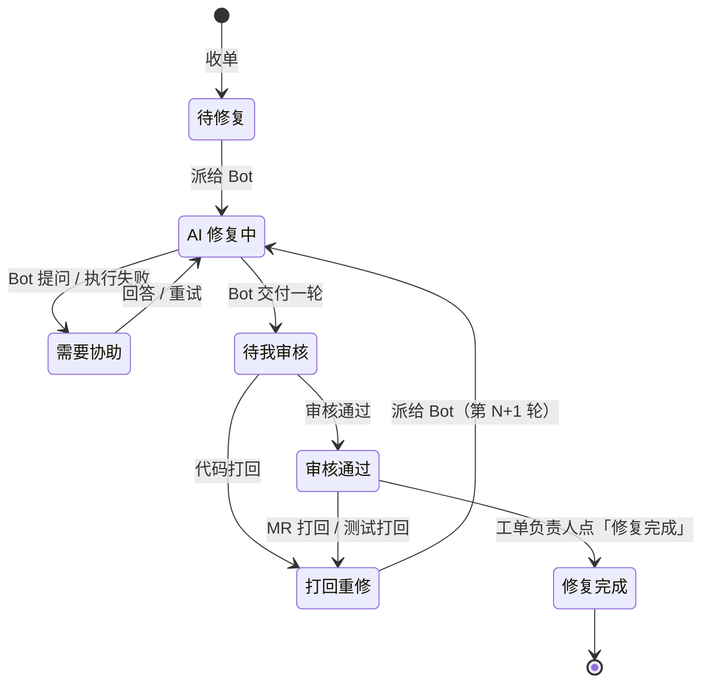

# 云匠（CLOUDCRAFT）· 一期技术设计方案（含二期零重构预留与演进架构）

> 状态：M1 编码基线（2026-11-24 锁版；2026-11-27 定稿：编排、数据隔离、执行与验证、客户端同步四层按架构评审结论重写，见 §1.2、§2.13、§3.6、§3.7、§5.3、§5.7、§7.1）。仍依赖外部实测或对比的事项集中在 §15：M1 第 1 周发起，施工第 6 步开工前闭环。

---

## 0. 说明（已确认 2026-11-24）

**写给谁**：做后端、Bot 执行器、发布模块、PC / 手机客户端的开发，以及后续接手的 AI。

**依据**（冲突时按这个顺序，再不行就问用户，改完两边一起改）：

| 文档 | 管什么 |
|---|---|
| `00-一期产品需求.md` | 要做什么、验收场景与二期跨项目演进规划（v1.0） |
| `05-链路流转.md` | 一张单从 0 到 14 每一步的开始、谁做、结果、分支 |
| `04-修复流转方案.md` | 公司实际怎么跑：分支、两次 MR、`tita build` / `tita release`、Apollo |
| `02-决策记录与禁区.md` | 已经定了的规则与被否掉的方向 |
| `01-设计主题.md` + `reference/images/` | 界面长什么样，接口要能撑起这些界面 |
| `07-工程化与实施计划.md` | 怎么开发：单仓结构、工具链、本地环境与模拟服务、测试、任务台账（本文 §13.4 的施工顺序在 `07` §9 展开为可执行任务） |

**写法约定**：

- 「**待定**」= 依赖外部实测的细节，散列于对应章节末尾（如 §4.7、§7.5），不要自己拍板。
- 「**推荐**」= 方案里的工程建议，已随章节锁定生效。
- 链路步骤用「第 N 步」，指 `05-链路流转.md` 的编号。
- 不在本文写任何密钥、令牌、密码。`tita` CLI 源码里有 OSS 访问密钥，**不能抄进任何文档或代码仓库**，部署时由运维放进服务器的密钥管理里。
- 「**估算**」= 还没有实测来源的数字（内存、体积、Token 节省比例等），实测后替换。
- **阶段口径**：**一期 = M1～M3**，**二期 = M4**（§13.2）。一期写到的能力都要做；排在 M2、M3 的能力，M1 先建好表结构、字段、接口和插槽位置（§13.6）；二期需要的预留见 §14.6。后续里程碑只加实现，不改已有结构。
- **命名以本文 §2、§3 为准**：表名、字段名、状态枚举在这两节定义，其他章节引用时不另起别名。

---

## 1. 总体架构（已确认 2026-11-21）

### 1.1 部署：所有执行都在内网服务器上

需求的核心是「关掉电脑，Bot 也会继续修」，所以**所有会花时间的事都在公司内网服务器上跑**：收单、修代码、浏览器复测、打包发布、Apollo 回滚。客户端只负责看和点，关掉不影响任何任务。



- **一台主服务器起步**（推荐 8C16G）：一期试点只有审批、OKR、考勤三个项目，Bot 默认同时修 3 张。所有服务用容器跑在一台内网 Linux 服务器上，Bot 执行器按「同时修几张」起对应数量的工作进程。量上来再把 Bot 执行器拆到别的机器，接口不变。
- **从公司外面访问**：手机和在家的电脑要能连到这台服务器，又不能每次都登 VPN（需求 §6）。候选是 Tailscale 或反代隧道，**待定**，见 §15 第 1 项。
- **服务器往外只出不进**：服务器主动去连 Jira、Tita、GitLab、Apollo、AI 网关和推送通道；客户侧自有 `cloudcraft-runner` 也采用纯出站 WSS 443 握手（§5.3a）。

### 1.2 服务拆分

一期放在同一个代码仓库。接口服务和后台任务是同一个程序的两种进程；执行相关的四块（Bot 执行器、构建沙箱、发布执行器、模型代理）各自单独起进程、用单独的系统用户。

| 服务 | 负责 | 对应链路 | 不做 |
|---|---|---|---|
| **接口服务**（`cc-app`） | 客户端和对话助手的唯一入口：登录、权限、所有读写、`ActionGate`；在写事务里调用推进函数 `advance()`（§3.6）；WebSocket 网关按变更流推送（§3.7）；对话助手（全局 AI、本单 AI）也在这里运行，经模型代理调用模型（§11） | 全部 | 不跑长任务，不持有任何执行私钥 |
| **后台任务**（`cc-sys`） | 从 `work_items` 领任务：调度派单（默认 `P1 优先 → 同级打回在前 → 先来先到`）、采集（默认每 2 分钟，`429` 退避，`401` 熔断）、定时器、租约回收、Outbox 投递、变更流发号、存储清理、每 10 分钟对账（§2.12） | 第 1、2、3、7、12 步 | 不改原平台的单，不按个人偏好乱拖他人顺序 |
| **Bot 执行器** | 领一段执行节点的租约，在断网沙箱里跑 AI 引擎；宿主侧提供工具并逐次校验；产出复现物、改动和证据，交宿主机回放判定（§5.7） | 第 3、3a 步 | 不连数据库，不持有发布凭据 |
| **构建沙箱** | 断网、无凭据地构建审核通过的提交，只产出产物和 sha256 清单（§7.1） | 第 7、11 步 | 不接触任何凭据，不上传 |
| **发布执行器** | 只运行固定版本的可信适配器：合 MR、按 sha256 上传产物、发布到环境、核对生效、可选回滚；用操作人个人凭据留痕 | 第 6、7、10、12 步 | 不执行仓库里的任何代码和脚本 |
| **模型代理**（`llm-egress-proxy`） | 只监听本机 Unix Socket；注入模型密钥，钉死上游地址和接口路径，统计 Token 与费用并执行熔断 | 全部 AI 调用 | 不转发到未配置的上游或非补全类接口 |
| **通知服务** | 按个人通知设置（用户时区）发桌面与手机推送（`PushChannelAdapter`），免打扰、去重；Core 必推告警 + 插件注册通知 | 第 2、3a、4、8 步等 | 不决定业务状态 |
| **证据与附件存储** | 截图、录屏、日志、复现物、执行记录包（按 sha256 寻址）、原单附件、Skill 文件；按保留期清理并置 `purged_by_ttl` | 第 3、4、9 步 | 不存明文凭据 |

**为什么执行相关的四块要单独起进程**：

- 它们执行不可信的东西（AI 改的代码、构建脚本、第三方 CLI），出错或卡死不能拖垮接口服务。
- 凭据按进程分开：Bot 执行器只有 `bot_exec`，发布执行器只有 `release_exec`，构建沙箱什么凭据都没有。**跑仓库代码的地方没有凭据，有凭据的地方不跑仓库代码**（§2.10、§5.3、§7.1）。
- 执行器（含 M3 远程执行器）不连数据库，只通过 `RunnerTransport` 和接口服务通信；认领和写回都在 PG 里带租约令牌完成（§2.12、§3.6）。

### 1.3 技术选型（已确认 2026-11-21）

选型原则：**团队已经会的优先**。公司前端是 React + TypeScript，`tita` CLI 是 Node 写的，浏览器自动化和主流 AI 编码工具也都是 Node 生态，所以服务端和 PC 端用 TypeScript；手机端用 Flutter（用户选定）。

| 项 | 选定 | 理由 |
|---|---|---|
| 后端语言 | **Node.js 24 LTS + TypeScript** | 和前端、`tita` CLI、浏览器自动化、AI 编码工具同一生态；服务端和 PC 端共用类型定义 |
| 后端框架与数据层 | **Fastify 5 + Drizzle ORM + TypeBox**（Native ESM；2026-11-27 定为 TypeBox，见 `07` §3.1） | 单源 Schema 同时驱动入参校验、TS 类型和 OpenAPI 3.0.3（给 React 与 Flutter 同源生成客户端）；Drizzle 强类型 SQL，事务与 `rev` 乐观锁直观；`routes / service / repo` 分层 + ESLint 边界门禁 |
| 数据库 | **PostgreSQL 16** | 业务状态、流程进度、任务队列、定时器、外发消息、变更流全部在一个库里，靠事务、约束和 RLS 保证正确；JSONB 存 AI 的结构化产出；中文全文检索用 `pg_bigm`（§15）；用到 15+ 的 `UNIQUE NULLS NOT DISTINCT` |
| 编排 | **推进函数 `advance()` + `work_items` 任务租约表**，全部在 PG 内（§3.6） | 流程进度和业务状态在同一事务提交，只有一份状态；画布配置是数据，升级服务不影响进行中的单。底层的定时器、重试、租约自己实现（S2 与 DBOS 对比后定，§3.6） |
| 流程画布 | **`@xyflow/react`** | 连线画布，支持分支、按仓扇出与回退连线 |
| 接口与实时 | **OpenAPI 3.0.3 + 统一 `ApiError` + 单条 WebSocket（变更流 + AI 流）+ `HostPlatformAdapter`** | `2xx` 直接返回强类型 DTO，集合用 `{items, next_cursor, has_more}`；`4xx/5xx` 统一 `ApiError { code, message, data? }`，`message` 按 locale 渲染；`X-Request-Id`、`Retry-After` 走 Header；实时推送见 §3.7；端侧宿主能力走 7 项显式 `HostPlatformAdapter` |
| 浏览器自动化 | **Playwright** | 截图、录屏、多账号上下文、Cookie 注入、请求拦截都有现成支持；和后端同为 Node 生态 |
| 代码沙箱 | **M1：rootless Docker + `--network=none`**；M3 云端共享池：gVisor 或 microVM | 服务器上不需要额外内核特性；每次执行记录隔离等级，调度可按风险要求更高等级（§5.3） |
| 证据存储 | **`StorageAdapter`**：单机本地磁盘 + 签名临时 URL；多节点切 MinIO / 对象存储 | 截图录屏量大，不进数据库；切换不改业务代码 |
| AI 引擎与模型 | **默认 Pi 内核**（`pi-ai` + `pi-agent-core` + `pi-coding-agent`）+ **多模型**（OpenAI 兼容 / Anthropic / Gemini / 本地 Ollama 等）；引擎走统一契约（§11.4），M2 接第二个引擎 | 纯 TypeScript、内核精简，提供流式事件、运行中插话、会话持久化、Token 计费和自定义工具。Pi 由小团队维护：锁定版本，M1 第 1 周做原型验证（§15），不达标时再讨论替代方案（目前**没有选定的备选引擎**，2026-11-27），契约不变 |
| PC 客户端 | **Electron + React + TypeScript** | Mac、Windows 一套代码；桌面通知、开机自启、`cloudcraft://` 深链接成熟；M3 本机执行器复用 Node。实现（U1）：渲染进程 `apps/desktop/src/renderer/`（Vite，先在浏览器里开发，U2 套 Electron）；外壳与组件 `packages/ui-kit`（`<ScrollArea>` 用 Radix ScrollArea，界面文案用 `intl-messageformat` 读 `i18n/zh-CN.json`），工作台三栏 `packages/workbench-ui` |
| 手机客户端 | **Flutter** | iOS、Android 一套代码，两端渲染一致；`BackdropFilter` 两端都能做毛玻璃 |

**手机用 Flutter 带来的两件事**：

- **代码共用方式**：Flutter 用 Dart，不能直接用 TypeScript 的类型和接口客户端。所以**接口以 OpenAPI 描述为准**，从同一份描述分别生成 TypeScript（PC、对话助手）和 Dart（手机）的接口客户端和数据类型；改接口只改一处，两端重新生成。实时推送（§3.7）的消息格式也写进这份描述。
- **设计 token**：`tokens/theme.css` 是 CSS 变量，手机端不能直接用。由一个小脚本把 token 转成 Dart 常量（颜色、圆角、毛玻璃参数），PC 和手机同源，不手抄。

**毛玻璃效果**：Mac 上用系统的窗口材质；Windows 上系统模糊效果弱，用半透明底色加背景图模拟，看起来接近但不完全一样。手机端 Flutter 两个平台都能做出来。这和设计主题 §5.1「设计只画一套、只做系统差异」一致。

---

## 2. 数据模型（已确认 2026-11-24 锁版）

### 2.1 总原则

- **四条记录分表存**：工单状态、发布任务、测试记录、原平台确认各是各的表，互不代替（链路文档第二节）。例如「审核通过」不会顺手把发布任务改成已生效。
- **工作空间统一作用域**：全库业务表一律以 **`workspace_id`** 做隔离作用域；一期默认自动初始化 1 个默认 Workspace（界面不露空间切换器），二期直接支持多工作空间与跨平级项目协作，零迁移成本。
- **库里只放业务数据和短文本**：截图、录屏、日志全文、原单附件放证据存储，表里只存对象地址和摘要。
- **编号两套**：主键用 UUID，界面编号是单独字段。工单：外部来源单显示原平台单号（`tickets.external_id`，如 Tita `TK-20871`、Jira `OKR-1234`）；手动新建单和系统派生单显示工作空间自增的 `M-<序号>`（`tickets.seq_no`；所有工单都发号，外部单的 `M-` 号作备用检索号）。发布任务为 `R-<序号>`（如 `R-0418`），MR 用代码源平台自己的编号。
- **时间**一律存带时区的时间（UTC），客户端按本地时区显示。
- **会被多人改的表都带 `rev`**（整数，每改一次加一）：用来防并发覆盖（第 3 节），也用来断线后按版本补齐。
- **历史不删**：审核结果、测试记录、发布步骤、事件记录只追加不改；人员停用、项目下线用状态字段，不物理删除，保证「每一步都能从这张单追溯」。
- **开始时定版本**：一轮修复开始时记下用的 Skills 版本、项目配置版本与契约快照，进行中的单沿用开始时的版本；改配置从下一张单生效。
- **为后续阶段留口，不为后续阶段写死**：核心 `tickets` 表不加二期专属字段（如 `changeset_id`、`proposal_ref`），也不往 7 态状态机里加二期状态；二期需要的关联用 6 项通用钩子承接（§14.6），一期界面不露出。M2、M3 能力在 M1 预留的表与接口见 §13.6。

### 2.2 总图

只画主要关系，字段见后面各表。



### 2.3 工作空间、组织权限与安全信封底座（2026-11-26 全审升级定案）

采用「**扁平租户 `workspace_id`（主隔离根） + 三类表分层隔离（A 全局 / B 握手索引 / C 租户 `FORCE RLS`） + 轻量 `roles` / `role_bindings`（纯权限驱动，零身份特判） + 手工多级 `org_units`**」模型：

| 表 | 一行是什么 | 关键字段与约束 |
|---|---|---|
| `organizations` | **【M3/M4 预留】** 集团/多业务线父实体 | `id`、名称（`workspaces.organization_id` 为 `UUID NULL`，跨事业部归集不破坏 PG RLS 分区边界） |
| `workspaces` | 一个工作空间（公司/团队或个人隔离边界） | `id`、`kind`（`'personal' \| 'organization'`）、`slug`（保留字+改名 90 天冻结）、`default_network_profile_id`、`timezone`、`organization_id UUID NULL`、部署模式（`saas / self_hosted`）、创建时间 |
| `workspace_quotas` | 算力、存储与防失控预算配额（均可配置带默认值） | `workspace_id`（PK）、套餐、并发槽范围、单轮最大时长/Turn 数/Token 与成本熔断阈值、`retention_days`（证据默认 90）、**`soft_delete_retention_days`（软删回收站保留天数，默认 30）**、**`operation_log_retention_days`（操作记录保留天数，默认 180）**、`storage_quota_bytes`（默认 50GB） |
| `workspace_counters` | 工作空间内单号原子发号器 | `workspace_id`、`counter_type`、`next_val`（`UPDATE...RETURNING` 零冲突） |
| `network_profiles` | 企业自签 CA 与出站代理拓扑规格 | `id`、`workspace_id`、`name`、`ca_bundle_pem`、`ca_fingerprint`、`http_proxy`、`https_proxy`、`proxy_secret_id UUID NULL`（外键 `secret_items`）、`no_proxy`、`strict_tls DEFAULT true`、`rev` |
| `runners` | 注册在线的无状态执行器节点 | `id`、`workspace_id`、`owner_user_id`（`personal` 必填）、`scope`（`personal / team / cloud`）、`network_zone`、`network_profile_id`、`runner_roles TEXT[]`、`priority`、`drain_mode`、`status`（`'pending'\|'online'\|'revoked'`；在线 / 离线按 `last_heartbeat_at` 现算，不存）、`last_heartbeat_at`、`enroll_token_hash` + `enroll_expires_at`（一次性注册令牌的哈希，15 分钟）、`auth_token_hash`（长期密钥的哈希）。心跳列每几秒变一次，这张表不挂漏写探针，注册、排空、吊销仍经统一写入记操作记录 |
| `runner_keys` | 执行器双域 X25519 公钥（服务端物理零私钥） | `id`、`workspace_id`、`runner_id`、**`key_role`（`'bot_exec' \| 'release_exec'`，宿主机按独立进程 `0400` 隔离）**、`public_key`、`key_fingerprint`、`epoch`、`status`（`'active'\|'draining'\|'revoked'`）、`revoked_at`、`revoked_reason` |
| `recovery_keys` | 零知识恢复公钥与空间多管理员托管 | `id`、`workspace_id`、`scope`（`'user_recovery' \| 'workspace_recovery'`）、`owner_user_id`、`public_key`、`encrypted_private_key`（客户端派生密钥包裹）+ `workspace_recovery_escrows` 多副本托管 |
| `secret_items` & `credential_envelopes` & `secret_deliveries` | 统一凭据密文、按域防越权信封与全量下发台账（防 `bot_exec` 碰 `personal_exec`） | `secret_items`: `workspace_id`、`credential_class`（`'shared_readonly'\|'workspace_secret'\|'personal_exec'\|'llm_gateway'`）、`owner_user_id`、`ciphertext`（吊销抹除后置 `NULL`）、`key_epoch`、`rotation_state`（`'clean'\|'pending_dek_rotation'\|'exposed_needs_reissue'\|'revoked_purged'`）；<br>`credential_envelopes`: 复合外键 + 表级 `CHECK` 死锁 **`NOT (secret_class_snap='personal_exec' AND target_key_role='bot_exec')`** 且 `personal_exec` 恢复信封强锁仅本人 `user_recovery`；<br>**`secret_deliveries`**（替代单值 `last_delivered_runner_id` 防多机覆盖漏标）：`UNIQUE(workspace_id, secret_id, runner_id)` 记录每台曾拉取该密文的执行器与 `key_epoch` |
| `users` | 全局独立邮箱账号 | `id`、邮箱（`LOWER(email)` 唯一）、Argon2id 哈希、邮箱已验证、昵称、`system_bootstrap_state`、`is_instance_admin`、状态、`locale VARCHAR(16)`、`timezone` |
| `user_auth_methods` | **【M3 预留】** 外部 SSO 联合身份 | `user_id`、`provider VARCHAR(64)`（开放命名，如 `email / oidc / saml / scim:<plugin>`，禁写死厂商枚举）、`subject`、`tenant_key` |
| `user_auth_tokens` | 账号级 OTP 与一次性重置密码令牌 | `id`、`user_id`、`purpose`（`'register_otp'\|'self_password_reset_otp'\|'admin_reset_link'`，SaaS 硬禁后者）、`salt`、`email_hmac`、`token_hash`（加 `SERVER_OTP_PEPPER`）、单 CTE 无条件自增 `attempts < 5`、`expires_at`、`used_at`、`revoked_at` |
| `refresh_tokens` & `ws_tickets` | 端侧刷新会话与 15s WebSocket 一次性门票 | `refresh_tokens(id, user_id, device_id, token_hash UNIQUE, expires_at, revoked_at)`；`ws_tickets(id, user_id, workspace_id, channel('client'\|'admin'), token_hash UNIQUE, expires_at, used_at)` |
| `workspace_invitations` | 空间免 SMTP 邀请记录（12 位口令防枚举） | `id`、`workspace_id`、`invited_email`、`token_hash`（`>=128-bit`）、`short_code_hash`（12 位分组 Base32 `#CC-XXXX-XXXX-XXXX#`，约 60 位随机；输错的口令对不上任何一行，防枚举靠 §2.9 的 `auth_rate_limits` 限流）、`preset_org_unit_id`、`preset_role_id`、`preset_project_ids`、创建人、`expires_at`（默认 24 小时，可配）、`accepted_at`、`accepted_by`、`revoked_at` |
| `workspace_members` | 成员席位与主部门 | `workspace_id`、`user_id`、`account_type`（`'human' \| 'service'`；不设 `guest` 身份分支，外包只是可配置的低权角色）、`primary_org_unit_id`、状态、`expires_at`、`authz_epoch`（权限版本，撤权或转派时加一，§3.7） |
| `org_units` | 多级组织部门树（写前锁 `pg_advisory_xact_lock`） | `id`、`workspace_id`、`parent_id`、`path`（`ltree`）、名称、`lead_user_id`、`source VARCHAR(64)`（`manual` 或 `scim:<plugin_id>`）、`external_dept_id`、**`default_package JSONB DEFAULT '{}'`**（部门预设角色/项目包，禁含 `personal_exec`） |
| `org_unit_members` | 部门与成员绑定（支持虚线借调） | `workspace_id`、`org_unit_id`、`user_id`、是否主部门 `is_primary`、`expires_at`、`source` |
| `roles` & `role_bindings` | 统一 RBAC 角色与细粒度 Bindings（全表含 `workspace_id`） | `roles`：含 `workspace_id`、内置/克隆标记、`is_owner`（DB 防末位拥有者/角色管理权归零）、权限集合以 **`TEXT` 数组**存 `core:*` 与 `ext:<plugin_id>:*`（新装插件对非 Owner 克隆/受限角色默认 `Fail-Closed`）；<br>`role_bindings`：`workspace_id`、`user_id`、互斥校验 `(role_id XOR permission_key)`（支持单键覆盖）、`scope_type`（`'workspace'\|'org_unit'\|'project'\|'ticket'`）、`scope_id`、`effect`（`'allow'\|'deny'`，`Deny-Overrides`）、`expires_at` |
| `projects` | 平级业务项目 | `workspace_id`、名称、`slug`、`owning_org_unit_id`、状态、开工步数、**`workflow_template_id`**、`risk_rules JSONB`（含可配阈值、移动端 L2 逐行审开关与自动结单开关）、`default_locale` |
| `identities` & `identity_issues` | 外部平台身份映射与待处理队列 | `identities`：`workspace_id`、`user_id`、`connector_id`（`ON DELETE RESTRICT`，**移除冗余静态厂商枚举**）、`external_id`、`external_display`；<br>`identity_issues`：支持「关联永久身份 / **仅指定本单临时修复人（不污染 `identities`）** / 退回作废取消」三出口 |

- **M1 实现档（表结构一次建全，后续只加逻辑）**：`runners` / `runner_keys` / `secret_items` / `credential_envelopes` / `secret_deliveries` 在 M1 全部建表并按本节约束写入。M1 只有服务器上的 1 台内置执行器：`bot_exec` 与 `release_exec` 各 1 对密钥，私钥文件分属两个系统用户（`0400`），API 进程只有公钥。多执行器注册、密钥 `epoch` 轮换与被盗吊销（§2.10）随 M3 远程执行器实现；`recovery_keys` / `workspace_recovery_escrows`（零知识恢复）、`organizations`、`user_auth_methods` 在 M1 建表留空，分别随 M3 的高敏部署档、集团视图和 SSO 实现（§13.6）。
- **项目级 RLS**：项目下的所有子表冗余 `project_id`。每个事务开头，由 `SECURITY DEFINER` 函数 `app_resolve_visibility()` 按当前成员关系和 `role_bindings` 算出可见项目，写入 `SET LOCAL app.visible_project_ids`；策略为「`workspace_id` = 当前空间 且 `project_id` 在可见项目内」，不在策略里逐行调用函数。撤权在下一个事务立即生效，同时 `workspace_members.authz_epoch` 加一，通知客户端清缓存（§3.7）。执行器写回只设所属的那一个项目。
- **个人凭据只给本人确认过的执行器**：`runner_trust(user_id, runner_id, key_fingerprint, confirmed_at)`。`personal_exec` 的信封只加密给本人在客户端确认过指纹的执行器，新注册的执行器不会自动拿到，防止管理员注册一台自己控制的执行器来解密员工令牌。
- **邀请不能提权**：创建和领取邀请时各校验一次，`preset_role_id`、`preset_project_ids` 必须在邀请人当时的有效权限之内；拥有者角色（`is_owner`）不能被预设。邀请确认页展示空间拥有者和已验证域名，防止仿冒空间。
- **PG `FORCE RLS` 三层隔离与防超管自锁死（2026-11-26 定案）**：
  - **三层表分类**：A 全局账号表（`users / user_auth_methods / user_auth_tokens / refresh_tokens / devices / organizations / ws_tickets`）由 `user_id` 鉴权；B 双态握手索引表（`workspaces / workspace_members / workspace_invitations / runners` 握手）通过窄 `SECURITY DEFINER` 函数过认证并写入 `app.current_workspace_id`；C 纯租户业务表与 **全部子表（如 `roles`、`skill_versions`、`ticket_assignees`、`rounds`、`round_repo_slices`、`verify_items`、`reviews`、`bot_questions`、`messages`、`evidences`、`bot_runs`、`release_steps`、`merge_requests`、`test_records`、`platform_confirms`）全部下沉 `workspace_id NOT NULL` + 复合外键 + `FORCE ROW LEVEL SECURITY`**（策略强制 `NULLIF(current_setting('app.current_workspace_id', true), '')::uuid`）。
  - **迁移与运行账号分离**：拆设 `cloudcraft_migrator`（仅 DDL 迁移）与 `cloudcraft_app`（`NOSUPERUSER NOBYPASSRLS`，运行时绝不绕过 RLS；调度、采集、清理等要跨工作空间找活的系统任务走 §2.12 的窄函数）；`org_units` 写树统一使用 PostgreSQL **两参咨询锁** `pg_advisory_xact_lock(hashtext('cc:org_tree'), hashtext(workspace_id::text))`。
  - **防自锁与停用交接**：数据库事务行锁 `FOR UPDATE` 严禁有效持有 `is_owner` 或核心成员管理权的活跃管理员数降为 0（极端误操作配宿主机 CLI `craft-server auth restore-owner`）；停用成员在同一事务强制吊销 `refresh_tokens / ws_tickets`、停用本机 `personal` Runner，并列出待移交的审核单、`test_records.tester_id`、固定 MR 审核人、`org_units.lead_user_id` 及 `release_configs` 指定名单完成移交。
- **实现（P1）**：
  - 账号名沿用本地环境的 `cc_migrator`（迁移）/ `cc_app`（运行，`NOBYPASSRLS`），即上文的 `cloudcraft_migrator` / `cloudcraft_app`。
  - 建表助手 `apps/server/src/db/schema/tenant.ts` 一次生成 `id`、`workspace_id`（+ `project_id`）、`rev`、`created_at`、`updated_at`、`deleted_at`，以及 `UNIQUE(workspace_id, id)` 和复合外键，并登记进租户表清单。
  - RLS 策略、`FORCE`、授权、只追加触发器和漏写探针，由清单生成 `apps/server/src/db/sql/security.sql`，每次迁移后重放（`pnpm gen` 重新生成，`verify` 检查是否最新）。
  - 事务开头由 `app_enter(user, workspace)` 核对成员身份后写入 `app.current_workspace_id`、`app.current_user_id`、`app.visible_project_ids`（`apps/server/src/db/client.ts` 的 `withWorkspaceTx`）。P1 的 `app_resolve_visibility()` 让活跃成员看到空间内全部项目，P2 接入 `role_bindings` 后收窄，调用方不变。
  - `SECURITY DEFINER` 函数归 `cc_migrator` 所有；因为开了 `FORCE`，它只在需要跨空间访问的表上（`workspaces`、`workspace_members`、`projects`、`work_items`、`audit_probe`）有一条只对 `cc_migrator` 生效的放行策略。
  - 越权测试从系统表列出所有带 `workspace_id` 的表自动生成（`apps/server/test/tenancy/`）。
- **实现（P2）**：
  - 表：`apps/server/src/db/schema/iam.ts`（`user_auth_tokens`、`refresh_tokens`、`ws_tickets`、`auth_rate_limits` 是 A 类全局表；`roles`、`role_bindings`、`workspace_invitations`、`notifications` 走建表助手）。`users` 加 `password_hash`、`email_verified_at`。
  - 五个内置角色、权限键、`ActionGate` 定义在 `packages/core-protocol/src/permissions.ts`。建空间时（`createWorkspace`）一起写入五个角色，创建人绑拥有者角色。
  - 权限按键联算：空间级允许 − 拒绝（`iam-service.ts` 的 `permissionsOf`），不按角色名分支。`app_resolve_visibility()` 改成按 `role_bindings` 算可见项目：空间级拿到 `core:*` 或 `core:projects:view_all` 的看全部；否则只看绑定了的项目；项目级拒绝优先。
  - 领邀请用窄函数 `app_accept_invitation`（领取人还不是成员）：核对邮箱绑定，写成员和预设角色 / 项目，再进入空间；调用方在同一事务里补记操作记录。预览用 `app_preview_invitation`。
  - 带「本人」列的表（`notifications`、`change_stream.recipient_user_id`）由建表助手的 `ownerColumn` 生成 RLS：读要求是本人，写只要求同一空间，这样能给别的成员发通知，但读不到别人的。
  - 邀请不能提权：拥有者角色不能预设，预设角色的每个权限邀请人都要有，预设项目要在邀请人可见范围内。
  - 还没做（随后续任务）：自定义角色与按部门 / 工单作用域授权（P10）、`org_units`（P10）、凭据信封（P3）、停用成员时的移交与吊销会话（P10）、`workspace_quotas`、`network_profiles`、恢复密钥（M3）。
- **双平面鉴权与纯权限驱动**：Plane A 支持「空间 → 部门 → 个人」非密钥级联；Plane B 个人写凭据与代码审签责任永不继承或代审；所有能力（含「任何人」发布、作废、接手、非生产回滚）一律通过 RBAC 权限点 + `role_bindings` 作用域联算，不写死任何角色名称特判。
- 收单时按 `(workspace_id, connector_id, external_id)` 匹配 `identities`；无项目权限时进 `identity_issues`，已有 `ticket_assignees(source='manual')` 时不静默覆写。

### 2.4 项目配置、连接器与可定制工作流（2026-11-26 全面去硬编码升级）

| 表 | 一行是什么 | 关键字段与说明 |
|---|---|---|
| `repos` | 物理代码仓库（多项目共享同一 Monorepo 不撞表） | `workspace_id`、`source_type`（`'connector' \| 'local'`）、`connector_id`、`remote_repo_id`、`local_path`、`access_mode`（`'read_write' \| 'read_only'`）、`default_branch`、`branch_template`（默认 `fix/<project_slug>/<ticket_no>`）、`port_branch_template`、`toolchain_id`、`test_baseline_reset_*`（仅一次性基线自清除字段）、`atlas_snapshot_key`；**`UNIQUE(workspace_id, connector_id, remote_repo_id)`** |
| `repo_targets` | 归属项目的可构建/部署子目标（支撑 Monorepo 子包） | `id`、`workspace_id`、`repo_id`、`project_id`、`package_dir`、`package_name`、`monorepo_tool`、`build_scope`、`dist_dir`、`verify_strategy`（`'browser_dist_replace' \| 'test_suite' \| 'service_api_probe'`）、`test_services JSONB`（后端单测依赖的附属服务，§5.3）、`asset_url_patterns JSONB`、`mfe_entry_type`、`mfe_entry_file`、`test_branch NULLABLE`、`release_config_id NULL`、`auto_detected_meta`、`manual_overrides` |
| `environments` | 项目的自定义环境（不限数量，禁写死 `TEST/PROD` 枚举） | `workspace_id`、`project_id`、`env_code VARCHAR(32)`（如 `staging / test / prod-cn`）、`env_tier`（`'dev' \| 'test_gate' \| 'production'`）、`name`、`entry_url`、`sort_order` |
| `env_accounts` | 环境账号 | `workspace_id`、`environment_id`、角色名、账号名、凭证类型、`secret_id`（外键 `secret_items`）、数据权限（`'read_only' \| 'read_write'`） |
| `connectors` | 统一外部系统连接器实例 | `workspace_id`、`name`、`plugin_id`、`category`、`credential_class`、`scope`（表级 CHECK 强锁 `personal_exec` 只属 `scope='user'`）、`network_profile_id`、`preferred_runner_zone`、`status`（`'enabled'\|'disabled'`）、`deleted_at`、`secret_id`、`health_state`（含 `'auth_halted'` 401 熔断态）、`rev` |
| `triggers` & `collect_unmatched_items` | 自动收单触发器 & 未匹配项目暂存快照 | `triggers`: `workspace_id`、`project_id`、`connector_id`、`mode`（`'poll'\|'webhook'`）、`webhook_secret_id UUID NULL`（外键 `secret_items`）、`poll_interval_sec`、`poll_cursor`、`collect_since`、`condition_jsonb`、`env_field_mapping`、`priority_mapping`、`deleted_at`、`rev`；<br>`collect_unmatched_items`: 存未命中或撞多个项目的原始报文快照待人工指定归属 |
| `release_configs` | 目标级扩展发布与交付流策略（按 `repo_target_id` 1:1，支持多仓） | `workspace_id`、`project_id`、`repo_target_id`、`provider_connector_id`、`target_ref JSONB`、`test_branch_reviewers`、`main_branch_reviewers`、`env_deployer_rules`、`retest_policy`（单人/测试权限组互测） |
| `workflow_templates` / `workflow_template_versions` / `workflow_nodes` / `workflow_edges` | 可定制工作流（按图存储）与节点级 Skills 绑定 | `workflow_templates`: 工作空间内置预设（前端浏览器/后端单测/极简单主干/高合规定制）与项目模板；<br>`workflow_template_versions`: 不可变版本快照（含 **`retry_routing JSONB` 默认回退起点配置** 与 **`upstream_evidence_policy`** 证据继承策略）；<br>`workflow_nodes`: `seq_no`、`phase`（`'execution' \| 'delivery'`）、`node_key`、`title`、`node_kind`（`host_prepare / ai_agent / deterministic_verify / human_gate / cr_merge / release_deploy / plugin_step`）、`stage_mode`（`'ai_phase' \| 'isolated_checkpoint'`）、`fanout_mode`（`'per_ticket'\|'per_repo'`）、`config JSONB`（工具白名单、分支/环境引用、跳过条件 `run_when`、失败策略、可配门禁开关）、`skill_bindings JSONB`（**`skill_ids[]`、`override_mode` (`'merge'\|'override'`) + 节点行为指令 `node_instructions`**）、`retry_policy`（可重试错误、心跳超时、次数；有外部副作用的节点固定只执行 1 次）；<br>`workflow_edges`: `from_node_id`、`to_node_id`、`kind`（`next \| on_fail \| rework`）、`condition JSONB`（与 `run_when` 同一规则格式）；只有 `rework` 边允许成环。预设模板是线性图，画布上可以加分支 |
| `module_configs` | 扩展插件 Schema 配置隔离仓 | `workspace_id`、`module_id`、`scope`、`scope_id`、`config_json`、`secret_ids[]` |
| `skills` / `skill_versions` | 规则资产（可挂空间/部门/项目，也可绑定至特定工作流 AI 节点） | `workspace_id`、`org_unit_id`、`skill_key`（版本化覆盖槽位键）、范围、名称、启用状态、加载模式（常驻 / 按需）、适用范围、`token_estimate`、`provenance`（官方 / 人工编写 / AI 起草 / 导入）、`trust_tier`（`T0 \| T1 \| T2`，§5.9）、`skill_versions` |
| `ai_settings` | 全局 AI 密钥仓与工作空间默认路由 | `workspace_id`（PK）、默认引擎、Heavy/Fast 模型、网关地址、`secret_id`（`llm_gateway` 域）、`model_pricing_override`、单轮 Turn/Token/死亡循环默认熔断阈值（允许项目级非密钥策略覆写） |
| `notify_settings` | 个人通知与用户时区摘要设置 | `workspace_id`、`user_id`、`timezone`、`digest_hour DEFAULT 18`、`digest_enabled`、按核心/已启插件注册事件的通知开关 |

「发测试的人」「正式发布人」「谁能回滚」「谁能点合主干」均存成统一授权策略 `{类型: 修复人 / 任何人（=作用范围内持对应 RBAC 权限者）/ 指定的人 / 同正式发布人, 人员: [...]}`，受 `ActionGate` 统一校验。

### 2.5 工单与修复（含二期预留钩子，汇总见 §14.6）

| 表 | 一行是什么 | 关键字段 |
|---|---|---|
| `tickets` | 一张原子执行工单 | `workspace_id`、`project_id`（支持无 `fixing`/活跃发布且跨仓旧轮清场后的审计转派）、`cost_org_unit_id UUID NULL`、`connector_id UUID NULL`、`trigger_id UUID NULL`、**`source_type`（`'connector' \| 'manual' \| 'system'`，清除静默写死厂商枚举）**、`external_id`、`delivery_key VARCHAR(128) NOT NULL DEFAULT ''`、`seq_no`（工作空间级 `workspace_counters` 原子自增 `M-<序号>`）、标题、优先级、`reopen_seq INT DEFAULT 0`、**`status`**（7 态英文枚举见 §3.1）、`close_reason`（`'completed' \| 'cancelled' \| 'upstream_closed' \| 'duplicate' \| 'wont_fix' \| 'no_code_fix'`，统计与重启计数仅计 `completed`）、`source_recalled_at TIMESTAMPTZ NULL`（原单撤回预警时间：未开跑 `queued` 自动出队，已开跑锁未发起发布但不强杀 Bot）、复现环境、默认测试人、当前第几轮、完成人与时间、原单快照、`rev`；<br>**【二期预留】** `parent_ref_type` + `parent_ref_id`、`kind DEFAULT 'bug'`、`context_meta JSONB` |
| `ticket_assignees` | 一张单的修复人（含 `workspace_id` + 复合外键） | `workspace_id`、`ticket_id`、`user_id`、`source`（`'auto' \| 'manual' \| 'temp_override'`）、`claimed_at NULL`（配合项目可配 `assignee_claim_mode`：`first_reviewer_claims` / `shared_all` / `countersign`）、`reopen_seq` |
| `rounds` | 一轮修复（含 `workspace_id` + 模板快照冻结） | `workspace_id`、`ticket_id`、`round_no`、起因（`new / code_rejected / test_rejected / mr_rejected / main_conflict / manual_restart / contract_updated`）、`status`（`queued \| fixing \| needs_help \| delivered \| stopped`，含义见 §3.2；无代码结单同样是 `delivered`，用 `delivery_mode` 区分）、**`executor_type`（`'bot' \| 'human'`）**、**`origin`（`'auto' \| 'human_takeover'`）**、**`fence_token INT DEFAULT 1`**（防我来接手/抢答/重启脑裂）、`workflow_template_version_id`、`active_node_run_id`、`handoff_ledger JSONB`、`queue_reason`、`delivery_mode`（`'code_fix' \| 'no_code_fix'`）、`no_code_reason`、`existing_fix_commit_sha`、`delivery_digest`、`risk_level`、`review_rev`、`stale_reason`、`delivery_payload`、`source_lang`、`skills_snapshot`、`contract_snapshot` |
| `round_repo_slices` | 一轮物理仓改动切片（`UNIQUE(round_id, repo_id)` + `workspace_id`） | `workspace_id`、`round_id`、`repo_id`、`branch`、**`base_main_sha`**（用于三视图 Diff 去污分离主干改动与纯修复）、`start_sha`、`head_sha` |
| `round_target_builds` | **【新增 · `T-06`】** 受影响子目标构建与产物清单 | `workspace_id`、`round_id`、`repo_target_id`、`artifact_manifest_key`、`build_status`、`verified_telemetry JSONB` |
| `flow_instances` | 一次流程运行（修复轮次、交付段、跨仓大包、评测；二期变更集只加一种 `kind`） | `workspace_id`、`project_id`、`kind`（`round \| delivery \| bundle \| eval`）、`ticket_id NULL`、`round_id NULL`、`parent_ref_type` / `parent_ref_id`、`workflow_template_version_id`、`plan JSONB`（开跑时由模板版本编译出的不可变执行计划）、`plan_schema_version`、`status`、`rev` |
| `node_runs` | 流程里一个节点的一次尝试（执行段和交付段共用） | `workspace_id`、`project_id`、`flow_instance_id`、`node_id`、`repo_id NULL`（`per_repo` 扇出）、`environment_id NULL`、`node_key`、`node_kind`、`attempt_no`、`run_mode`（`'full' \| 'verify_only'`）、`status`（`pending / running / waiting_human / done / failed / skipped / skipped_inherited / cancelled`）、`skip_reason`、`inherited_from_node_run_id`、`inherited_head_sha`、关联业务记录（`bot_run_id`、`merge_request_id`、`release_task_id`、`test_record_id`、`platform_confirm_id`）、`executor_id`、`input_snapshot`、`structured_output JSONB`、`used_skill_versions`、`artifacts JSONB`、`token_usage JSONB`、`error_raw`、`started_at / ended_at`、`rev`（重试追加 `attempt_no + 1` 新行，不覆盖历史） |
| `verify_runs` | 一次宿主机回放判定（§5.7） | `workspace_id`、`project_id`、`round_id`、`repro_ref`（复现物）、`repro_sha256`、`harness_sha256`（冻结的测试配置与测试工具文件）、`base_sha`、`head_sha`、`base_result`（必须失败）、`head_result`（必须通过）、受影响既有测试结果、`isolation_tier`、`attestation NULL`（M3 远程执行器签名）、`verdict` |
| `verify_items` | 交付里的一条验证项 | `workspace_id`、`round_id`、内容、结果、原因、证据、重点测、`verifier_ref`、`contract_ref`、`verify_stage` |
| `reviews` | 一轮的审核结果（支持可配会签与自检模式） | `workspace_id`、`round_id`、`delivery_digest`、`review_rev`、结果、审核人、`self_delivery BOOLEAN DEFAULT false`、未测/Soft Gate 勾选、意见、`reject_category`、`risk_level`、代码位置、截图、原文快照 |
| `bot_questions` & `messages` & `evidences` | 提问、对话与证据（含 `purged_by_ttl` 墓碑态） | `evidences` 增加 **`storage_state`（`'active' \| 'purged_by_ttl'`）**，90 天 TTL 到期清理实体保留库行与文字审计不显示破图 404 |
| `bot_runs` | 执行器尝试记录（含租约防脑裂 + 断电快照） | `workspace_id`、`round_id`、尝试次、`role`、`candidate_group_id`、`actor_primary_org_unit_id`、**`lease_token UUID`、`last_heartbeat_at`、`session_snapshot_key`**、门禁结果、日志地址、Token 数与模型费用 |

- 「排队中」与「等待执行器（`waiting_runner`）」都不是工单状态，而是 `rounds` 的状态与 `queue_reason`；排第几实时算（P1 → 同级打回 → 入队时间），不存。
- 一张单的「待我审核」对应的是**某一轮的 `delivery_digest` + `review_rev`**；审核时任一值对不上（Bot 又提交了或二期契约已升版）即拒绝。
- **跨项目转派前置与事务规则（`tickets.project_id`）**：仅当工单无「修复中」轮次且无活跃 `release_tasks` 时允许转派；在同一事务内：① 校验并清理非目标项目成员的 `ticket_assignees`（若清空则标「需指定修复人」）；② 重置原项目的 `environment_id`；③ 保留原项目 `visibility_scope='project_only'` 的证据与消息归属原项目可见域（不向目标项目裸露源码/录屏）；④ 写入 `events` 审计记录。

### 2.6 发布

| 表 | 一行是什么 | 关键字段 |
|---|---|---|
| `release_tasks` | 一次单目标发布（取消写死 Apollo/TEST/PROD 字段） | 编号（`R-0418`）、`workspace_id`、`ticket_id`、`repo_id`、`repo_target_id`、`round_id`、`bundle_id`、`environment_id`（关联自定义 `environments`）、`target_ref JSONB`、**`source_branch`**、**`tested_fix_head_sha`**、`node_run_id`（发起它的 `node_runs` 行）、`status`（枚举见 §3.3）、暂停原因 `paused_reason`、包版本、构建提交号、**`verified_revision`**（插件回读生效标识）、`rev` |
| `release_steps` | 一次发布里的一条命令（含 `workspace_id`） | `workspace_id`、`release_task_id`、`slot`（`build \| publish \| release \| verify \| notify`，对应 §7.1 指令槽）、状态、实际命令（脱敏）、退出码、报错摘要、日志地址、尝试次 |
| `merge_requests` | 一次代码变更请求 CR/MR（适配 GitLab/GitHub 等） | `workspace_id`、`ticket_id`、`round_id`、`repo_id`、`node_run_id`、`direction`（`to_env` 合入环境分支，带 `environment_id` / `to_main` 合回主分支）、外部 CR 编号、源与目标分支、审核人、`state`（`open \| merged \| rejected \| superseded \| closed`）、`merge_sha`、打回意见 |
| `test_records` | 一次复测结果（含 `workspace_id`） | `workspace_id`、`release_task_id`、包版本、指定测试人 `tester_id`（支持在等复测期中途改派）、结果（等复测 / 通过 / 打回）、意见、重点测项结果 |
| `rollbacks` | 一次可选扩展回滚记录 | `workspace_id`、`environment_id`、`target_ref JSONB`、`before_snapshot JSONB`、`target_snapshot JSONB`、`rolled_back_commit`（用于阻断未 `revert` 故障包再上生产）、操作人、确认码（锚定 `env_code`）、回读与业务验证（含停在待验证时的重验/手动恢复/更早版本回退记录）、关联工单 |
| `bundles` | 跨仓大包的业务记录 | `id`、`workspace_id`、`bundle_no`、`ticket_id`、`environment_id`、`snapshot_manifest JSONB`、`notify_sent_at`、`flow_instance_id`、`rev`。执行由 `kind='bundle'` 的流程实例驱动：每个发布单元是一个节点，依赖关系就是图的边；上游重发时下游节点标「过期需升级」；总状态由 SQL 实时聚合 |

- **交付段三层记录（谁驱动谁）**：交付段是一个 `kind='delivery'` 的流程实例，`node_runs` 是唯一的推进记录，每个节点每次尝试一行。节点按类型产出业务记录：`cr_merge` 节点建 `merge_requests`；`release_deploy` 节点建一条 `release_tasks`（一次「某目标发到某环境」，承担串行锁、生效核对和覆盖判断），其下的 `release_steps` 逐条记录 `craft` 命令；复测节点建 `test_records`；原平台确认节点建 `platform_confirms`。界面的交付进度按 `node_runs` 渲染，点开某次发布再看 `release_steps`。默认节点见 §3.3。
- 测试记录绑定**包版本**，不是绑定工单：同一张单打回再发，上一版本的测试结果留在历史里。
- 正式发布的三项前置（代码审核通过、复测通过、合回主分支 MR 通过）**不存成字段**，每次从 `reviews`、`test_records`、`merge_requests` 现算，避免两处不一致。

### 2.7 原平台确认

| 表 | 一行是什么 | 关键字段 |
|---|---|---|
| `platform_confirms` | 外部来源工单的原平台确认（由插件能力按需生成） | `workspace_id`、`ticket_id`、`connector_id`、状态（待原平台确认 / 已确认）、确认人、确认时间 |

- **仅当源连接器插件声明 `manifest.capabilities.requires_external_confirm === true` 且 `tickets.source_type = 'connector'`** 时生成待办；**手动新建（`manual`）、派生单（`system`）及无需回源确认的连接器自动跳过**。
- 只有点「我已在原单确认」才改成已确认，打开原单链接不算。

### 2.8 采集、通知、审计、对话助手

| 表 | 一行是什么 | 关键字段 |
|---|---|---|
| `collect_runs` | 一次采集 | `workspace_id`、`trigger_id`、开始和结束时间、成功与否、报错、拉到几张、新收几张。距上次成功超过 15 分钟算异常 |
| `notifications` | 发给某人的一条通知 | `workspace_id`、人、事件类型、关联对象、去重键、标题正文、跳转链接、触发规则（Core 必推 / 插件注册）、发到了哪些设备、已读时间 |
| `devices` | 某人的一台设备 | `user_id`、平台（Mac / Windows / iOS / Android）、推送通道适配 `push_channel`（`apns / fcm / vendor_push_proxy / webhook`）、推送令牌、最后在线时间 |
| `events` & `operation_reverts` | **不可变**操作记录底账 + 独立回滚关联表 | `events`: `workspace_id`、**`seq BIGINT GENERATED ALWAYS AS IDENTITY`**、`event_category`（`'workflow' \| 'security_audit'`）、`action_kind`（`'create'\|'update'\|'soft_delete'\|'restore'\|'version_switch'\|'revert_patch'\|'reorder'\|'bind_change'`）、`entity_type VARCHAR(64)`、`entity_id UUID`、`entity_display TEXT`、`scope_type`（`'workspace'\|'project'\|'org_unit'\|'user'`）、`scope_id UUID NULL`、`project_id UUID NULL`、`owner_user_id UUID NULL`、`client_source`（`'pc_ui'\|'mobile_ui'\|'global_ai'\|'ticket_ai'\|'api'\|'system_sync'`）、`sensitivity`、`schema_version INT DEFAULT 1`、**脱敏改前/改后快照（`before_snapshot` / `after_snapshot` `JSONB`）**、`changed_fields TEXT[]`、**`revert_mode`（`'soft_undelete'\|'version_pointer'\|'restore_before'\|'non_revertible'`）**、`revert_block_reason TEXT NULL`、`revert_of_event_id UUID NULL`、`batch_op_id UUID NULL`、请求 ID、展示原文快照（PG `REVOKE UPDATE, DELETE, TRUNCATE` + 无条件 `RAISE EXCEPTION` 触发器锁死真只追加；不设全局 `prev_hash` 写锁瓶颈，M2/M3 仅对稀疏 `security_audit` 走独立链头或异步锚定）；<br>**`operation_reverts`**：`PRIMARY KEY(workspace_id, target_event_id)`、`UNIQUE(revert_event_id)`、执行人、时间（单主键约束原子防重回滚，永不回写 `events`） |
| `assistant_sessions` / `assistant_messages` / `assistant_actions` | 全局 AI / 本单 AI 会话与跨端原子确认卡表（均含 `workspace_id + FORCE RLS`） | `assistant_sessions`: `workspace_id`、`user_id`、`scope`（24h 同作用域复用，支持切对象 anchors）；`assistant_messages`: `id`（流首帧前预分配同源主键）、`blocks`（Tagged Envelope `JSONB`）、`status`（`streaming \| committed`）；<br>**`assistant_actions`**（替代塞入 JSONB）：`id`、`workspace_id`、`message_id`、`block_id`、`tool_call_id`、`actor_user_id`、`action_type`、`target_id`、`items JSONB`（批量逐项校验结果）、`token_hash UNIQUE`、`state_digest`（防 TOCTOU 指纹钉扎）、`resume_mode`（`'silent' \| 'continue'`）、`status`（`pending \| executed \| partial_failed \| expired \| cancelled`）、`op_id`、`executed_by`、`executed_at`、`expires_at`、`rev` |
| `idempotency_keys` | 客户端按钮幂等防重表（保留 24 小时） | **`PRIMARY KEY(workspace_id, actor_user_id, endpoint, op_id)`**、`response_payload`、`expires_at` |

- `events` 是全工作空间的不可变操作底账：所有写操作都在同一个 `withWorkspaceTx` 事务里通过服务层显式 `recordEvent(tx, ctx, spec)` 写入脱敏 `before_snapshot / after_snapshot`。对话助手做的每个操作以当前登录人身份调用接口并标 `client_source = 'global_ai' | 'ticket_ai'`。具体三轨软删与数据回滚机制见 **§2.11**。
- **实现（P1）**：`events` 表（`apps/server/drizzle/0001_events.sql`，按月分区 + 默认分区；Drizzle 定义在 `apps/server/src/db/events.ts`）比上表多两列：`actor_user_id`（操作人）和 `txid`（`xid8`，写入事务号，用来和 `audit_probe` 对账）。统一写入函数在 `apps/server/src/db/write.ts`（`insertRow` / `updateRow` / `softDelete` / `restore` / `createWorkspace`），快照按列名存、密钥类字段统一替换为 `[redacted]`。分区子表收回运行账号的全部权限，只能经父表访问。探针挂在建表助手登记为业务表的所有表上（不只 9 类配置表），`work_items`、`outbox`、`effects`、`change_stream` 这类基础设施表不挂。
- **漏写检测**：9 类配置表各挂一个通用触发器，只把「表名、行 ID、操作人、事务号」写进 `audit_probe`，不存内容；对账任务和 CI 检查每条探针都有对应的 `events`。脱敏只在 `recordEvent` 一处实现，不在触发器里另写一套。
- **只追加，但能按期清理**：`events` 按月分区（`PARTITION BY RANGE (created_at)`），运行账号没有删除权限；到期清理由迁移账号 `cloudcraft_migrator` 的定时任务整块 `DETACH` + `DROP` 过期分区。各工作空间保留期不同，按最长保留期删分区，较短的保留期在查询层按 `created_at` 过滤、不再展示。`security_audit` 类事件单独配置保留期（**推荐**不短于 1 年）。`operation_reverts` 随对应 `events` 一起清理。

### 2.9 防重复的唯一约束与关键索引

靠数据库约束兜底，不只靠代码判断：

| 约束 / 索引 | 定义与防什么 |
|---|---|
| `users` 邮箱唯一与归一化 | `UNIQUE(LOWER(email))`（入库与登录/邀请前统一 `trim().toLowerCase()`，防大小写绕过建重号或孤岛） |
| `identities` 外部身份唯一 | `UNIQUE(workspace_id, connector_id, external_id)` + `connector_id REFERENCES connectors(id) ON DELETE RESTRICT`（跨连接器多实例不串号，禁按展示名静默合并） |
| `org_units` 树写并发互斥 | 增删改移动部门一律先取事务级两参咨询锁 `pg_advisory_xact_lock(hashtext('cc:org_tree'), hashtext(workspace_id::text))` 再重写 `path`，防并发构树成环或断链 |
| `tickets` 外部单防重（**局部唯一索引**） | `UNIQUE(workspace_id, connector_id, external_id, delivery_key) WHERE external_id IS NOT NULL`（包含 `connector_id` 防双 Jira 等同号撞单，兼容手建/派生单） |
| `tickets` 序号防重 | `UNIQUE(workspace_id, seq_no) WHERE seq_no IS NOT NULL`（配合 `workspace_counters` 原子 `UPDATE...RETURNING` 发号，零冲突） |
| `tickets` 编排反查索引 | `INDEX(workspace_id, parent_ref_type, parent_ref_id) WHERE parent_ref_id IS NOT NULL`：二期按切片实时聚合所有派生工单与回归 Bug |
| `user_auth_tokens` & `workspace_invitations` 防爆破与防双花 | **OTP 防碰撞与防暴力破解**：`token_hash = HMAC-SHA256(SERVER_OTP_PEPPER, purpose + ':' + salt + ':' + email_hmac + ':' + code)`（**不建全局 `UNIQUE`**），验证单 CTE 锁最新有效行并无条件 `attempts = attempts + 1`（`attempts < 5`）；<br>**邀请防重发与防枚举/双花**：短口令为 12 位分组 Base32（`#CC-XXXX-XXXX-XXXX#`）。输错的口令匹配不到任何邀请行，所以防枚举不靠行上计数，而是按 IP、设备、账号三个维度限流：`auth_rate_limits(key_hash, window_start, count)`，**推荐**每个维度每小时 10 次，超限冷却 1 小时并记审计；登录、发 OTP 同样走这张表；局部唯一索引改 **`UNIQUE(workspace_id, LOWER(invited_email)) WHERE accepted_at IS NULL AND revoked_at IS NULL`**（支持重发时同事务置 `revoked_at=NOW()`）；已登录领取硬锁 `AND LOWER(invited_email) = LOWER($actor_email)` |
| `repos` 与本地路径防重 | `UNIQUE(workspace_id, connector_id, remote_repo_id) WHERE connector_id IS NOT NULL AND deleted_at IS NULL` + **`UNIQUE(workspace_id, local_path) WHERE source_type = 'local' AND deleted_at IS NULL`**（复合外键仍指向不变 `(workspace_id, id)`；Drizzle upsert 强制声明对应 `targetWhere`） |
| `rounds` & `round_repo_slices` 并发防重 | `rounds`：`UNIQUE(ticket_id, round_no)` + **`UNIQUE(ticket_id) WHERE status IN ('queued', 'fixing', 'needs_help')`**；`round_repo_slices`：`UNIQUE(round_id, repo_id)` |
| `reviews` 审核防重 | `UNIQUE(round_id)`：手机和 PC 同时审、多人同时审，谁先写进去算谁的 |
| `release_tasks` 发布防重 | `UNIQUE(ticket_id, repo_id, environment_id) WHERE status IN ('waiting_lock','waiting_human','running','paused','effective_pending_retest')`（活跃态，枚举见 §3.3） + 事务取应用环境级两参咨询锁 `pg_advisory_xact_lock`；建 `INDEX(workspace_id, bundle_id) WHERE bundle_id IS NOT NULL` |
| `merge_requests` CR/MR 防重 | `UNIQUE NULLS NOT DISTINCT (ticket_id, repo_id, direction, environment_id) WHERE state = 'open'`：「从某一步重试」时防重复提 MR |
| `platform_confirms` 确认防重 | `UNIQUE(ticket_id)`：外部单防重复生成确认待办 |
| `work_items` 单例 | `UNIQUE(workspace_id, singleton_key) WHERE status IN ('queued','leased')`（P1 加上 `workspace_id`，键冲突不会跨空间）：同一对象（同一轮修复、同一发布任务）同一时刻只有一个活跃任务 |
| `effects` 外部副作用幂等 | `UNIQUE(workspace_id, effect_key)`：重试不会重复合 MR、重复上传或重复发布 |
| `change_stream` 推送序号 | `UNIQUE(workspace_id, stream_seq)` |
| `notifications` 通知防重 | `UNIQUE(workspace_id, user_id, dedupe_key)`：同空间多人各自去重、跨空间不撞键 |

### 2.10 敏感字段、三域信封隔离与灾备恢复边界（T-05 定案）

> 实现（P3a）：存储 `apps/server/src/service/secrets.ts`（凭据用独立数据密钥加密，数据密钥用部署主密钥包裹；本机是 `~/.cloudcraft-dev/keys/dev-master.key`，生产换 KMS）；下发 `packages/core-protocol/src/envelope.ts`（X25519 临时密钥 + HKDF + AES-256-GCM，执行器用 `bot_exec` 私钥打开，私钥不出执行器主机）。执行器只能取**本步执行计划里引用的**凭据、必须持有该步租约，`personal_exec` 永不封给 `bot_exec`（表级 `CHECK` 兜底），每次下发写 `secret_deliveries`。信封里放的是连接器算好的 git 认证头，执行器不认识平台。M1 单机版：连接器调用（验证、列仓、读文件）在接口服务进程里做，远程执行器代调随 M3；`release_exec` 密钥、轮换与被盗吊销随 P6 / M3。

- **三域密码学隔离与 4C8G 进程拆分**：即使在 `compact-4c8g` 单机部署，对外 HTTP/WS（Fastify）也必须与 `bot-executor / release-executor / mcp-tool-host` 拆为独立 OS 进程与权限 UID：
  1. **`llm_gateway` 域（`ai_settings`）**：由同仓旁置的极薄 **`llm-egress-proxy`**（`~35MB`，仅监听 `0600` 本地 Unix Socket）读 `LLM_KEK` 解密并注入请求头，保住 0 Runner 可用通道 2 与 `<1.5s` TTFT，同时不让 Fastify HTTP 层读取 `LLM_KEK`；
  2. **`bot_exec` 域（`env_accounts`、采集令牌、代码仓推送 `write_repository` 账号）**：API 层仅持公钥 `pk_bot_exec`；`POST /v1/connectors/verify` 内存即时包裹短期验证信封派发后立刻擦除；
  3. **`release_exec` 域（`personal_exec` 个人代码源 `api` PAT、发布/回滚写凭据）**：API 层与 `bot_exec` 均只持公钥 `pk_release_exec`，PG `credential_envelopes` 表级 `CHECK` 死锁 `bot_exec` 与 `workspace_recovery` 永拿不到员工个人 `personal_exec` 的 DEK。
- **两档透明安全边界（消除「零知识 vs 自动重装」伪命题）**：
  - **标准托管信封（默认 · 防 DB 拖库/越权 + 换机自动 0 丢数）**：KMS 托管工作空间 KEK，明确声明控制面 KMS 在可信域内，换机自动重签信封；
  - **高敏零知识 E2EE（政企 / `cloudcraft-runner` 可选）**：控制面不存 `WEK_priv / URK_priv`，换全新机需通过同空间另一在线 Runner 核验指纹重包、或成员/管理员桌面端本地 `sk_ws / sk_user`、或离线 `Recovery Key` 恢复。
- **被盗/解绑 Runner 毫秒止血与精准轮换**：单事务置 `runners` & `runner_keys` 为 `revoked`、切断 WSS、物理删除该 `runner_key_id` 名下全部 `credential_envelopes`；查询 **`secret_deliveries` 台账（无视配置是否处于 `deleted_at` 回收站）**，**精确对所有被盗机器曾拉取过的凭据**标 `exposed_needs_reissue`（`ActionGate` 阻断写入直至重签），其余标 `pending_dek_rotation` 滚动更新 `DEK_new (epoch + 1)`；常规 90 天轮换走 `draining` 双代过渡。
- **分级 TTL、磁盘水位保护与 `purged_by_ttl` 契约（`B5` 定案）**：
  - 排障 `trace.zip` TTL **7 天**（仅失败留存，`project_only` 且脱敏 Cookie/Header）；暂停会话 `session_snapshot` 在轮次结束或取消后 **+7 天**；完整 `stdout` 日志留 **30 天**（结构化报错摘要长留）；修前/修后 WebP 截图、VFR MP4、`replay.json` 与交付产物按工作空间 `retention_days`（默认 90 天，可配）清理；临时试构建 `dist/` 与 `/data/cache/<workspace_id>/` 底包 **7 天未命中 + 80% 磁盘水位优先 LRU 驱逐**（GC 清理前必查跳过持有活跃容器/OverlayFS 挂载租约的目录）；`Repo Atlas` 按仓保留最近 **20 个 SHA**。
  - `StorageGCWorker` 清理物理实体后置 `evidences.storage_state = 'purged_by_ttl'`、`purged_at` 记时、签名链接明确返回 **`media_url: null`**（防伪造 404 链接），端侧统一渲染占位卡片；工作空间总存储配额（`storage_quota_bytes` 默认 50GB）超限优先驱逐非核心缓存，仍超限仅拦截新建运行，**不阻断待审核/发布中工单**。运维全库备份（WAL/pg_dump）须与 KMS/恢复密钥异地分离备份，定期演练双要素匹配恢复。

### 2.11 三轨分层操作记录、9 类配置软删与安全回滚引擎

为实现「**配置误删不物理消失、关键修改可回溯、回滚不破坏现有数据**」且不制造全库重放脆弱引擎，采用**按实体性质三轨分治**模型（各可软删/可回滚表统一携带 `rev INT NOT NULL DEFAULT 1` 乐观锁）：

1. **三轨分类与边界（禁止把状态机、树结构与 IAM 硬塞进通用快照重放）**：
   - **轨道 A｜9 类声明式配置资源（统一软删回收站 + 5 秒撤销 + 一键还原）**：限定 **`projects / repos / repo_targets / environments / env_accounts / connectors / triggers / workflow_templates / skills`**（及 M2 插件 `module_configs`），统一增加 `deleted_at`、`deleted_by`、`delete_reason`、`delete_batch_id`；业务唯一索引加 `WHERE deleted_at IS NULL`。
     - **运行态删除拦截 & 批量连带追踪**：软删前同事务检查，若目标存在活跃 `rounds (queued/fixing/needs_help)` 或 `release_tasks`，返回 `409 ENTITY_IN_ACTIVE_USE` 拦截；父级删连带写 `delete_batch_id` 给当时活跃子项，恢复父级时仅拉起同 `delete_batch_id` 子项（不复活更早单删项），恢复子项要求父级未被删。**历史已引用行永不物理 `DELETE`**（仅由存储/密文 GC 擦除 `ciphertext` 或媒体对象）。
     - **唯一键冲突策略**：恢复遇 `WHERE deleted_at IS NULL` 碰撞返回 **`409 RESTORE_KEY_CONFLICT`**，引导「重命名后恢复」（不静默覆盖现行生产配置）。
   - **轨道 B｜版本化聚合与工单状态机（走原生领域版本/状态动作，零 JSONB 节点重放）**：
     - `workflow_templates` 与 `skills` 的历史回退走 **`revert_mode = 'version_pointer'`**——直接从不可变的 `workflow_template_versions` / `skill_versions` 激活目标历史版（从下一轮 `next_round` 生效），不拆解重放多行 `workflow_nodes`；
     - `tickets`、`rounds`、`reviews`、`release_tasks` **绝不设 `deleted_at` 也不允许快照倒流**（工单统一走 `close_reason='cancelled'` + `Reopen`，防止外部采集器因忽略已软删单而无限重复建单）。
   - **轨道 C｜IAM 权限、组织树、密文生命周期与外部副作用（真审计留痕 + 显式防护，禁止通用倒流）**：
     - `roles` / `org_units` 使用 `status = 'active' | 'archived'`（`scim:*` 外部同步部门标 `non_revertible`；如允许恢复手动组织架构须持树级咨询锁并重算全子树 `ltree path` 与 `is_owner >= 1` 守卫）；`role_bindings` / `identities` 解绑即实时生效并将完整 `before_snapshot` 记入 `events`（严禁加 `deleted_at` 防止 `ActionGate` 漏判复活权限）。
     - **密文双删模式与禁回滚令牌轮换**：删除连接器 / `env_accounts` 显式二选一——①「移入回收站（密文在 `secret_items` 保活但参与所有 `runner` 吊销与 `DEK` 轮换，恢复时核查 `rotation_state === 'clean'` 才自动重连）」或 ②「因泄露立即销毁密文（`purge_secret = true`，置 `revoked_purged` 且擦 `ciphertext`，日后恢复仅留空壳标记 `needs_reauth`）」；**任何凭据/PAT 轮换更新均实时销毁旧密文并标 `non_revertible`**，绝不允许回退启用旧泄露令牌。
     - 外部已合入 MR、已执行远端发布/回滚标 `non_revertible`（引导新提 `revert` MR 或通过可选回滚插件处理）。
2. **显式服务层日志与可选扁平字段还原白名单**：
   - 在 `service` 层同一事务显式调用 `recordEvent(tx, ctx, spec)`（含 URL 内嵌 `user:pass@host` / query token 双重采集+读取脱敏）。`events` 永不 `UPDATE`；回滚占用记入 `operation_reverts`。
   - 对非版本化的扁平配置修改（**显式白名单：`projects` 策略规则、`environments`、`repo_targets`、`triggers` 非游标字段**），`restore_before` 仅回写白名单允许字段且必须通过对应实体 `Zod` 校验（模式漂移报错 `422 SNAPSHOT_SCHEMA_INCOMPATIBLE`）；恢复 `triggers` 时**永不倒退 `poll_cursor`** 且默认置 `status='disabled'` 需先跑 `Dry-Run` 防历史单洪水；回退代理/CA/`gateway_url` 需手动输入 `L2` 确认防静默 MITM。
3. **三段接口、全态 `state_digest` 防 TOCTOU 与严格当前态鉴权**：
   - `GET /v1/operation-logs` & `GET /v1/operation-logs/:id/restore-preview`：在 SQL 过滤阶段（`q` 搜索之前）强制执行 **双条件鉴权**：`ops_log:read`（敏感审计需 `audit:read`）**AND 目标资源当前态仍具可见权**（已移出项目的旧成员不可通过 `actor_user_id=me` 偷看历史快照；`tickets` 跨项目转派后历史快照保持 `project_only` 不向新项目裸露）。预览计算并返回全态 **`state_digest = SHA256(target_rev, current_row, conflict_set, linked_secret_states, parent_state, plugin_state)`**。
   - `POST /v1/operation-logs/:id/restore`：强制传 `Idempotency-Key` + `state_digest`（`409 RESTORE_STATE_STALE`）+ 双权校验（`ops_log:restore` + 目标实体写权 + `personal_exec` 仅本人）；通过 `INSERT INTO operation_reverts` 主键原子拦截并发重复回滚（`409 EVENT_ALREADY_REVERTED`）；**高危 `L2` 实体（`roles / role_bindings / org_units / network_profiles / ai_settings / connectors / env_accounts / triggers` 及无门禁模板）硬禁止 AI 助手通过 `confirm_card` 直接还原**，仅返回深链接交桌面/Web 端确认。

### 2.12 跨工作空间的系统任务与任务认领


> 实现（P1）：`apps/server/src/db/sql/functions.sql`（`sys_claim_work`、`sys_renew_lease`、`app_enter_lease`）、`apps/server/src/orchestrator/queue.ts`、`apps/server/src/db/client.ts`（`withLeaseTx`）；越权测试 `apps/server/test/`。过期租约的回收：`sys_claim_expired` + `apps/server/src/orchestrator/effects.ts`（`reapExpiredLeases`，S2）；定时跑它的后台循环在 `apps/server/src/sys.ts`（E1，`cc-sys`，间隔 `CC_SYS_REAP_INTERVAL_MS`）；执行器领活不用跨空间的窄函数，在 `app_enter_runner` 进入的工作空间事务里认领（`repo/runner-repo.ts`）。「一次领一段执行节点」（E2）：执行器写回时带 `take_next`，写回打开的同一流程的下一个沙箱节点在同一事务里直接租给它，工作区留在这台执行器上；排空中不给。换了执行器（原来那台崩了）时，新执行器从推上去的 `fix/` 分支重新准备工作区，没推过的改动作废、该节点重做

运行账号 `cloudcraft_app` 不能绕过 RLS，而调度、采集、清理、汇总都要先知道「哪些工作空间有活」。做法是**先用窄函数认领，再进单个工作空间的事务干活**。

- **认领用已提交的租约，不靠行锁**：`sys_claim_work(kinds, limit, owner)`（`SECURITY DEFINER`）在一个短事务里用 `FOR UPDATE SKIP LOCKED` 选出到期的 `work_items`，写入 `lease_token`、`lease_owner`、`lease_expires_at`，`fence` 加一，**立即提交**，只返回 `(workspace_id, work_item_id, lease_token, fence)`。干活发生在这个事务之外。
- **续租和完成都带令牌**：续租时 `UPDATE … WHERE lease_token = $1` 影响 0 行，说明租约已经失效，执行者立即停手；完成时带令牌，并和 `advance()` 在同一事务提交（§3.6）。时间一律用数据库的 `now()`；推送分支用 `--force-with-lease`。
- **执行器也走同一套租约**：本机、团队、云三种执行器通过 `RunnerTransport` 领租约（一次领一段执行节点），写回带 `fence` 做比较更新，事件按 `(run_id, attempt, local_seq)` 去重。

| 任务类型（`work_items.kind`） | 做什么 |
|---|---|
| `dispatch_round` | 按 §4.6 的顺序把排队的轮次派给空闲执行器 |
| `collect_trigger` | 到期的触发器去拉单 |
| `gc` | 到期证据、过期会话快照、待擦除密文的清理 |
| `digest` | 按用户时区到点的每日汇总与提醒 |
| `lease_reaper` | 回收过期租约：无外部副作用的节点从检查点续跑，有外部副作用的标「执行中断」（§5.8） |
| `outbox_deliver` | 投递 `outbox` 里的通知、Webhook、插件事件 |
| `stream_relay` | 给已提交的变更按工作空间发 `stream_seq`（单实例，用 advisory lock 选主，§3.7） |
| `reconcile` | 每 10 分钟对账一次不变式，发现卡住的单就告警（§3.6） |

- 认领函数只返回 ID 和令牌，不返回业务内容；函数归 `cloudcraft_migrator` 所有，`cloudcraft_app` 只有 `EXECUTE` 权限。
- 新增系统任务只加一种 `kind`；不给运行账号开 `BYPASSRLS`，也不用迁移账号跑业务。
- 每种任务配一条越权测试：在工作空间 A 的上下文里执行后续逻辑，读不到工作空间 B 的数据（§13.5）。

### 2.13 编排、外部副作用与推送的表


> 实现（P1）：`apps/server/src/db/schema/core.ts`（表）、`apps/server/src/orchestrator/queue.ts`（入队、Outbox、副作用登记）。`change_stream` 的中继发号随 P2 做

| 表 | 一行是什么 | 关键字段 |
|---|---|---|
| `work_items` | 一个待执行的任务或定时器（系统里唯一的任务队列） | `workspace_id`、`kind`、`singleton_key`、`payload`、`run_after`（定时）、`attempts`、`lease_token`、`lease_owner`、`lease_expires_at`、`fence`、`status`（`queued \| leased \| done \| failed \| cancelled`） |
| `effects` | 一次外部副作用（合 MR、上传产物、发布、回原平台、发通知） | `workspace_id`、`effect_key`（幂等键）、`node_run_id`、`kind`、`request`、`result`、`status`、`verified_at`（重试前回读核对的时间） |
| `outbox` | 同事务写入、提交后投递的外发消息 | `workspace_id`、`topic`、`payload`、`attempts`、`delivered_at` |
| `change_stream` | 推给客户端的一条有序变更（§3.7） | `workspace_id`、`stream_seq`（提交后由中继发号）、`entity`、`entity_id`、`project_id`、`op`（`upsert \| tombstone`）、`rev`、`row JSONB`（行摘要，≤ 2KB）、`authz_epoch` |
| `eval_cases` | 一个评测用例（§8） | `workspace_id`、`project_id`、`ticket_id`、`base_sha`、原单快照、复现物、人工最终 diff、`label`（通过 / 打回负样本） |
| `audit_probe` | 一条漏写检测探针（§2.8） | 表名、行 ID、操作人、`txid` |

---

## 3. 状态与一致性（已确认 2026-11-21）

这一节回答三件事：每条记录的状态怎么变、几个人或几台设备同时点怎么办、客户端断线后怎么对上。

### 3.1 工单状态



图只画主路径；作废、无代码结单、停止本轮和人工接手见下表与 §3.2。

**英文枚举**（`tickets.status`）：待修复 `pending` · AI 修复中 `fixing` · 需要协助 `needs_help` · 待我审核 `in_review` · 打回重修 `rework` · 审核通过 `approved` · 修复完成 `done`。「修复完成」用 `close_reason` 区分正常完成、作废、无代码结单等（§2.5）。

| 从 → 到 | 谁触发 | 改之前要检查 |
|---|---|---|
| （无）→ 待修复 | 采集服务 / 手动新建 / 二期系统派生 | 外部单核对 `external_id + delivery_key` 未收过；同时建第 1 轮，状态「排队中」（手动单在未开工项目下允许暂存等待开工，排队前允许创建人取消归档为 `修复完成 + close_reason='cancelled'`） |
| 待修复 / 打回重修 → AI 修复中 | 调度 | 项目已开工；有空闲 Bot；这张单没有别的轮在修 |
| AI 修复中 → 需要协助 | Bot 执行器 | Bot 提了问题，Hard 机审门禁自动退回 2 次仍未通过，或执行失败且自动重试用完（自动重试 1 次） |
| 需要协助 → AI 修复中 | 修复人回答 / 点「重试」 | 问题还没被别人回答 |
| AI 修复中 / 需要协助 → 需要协助（本轮已停止） | 修复人点「停止本轮」 | 本轮改 `stopped`，工单停在「需要协助」并写明「本轮已停止」；点「重新开始」开新一轮排队，工单回「待修复」 |
| AI 修复中 / 需要协助 → AI 修复中（人工接手） | 修复人点「我来接手」 | 按下方规则递增 `fence_token`，本轮 `executor_type='human'`；工单状态不变、界面标「人工修复中」，人工提交交付后照常进「待我审核」（§5.6） |
| AI 修复中 → 待我审核 | Bot 执行器 | 交付齐全且 Hard 机审门禁通过：各仓提交号、`delivery_digest`、根因、验证清单、修前修后证据 |
| 待我审核 → 审核通过 | 修复人 | 是这张单的修复人之一（可配单人自检确认或团队他人复核）；`delivery_digest` 与 `review_rev` 均匹配本轮最新；若有待人工复测或 Soft Gate 告警须同框勾选确认；仅当源平台插件声明 `requires_external_confirm` 时同时生成「待原平台确认」（无代码结单的交付见「待我审核 → 修复完成（无代码结单）」一行） |
| 待我审核 → 打回重修 | 修复人 | 同上（不要求勾未测项）；建第 N+1 轮（绑定此刻最新版本的工作流模板与 Skills），状态「排队中」 |
| 待我审核 → 修复完成（无代码结单） | 修复人 | 本轮 `delivery_mode='no_code_fix'`（诊断结论 + 复现证据，没有代码改动）；修复人点「确认结单」，`close_reason='no_code_fix'`，不生成 MR 和发布任务；不同意诊断就走打回（§5.7） |
| 审核通过 → 打回重修 | CR/MR 审核人 / 测试人 / 主干冲突检测 | 打回或检测到主干合入冲突（先外部闭 MR → 标 `superseded`）；建第 N+1 轮，在同修复分支继续 |
| 审核通过 → 修复完成 | 持 `core:tickets:complete` 权限人或开启「发正式生效自动完成」策略 | 未生效/未确认时先提醒一次，确认后仍可完成；指标与重启只计 `close_reason='completed'`（`fix/<单号>-r<seq>` 防重） |
| （任意未上生产生效态）→ 修复完成 (`cancelled`) | 持 `core:tickets:cancel` 权限者（非进行中本人仅失联兜底可强制） | 若含活跃 `release_tasks` 且正处于 `发布中` 则返回 `409`；否则同事务安全闭环、不污染 7 态 |

- **只靠这 7 个干净态**，状态流转统一走校验函数；`我来接手` 通过单事务递增 `rounds.fence_token` 先废旧 Bot 写回通道再安全停容器，开启 `executor_type='human'` 轮次，推送分支必过服务端 Git Diff（拒绝空 Diff）+ `gate_check` 门禁才可进审核。
- 原单外部撤回时写 `source_recalled_at`，仅在工单顶部预警并锁定尚未发起的发布按钮，**绝不静默强杀运行中 Bot**。

### 3.2 一轮修复的状态

| 状态 | 什么时候 | 下一步 |
|---|---|---|
| 排队中 | 新单或打回后建出这一轮 | 调度派给空闲 Bot → 修复中 |
| 修复中 | Bot 在执行 | 交付 → 已交付；提问 → 需要协助；出错 → 自动重试或需要协助 |
| 需要协助 | 等人回答或点重试 | 回答 / 重试 → 修复中（从原步骤继续，不从头来） |
| 已交付 | 交付完成，等审核 | 这一轮到此结束；打回会开新一轮，不改这一轮 |
| 已停止 | 修复人点「停止本轮」（见 5.6） | 点「重新开始」开新一轮 |

英文枚举（`rounds.status`）：排队中 `queued` · 修复中 `fixing` · 需要协助 `needs_help` · 已交付 `delivered`（`delivery_mode` 为 `code_fix` 或 `no_code_fix`）· 已停止 `stopped`。人工接手不新增状态，改 `executor_type='human'`、`origin='human_takeover'`。

Bot 执行器崩溃或机器重启：这一轮回到「排队中」排在最前，重新派出后**从上次完成的步骤之后继续**（每步完成都写进 `bot_runs`）。只动 `fix/` 分支和自己的工作目录，重做是安全的。

### 3.3 交付段与发布任务的状态

交付段由流程模板的 `delivery` 节点决定（§5.1），不写死步数，记录分层见 §2.6。内置「标准前端修 Bug」模板的默认交付段如下，括号里是公司试点（`tita` + Apollo，§7.4）的实际命令：

| 顺序 | 节点（`node_kind`） | 做什么 | 产出记录 |
|---|---|---|---|
| 1 | 合入测试分支 `cr_merge` | MR → 测试分支，等审核，通过后工作台用审核人个人凭据合入 | `merge_requests(direction='to_env')` |
| 2 | 发测试 `release_deploy` | `craft build`（构建沙箱，测试分支最新提交）→ `craft publish`（按 sha256 上传产物）→ `craft release --env <测试环境码>`（三段式写回 Apollo）→ `craft verify`（读 `<CommitId>` 核对）→ 通知测试人可以复测 | `release_tasks` + `release_steps` |
| 3 | 复测 `human_gate` | 指定测试人通过 / 打回 | `test_records` |
| 4 | 合回主分支 `cr_merge` | 修复人点「合回主分支」；MR → 主分支，等审核，通过后合入 | `merge_requests(direction='to_main')` |
| 5 | 发正式 `release_deploy` | 等正式发布人点「发布到正式环境」（三项前置现算）→ 在主分支最新提交重新 `craft build` → `craft publish` → `craft release --env <正式环境码>`（必须显式带）→ `craft verify` → 通知修复人、测试人已上线 | `release_tasks` + `release_steps` |
| 6 | 原平台确认 `plugin_step` | 仅来源连接器声明需要回原平台确认时出现（§2.7） | `platform_confirms` |

`release_tasks.status`（一次发布任务的状态）：

| 枚举 | 界面文案 | 含义 |
|---|---|---|
| `waiting_lock` | 排队中 · 等前置单发完 | 同一目标 + 环境已有活跃发布（§7.3） |
| `waiting_human` | 等人处理 | 等正式发布人点，界面写清等谁 |
| `running` | 发布中 | 某一条 `release_steps` 在执行 |
| `paused` | 已暂停 | 环境处于暂停窗口，或被紧急回滚抢占（§7.4） |
| `failed` | 失败 | 某一步失败，后面的步骤「没执行」，等人点「从这一步重试」 |
| `effective_pending_retest` | 已生效 · 等复测 | 测试环境发布核对通过 |
| `effective` | 已生效 | 正式环境核对通过；或测试环境复测通过 |
| `retest_rejected` | 复测打回 | 测试人打回，工单同一事务回「打回重修」 |
| `superseded` | 已被覆盖 | 同一环境被别的发布覆盖且不含本单改动，见下 |
| `cancelled` | 已取消 | 工单作废或打回时尚未开始的任务 |

MR 被打回不是发布任务的状态：`merge_requests.state='rejected'`，对应的 `cr_merge` 节点失败，工单回「打回重修」。

- 「发布前」不是存下来的状态：点「发布到测试环境」之前任务还不存在，界面按工单和项目配置现算。
- **发布步骤崩溃不自动重做**：`craft publish` 会上传产物、`craft release` 会改目标环境（试点即传 OSS、改 Apollo），有外部效果。执行器中断时这一步标「失败 · 执行中断」，由人点重试。
- **重试前先查现状**：重试合入先看 MR 是否已合；重试发布先跑 `craft verify` 读目标环境当前版本（试点即读 Apollo `<CommitId>`），已经对上就直接算这一步成功，不再跑一次。
- **被覆盖怎么判断**（推荐）：核对时或之后读到的 `<CommitId>` 不是本次的提交时，看它是不是本次提交的后代（`git merge-base --is-ancestor`）。是后代：说明新包里含本单改动，任务保持有效，单里注明「环境已更新到 X，包含本单改动」；不是后代：标「已被覆盖」，复测入口变灰，提示需要重新发。

### 3.4 测试记录和原平台确认

| 记录 | 状态 | 规则 |
|---|---|---|
| 测试记录 | 等复测 → 通过 / 打回 | 测试任务「已生效 · 等复测」时生成；绑定包版本；只有这次的测试人能点；打回同时把工单改成「打回重修」（同一事务） |
| 原平台确认 | 待原平台确认 → 已确认 | **仅当 `tickets.source_type = 'connector'` 且来源连接器声明 `requires_external_confirm === true` 时**在审核通过事务里生成（`manual` / `system` 与无需确认连接器跳过）；只有点「我已在原单确认」才改；后面再打回、再审核通过，不重复生成 |

### 3.5 多人、多设备同时操作

**每个改状态的请求都带两样东西**：

- **看到时的版本号 `rev`**：服务端按 `rev` 条件更新，对不上就返回「已有新结果」和最新内容，客户端刷新后提示，例如「已由林某在手机上审核通过」。
- **这次点击的操作 ID**：客户端每次点按钮生成一个，网络重发时带同一个。服务端记 24 小时，同一个操作 ID 直接返回第一次的结果。

再加上第 2.9 节的唯一约束兜底，几个常见情况这样处理：

| 情况 | 结果 |
|---|---|
| 手机和 PC 同时点「审核通过」 | 先到的成功；后到的版本对不上，返回已有结果 |
| Tita 节点两个负责人同时审 | 同上；另一人的待办同时消失，打开时提示「已由某某审核」 |
| 审核时 Bot 又提交了 | 审核的提交号和本轮最新不一致，拒绝，提示先看新改动 |
| 网络差，「发布到测试环境」点了三次 | 同一个操作 ID 或同一单 + 环境 + 提交号已有没结束的任务，都回到 `R-0418` |
| PC 页面开了一下午没刷新，点了打回 | 版本对不上，先刷新再显示已有结果 |
| 对话助手和人同时操作 | 助手也走同一套接口和版本检查，没有例外 |

### 3.6 编排：推进函数、任务租约与外部副作用


> 实现：`apps/server/src/orchestrator/advance.ts`（纯函数；计划 v1：线性的自动 / 人工节点、按仓扇出与汇聚、失败自动回到指定节点、人工打回到任意节点、执行中断停下等人）、`flow.ts`（在调用方事务里锁实例行并落命令，`OrchestratorPort` 接口）、`effects.ts`（外部副作用先登记再执行、重试前回读；过期租约回收）。属性测试 `advance.test.ts`（1000 组随机计划与信号）；「提交前崩溃什么都没发生」在 `apps/server/test/platform.int.test.ts`；S2 的 3 个场景（真杀进程）在 `apps/server/test/orchestration/`

合 MR、上传产物、改 Apollo 这些外部操作做了就撤不回，流程又可能停下来等人好几周。编排只用 PostgreSQL 一份状态：

1. **推进函数 `advance(tx, instance)`**：纯函数。输入冻结的执行计划（`flow_instances.plan`）、该实例的 `node_runs` 和人工信号，输出要执行的命令：开节点、建任务、改工单状态、登记外部副作用。它和触发它的写操作（审核、回答、执行器写回）在同一个事务里执行，先锁住实例行；事务失败就什么都没发生。
2. **人工等待不占进程**：等审核、等复测只是一行 `waiting_human` 状态的 `node_runs`。人点了按钮，接口服务在同一事务里写结果并调用 `advance()`。
3. **扇出、汇聚、打回、作废**：`per_repo` 节点按仓库扇出子行，汇聚用聚合 SQL 判断（默认全部成功，可配 `allow_partial_continue`）；打回走 `rework` 边，规则见 §5.1a；作废把未结束的节点置 `cancelled`。
4. **任务与租约**：需要执行器或后台去做的事写进 `work_items`，认领与续租见 §2.12。同一对象同一时刻只有一个活跃任务，由唯一约束保证（§2.9）。
5. **外部副作用只执行一次**：每次外部操作先在 `effects` 登记带幂等键的请求，再由发布执行器执行。执行中断就标「失败 · 执行中断」，人点重试前先回读现状（MR 是否已合、`craft verify` 读环境版本），对上了直接记成功（§3.3）。
6. **外发消息走 Outbox**：通知、Webhook、插件事件在同一事务写进 `outbox`，提交后由后台投递，不会出现「状态改了消息没发」或反过来。
7. **工程纪律**：
   - 每种节点声明重试策略（可重试错误、心跳超时、次数）；
   - 执行计划带 `plan_schema_version`，节点语义变了，旧版本计划仍按旧语义执行；
   - CI 用线上录下的「计划 + 节点记录 + 信号」回放新版 `advance()`，比对输出的命令；
   - 推进逻辑用穷举和属性测试覆盖打回、作废、部分仓失败的组合，再在每一步提交前后杀进程做故障注入；
   - 每 10 分钟对账不变式（例如「有活跃轮次就必须有活跃任务或等待人工的节点」），发现卡住的单就告警。
8. **可替换**：`advance()` 放在 `OrchestratorPort` 接口后面。底层的定时器、重试、租约**自己实现**（S2 对比 DBOS 后定，见下）；以后规模大到要分库，再评估 Temporal，业务语义不用重写。

**S2 对比结论（2026-11-27，DBOS Transact 5.5.0，本机 PG16，两边都是真杀进程）**：同样 3 个场景，自己实现的一侧 4 项测试全过（`apps/server/test/orchestration/`，约 9 秒）；DBOS 一侧 11 项检查只有 4 项不加额外代码就符合本方案的要求。

| 场景 / 方面 | 自己实现 | DBOS |
|---|---|---|
| ① 等人 3 天，中途部署新版本 | 等待只是一行 `waiting_human`，不占进程；新版本直接接着推进（执行计划冻结在实例里） | 应用版本默认按工作流源码哈希：改了工作流代码，旧版本等着的单**没有进程接管**，一直挂着。固定版本号后，加一步就报「工作流不确定」直接失败；只有每次改动都按 `DBOS.patch()` 写才能跑完。自动迁到新版本（auto-upgrade）、等待时不占内存（suspend）都要企业版 |
| ② 3 仓扇出，1 个失败，再打回 | 扇出、汇聚、自动回退、人工打回任意节点都是计划数据，`advance()` 统一处理；属性测试覆盖组合 | 能跑通，但「人工可选任意节点打回」得在工作流里手写一个读模板的解释器，相当于把 `advance()` 再写一遍 |
| ③ 发布执行到一半杀进程 | 租约过期后回收：有外部副作用在途的标「执行中断」等人点重试，重试先回读、只发布 1 次；没有副作用的重新排队续跑 | 默认写法重启后**自动重放步骤，外部发布了 2 次**；步骤里自己写回读能降到 1 次，但仍会自动继续，做不到「停下等人确认」，要另写 |
| 按事务设置的 RLS | 用户事务和租约事务开头进入工作空间，全部走 RLS | 工作流里的数据库事务可以先进入工作空间（实测可行）；但系统工作流没有租约，需要一个运行账号能随意进入任意工作空间的函数，削弱隔离边界 |
| 隔离 | 所有数据都在带 RLS 的租户表 | DBOS 系统表（`dbos.*`，约 15 张）没有 RLS，运行账号要有全部读写权限；工作流的入参、出参、消息明文存在里面，跨工作空间可读 |
| 执行器 | 执行器经 `RunnerTransport` 领租约、写回带 `fence`（§2.12） | DBOS 队列没有给远程执行器用的租约和 `fence`，`work_items` 仍要保留，变成两套队列（禁区：两套队列、两套租约） |
| 代码量 | 推进函数、任务租约、副作用登记与回收合计约 500 行（不计注释），S2 新增约 180 行 | 3 个场景的工作流约 140 行，但上面「要另写」的几项和 `work_items` 一项都不省 |
| 运维 | 只有业务表 | 多一套 `dbos` 表结构及其随版本的迁移；开源版只在进程启动时恢复本实例的工作流，多实例时死掉的实例上的工作流要靠付费的 Conductor 或自己写恢复 |

结论：DBOS 的长处（工作流写成普通代码、步骤自动持久化）正好和本方案「流程是可配置的数据、模板版本冻结、执行中断由人决定」相冲突，用它要么绕开它的核心，要么放弃这些要求。所以底层自己实现；DBOS 不再评估。DBOS 一侧的对比代码已删除，需要时从提交 `eece475` 的 `tools/s2-dbos/` 取回（`pnpm s2:dbos`）。

### 3.7 实时推送、断线补齐与通知防轰炸

> 实现（P2）：`apps/server/src/realtime/hub.ts`（连接、补齐、按用户的 RLS 读变更）、`service/changes.ts`（同事务写变更）、后台中继在 `sys.ts`（`sys_assign_stream_seq` 提交后按空间发号，再 `NOTIFY cc_change`）。推送的行由每条连接在自己用户的 RLS 下读出，所以收到的行和该用户查得到的行一致；只给某个人的行（通知）带 `recipient_user_id`。补齐窗口 1000 条，超出推 `resync_required`。AI 流（`op = 'stream'`）、背压、写后读的 `stream_seq` 回执、端外推送和 5 分钟合并随 P4 / P10。
>
- **一条 WebSocket 连接**：经 15 秒一次性门票建连（`POST /v1/ws-ticket`；`/admin` 用独立门票），绑定 `(user_id, workspace_id, channel)`，切换工作空间就断开重建。消息统一为具名信封 `WsEnvelope { v: 1, op, ts, data }`，未知 `op` 忽略。连接上走两类消息：
  - **变更流**（`op = 'change'`）：后台中继在事务**提交之后**按工作空间给变更分配递增的 `stream_seq`（§2.13）。发号发生在提交之后，所以客户端按 `stream_seq` 补齐不会漏掉「号小但提交晚」的事件，一个租户的长事务也不会卡住别的租户。每条变更是经 RLS 过滤后的行摘要（`upsert`）或删除标记（`tombstone`），≤ 2KB；Diff、日志、录屏这类大对象只带地址和 sha256，按需拉取。
  - **AI 流**（`op = 'stream'`）：`text_delta / thinking_delta / tool_progress / browser_thumb` 按 80～120ms 节流直推，不进变更流，单帧 ≤ 64KB；按 `socket.bufferedAmount` 分级背压（64～512KB 丢思考过程、>512KB 暂停 AI 流、超过 10 秒 `close(4008)` 重新同步）。
- **断线补齐**：客户端带上次的 `stream_seq` 重连，服务端补发之后的变更；落后超过保留窗口（**推荐** 7 天或 1000 条）推 `resync_required`，客户端整页重拉。
- **收回**：工单转派或成员被撤权时，在旧作用域写 `tombstone`，客户端删除本地对应数据；`authz_epoch` 变化时客户端清空缓存重拉；停用账号直接 `close(4003)`。
- **写后读一致**：命令返回本次提交对应的 `stream_seq`，按钮保持「提交中」，直到推送追上这个序号才更新界面，避免「点完又跳回旧状态」。
- **端侧**：PC 用变更流直接更新查询缓存，不再大面积重拉；手机（M3）把变更落到本地 SQLite，离线也能看。两端用同一份协议。CI 做差分测试：每个测试用户收到的行必须和 RLS 下查到的行完全一致。
- **AI 流断线续传**：流开始前预分配与数据库一致的 `message_id`，建 `streaming` 占位行（每 2～3 秒或工具边界落盘）；重连遇到进行中的流，先下发 `stream_snapshot(message_id, blocks, next_offset)` 再接续；端侧按 `message_id` 走 `streaming → committed` 状态机，不重复、不丢尾。
- **站内通知与防轰炸（`D10`）**：PC 顶栏头像旁设 `34px` 铃铛悬浮抽屉（手机首页头像旁设 `36px` 铃铛 Sheet），找回线上发布/回滚/采集恢复/他人抢审消退通知；内部重试不写通知，短时连续报错/连问按可配 **5 分钟时间窗** `burst:{ticket_id}:w{floor(ts/300)}` 原地合并仅推 1 次端外 Push；`critical`（PROD 失败 / 紧急回滚 / 401 采集熔断 / P1 阻塞）穿透 DND 免打扰。Dock「对话」与「发布」红点双端互斥计数（完成动作才减 1），行内 8px 未读点随任一端打开详情实时同步消退。

### 3.8 时间规则

| 规则 | 数值 | 来源 |
|---|---|---|
| 新单开始修 | 5 分钟内（有空闲 Bot 时） | 需求 §8.3 |
| 采集间隔 / 异常判断 | 每 2 分钟 / 超过 15 分钟没成功 | 需求 §8.3 |
| 一轮修复最长时间 | 单机/私有默认 60 分钟（共享多空间池按 `workspace_quotas.max_round_minutes` 可收紧至 20 分钟；单次试构建硬限 5 分钟、单次浏览器操作硬限 3 分钟），超时转「需要协助」，写明停在哪一步 | 统一口径 |
| 执行器心跳超时 | **推荐** 2 分钟 | 新定 |
| 原平台确认提醒 | 每天 18:00 汇总一次 | 链路第 13 步 |
| 重复操作 ID 保留 | 24 小时 | 新定 |

---

## 4. 收单与找人（已确认 2026-11-21）

对应链路第 1、2 步，以及第 3 步开始前的排队。

### 4.1 采集怎么跑（通用 `ticket_source` 连接器驱动）

- 采集服务按项目启用的来源连接器（`connectors.category = 'ticket_source'`，按可配周期默认每 2 分钟轮询，互不影响）调度任务；每次在 `collect_runs` 记一条：开始结束时间、成功与否、拉到几张、新收几张、报错原文。
- 同连接器下将多个项目的查询条件合并拉取后按规则分发，避免按项目重复请求上游限流。

| 来源类型（插件实现） | 通用采集契约 | 凭据与权限 |
|---|---|---|
| **问题跟踪类**（如可配 `ticket_source` 问题类连接器） | 按项目配置的查询条件（如 JQL / 状态过滤）拉取进入目标节点/状态的工单及变更历史（用于提取交付标识 `delivery_key`），支持分页与增量游标 | 只读连接器凭据（`credential_class = 'shared_readonly'`） |
| **工作流单据类**（如 `connector-tita` / 内部工单系统 / Webhook 推送） | 按项目配置的产品/队列 + 目标节点条件拉取，避免误收仅处于大状态、未进入 AI 处理节点的工单 | 租户隔离令牌 / Webhook HMAC 验签 |

**失败、补收与未匹配项分流（`T-07`）**：

- 单次采集失败按项目可配重试策略（默认当次内退避重试 3 次）兜底，仍失败则记录报错原文并在连接器健康卡置橙，凭据失效（`401/403`）单独高亮并引导更新凭据。
- 距上次成功超过可配静默阈值（默认 15 分钟）记为采集异常，顶栏胶囊变橙并通知对应管理员。
- 恢复后首次成功自动补齐断开期间仍停留在目标状态的单（已收过的按 4.2 `delivery_key` 去重）；若插件支持变更历史查询（如 Jira `CHANGED TO`），断开期间进出过的单与规则未命中/多项目重叠的单统一写入 `collect_unmatched_items`（状态 `unassigned / multi_matched / skipped_transient`），由人工认领或归档，不自动乱建重复单。

### 4.2 去重：什么算「同一次交付」

去重键统一为 **`(workspace_id, connector_id, external_id, delivery_key)`**（与 §2.9 的唯一索引一致；`delivery_key` 由对应 `ticket_source` 插件提取并标准化）：

| 典型来源实现 | `delivery_key` 提取方式 |
|---|---|
| 变更历史型（如 Jira） | 最近一次流转进入目标收单状态的变更记录 ID（Changelog ID） |
| 节点实例型（如 Tita / OA） | 目标节点当次实例 ID（无实例 ID 时兜底为节点进入时间戳） |

| 情况 | 默认策略（支持项目设置覆盖） |
|---|---|
| 同一次交付被反复采到 | 跳过，采集明细记「重复 · 同一次交付已跳过」 |
| 原单离开目标状态后再次进入，工作台原单**尚未解决完成** | 默认沿用原工单并追加「原单重新交给 AI」系统事件（不重复发接单通知） |
| 原单再次交付，工作台原单**已关闭/已发布** | 新建任务并标「第 N 次交给 AI」，关联历史单号 |

### 4.3 收单时存什么

- 所有外部字段通过项目级 **`priority_mapping`**（外部值 → `P1~P4`）与 **`env_field_mapping`**（外部环境名 → `environments.env_code` / 复现目标）做声明式映射，Core 零写死厂商枚举名：

| 字段类别 | 通用映射规则（由连接器适配器填充） |
|---|---|
| 基础标识 | `external_id`、原平台跳转链接、标题 |
| 优先级 `P1~P4` | 按项目 `priority_mapping` 映射，未命中走项目默认优先级 |
| 修复人 / 测试人 | 通过 `external_user_id` 经 `identities` 对齐；支持单人或多人，未配置的默认测试人留空由发布测试前当场指定 |
| 正文、环境与附件 | 抽取问题描述、复现步骤、环境、影响版本与沟通记录存进隔离快照 JSON，附件下载至证据存储标「原单附件」；复现默认环境取自项目来源/环境配置 |

- 原单内容整份保存快照后，后续采集对比快照哈希；有变化时写入「原单有更新」事件——**正在运行中的轮次不粗暴中断**，于下一轮或当前 `steer` 边界读取最新快照。
- **Prompt 注入防护**：原单正文、评论、附件内容一律用不可信材料封装标签隔离，严禁当成系统指令执行越权发布/删改动作（见第 5、11 节）。

### 4.4 找人

链路：原单外部用户 ID（`connector_id + external_id`，**禁按显示名模糊匹配**）→ `identities` → 工作台账号（`user_id`）。

| 情况 | 怎么处理 |
|---|---|
| 外部负责人全部匹配到开通中成员 | 全部记为 `ticket_assignees` 并通知「接到新单」；协作权由项目可配策略 `assignee_claim_mode` 控制（默认 `'first_reviewer_claims'` 第 4 步先审过者锁定主导权并清退其余 `auto` 候选待办，打回开新轮且未 `manual` 锁定时重放；并发回答 `ask_user` 由事务锁首答醒容器、后到含补充文本转 `steer`） |
| 部分匹配、部分未匹配 / 已停用 | 已匹配的照常记入并通知；未匹配项按缺失人写入 `identity_issues` 供人工认领 |
| 全部未匹配 / 原单无经办人 | 写入 `identity_issues`，工单带「需要处理 · 缺修复人」标记 |
| 待处理被确认后 | 补齐修复人、补发「接到新单」、结清该条 `identity_issues` |

- **找不到人时的三个出口**：Bot 可按项目队列策略先排队/预修复；同时 `identity_issues` 严格提供：**① 关联成员永久 `identities`**；**② 仅本单指定临时修复人（写 `ticket_assignees(source='temp_override')`）**；**③ 由持 `core:tickets:cancel` 权者退回取消归档**。
- **身份怎么关联**：外部身份统一在「成员与身份」按 `connector_id + external_id` 绑定确认；系统可推荐候选但须持对应权限成员确认后生效。

### 4.5 确定项目和等开工准备

- 保存项目采集/触发规则时校验同类连接器条件互斥（重叠则提示冲突，除非显式设为排他优先级），保障常规情况一张单命中唯一项目。
- 若命中多项目或零命中，写入 `collect_unmatched_items` 进待处理列表，由有权限成员手动指派项目或补全规则后重放。
- 项目尚在开工准备中未启动：允许收单并使第 1 轮处于 `queued(queue_reason='waiting_onboard')`，开工就绪后按 4.6 自动入队派发。

### 4.6 排队和派单

**排队与派单（可配默认策略）**：

- 排队顺序默认推荐 **P1 优先 → 同优先级打回重修在前 → 先来先到**；支持在工作空间/项目设置调整队列模式，并开放 `core:queue:bump_priority`（带审计）供授权人紧急置顶。
- 触发与并发公平调度沿用 `withWorkspaceTx` + `pg_advisory_xact_lock(wsHash, keyHash)`；`workspace_quotas` 与项目配置共同控制单轮超时（默认 60 分钟，可按项目覆盖），构建/浏览器按工作空间轮转调度。

**发布不和修复抢执行器**：发布任务走独立发布队列。同一 **`repo_id`（或发布目标标识）+ `env_code`** 同时只允许一个活跃发布，后来的进入 `waiting_lock` 并提示正在等待前置单发完（见第 7 节）。

### 4.7 本节待定

Tita 工单接口与字段、Jira 状态与优先级取值已移到 §15 统一跟踪（第 2、3 项）。

---

## 5. Bot 执行（已确认 2026-11-21）

对应链路第 3、3a 步：一轮修复从派出到交付。

### 5.1 节点化可定制执行流（替代写死 6 步 · `T-08b` 定案）

工单 AI 修复阶段与审后交付阶段不再写死为「固定 6 步 + 固定 5 步」，而是按项目「**流程模板**（`workflow_template_versions` + `workflow_nodes`）」逐节点实例化执行、真实落库 `node_runs` 并驱动双端界面动态渲染（出厂内置 **标准前端修 Bug、后端/SDK 单测、极简单主干 MR、企业高合规定制** 4 套预设模板，支持增删改序与节点级挂载专属 Skills）：

| 节点类型 (`node_kind`) | 运行机制（兼顾可定制 × 省 Token × 独立记录） | 默认内置前端节点示例 |
|---|---|---|
| `host_prepare` | 宿主机按 `ToolchainAdapter`（支持 `pnpm/npm/yarn/bun/go/python/java`）准备隔离工作区与分支（默认 `fix/<slug>/<no>`），不耗 AI Token | 拉代码准备目录与 `Repo Atlas` |
| `ai_agent`（双模式） | **默认 `ai_phase` 共享连续会话**：相邻 AI 节点保持单 Pi Session 前缀 KV 缓存（不重喂资料；只有上下文吃紧时才折叠上一节点的输出，因为折叠会让前缀缓存失效；按需展开本节点专属 `skill_ids[]`，Token 分账记入当前 `node_runs`）；<br>**可选 `isolated_checkpoint` 独立关卡**：强切 `setActiveTools()` 白名单并用宿主机 `complete_node(output)` 校验证据后放行 | 读材料 → 复现（可配 `run_when` 对后端跳过）→ 定位 → 改码 → 自定义节点（如安全自检/单测生成） |
| `deterministic_verify` | 零 Token 宿主机确定性门禁：按目标仓 `verify_strategy` 分派执行——前端跑 `craft try-build` + 浏览器局部 `dist/` 4 项遥测门禁，后端/SDK 跑隔离容器单测或接口探测；支持可配 `Hard Gate / Soft Gate`（允许配置豁免开关，关闭给明确风险提示） | 试构建、`typecheck`、单测、验证棘轮 |
| `human_gate` / `cr_merge` / `release_deploy` | 人工审核卡点与交付段动作，严格走统一 `ActionGate` 与个人 `personal_exec` 凭据 | 代码审核、可选 CR/MR、发环境、复测、结单 |

- **内置模板的执行段默认只有一个 AI 节点**：修 Bug 是循环，改了才发现定位错是常态，拆成固定的几个 AI 节点会丢上下文、限制回头。所以出厂模板的执行段默认是 `host_prepare → ai_agent（一个自由循环节点）→ deterministic_verify`；「读材料、复现、定位、改码」作为 `report_progress` 里程碑显示在进度条上。默认只设一道关卡：**交了复现物才开放改代码的工具**（§5.7）。团队仍可以把 AI 拆成多个节点、配 `isolated_checkpoint`。
- **节点能用哪些工具由宿主机决定**：宿主机按「当前节点 + `fence`」在服务端校验每一次工具调用（§5.3），不依赖引擎自己的工具开关，换引擎时节点语义不变。

### 5.1a 跨段回退状态机、全节点下拉、模板热升边界与合规防卡死（`D1` 定案）

所有回退、重修与接手回交的**起跑/接续节点均不在代码写死**，而是由 `workflow_template_versions.retry_routing` 存默认预选值，同时**无论在模板画布配置还是实际弹窗，下拉框一律完整列出当前工作流模板的全部节点（`1 → N`）供人直接选用**：

| 触发来源 | 建议模板默认值（仅作预选，不限改选） | 状态机路由分支 & `head_sha` 切分护栏 |
|---|---|---|
| `on_gate_fail`（Hard Gate 失败自修） | **同轮回到最后一个 `ai_agent` 改码节点** | 同轮追加 `attempt_no + 1` 自修（`≤2` 次自动退回） |
| `on_crash_resume`（崩溃 / 租约超期重启） | **同轮中断节点断点续跑（或 `verify_only` 补测）** | 同轮通过 `lease_token` / `fence_token` 从节点检查点安全续跑 |
| `on_review_reject` / `on_retest_fail` | **默认预选 `execution`「定位与改码」节点** | ① **选回 `execution` 或重审**：开 **`Round N+1`** 并切换最新模板版本，打回意见置顶注入，跳过前置标 `skipped_inherited`；<br>② **已过审且 `head_sha` 未变，在全节点下拉改选 `delivery` 后段节点（如「发测试部署」）**：**严禁开空壳 `Round N+1`**，工单维持 **`审核通过`** 锚定原 `approved_round_id`，在 `node_runs` 追加 **`attempt_no + 1`** 新行重跑！ |
| `on_human_takeover_submit`（`self_delivery`） | **默认预选下一跳 `deterministic_verify`** | 人工在 `human_takeover` 推了新代码，必归属当前未过审轮次；若改选跳过未跑门禁直进 `human_gate`，强提示风险并写审计 |

- **模板跨段变更锁 `v1 → v2`（`D1`）**：`Round N` 启动即冻结 `workflow_template_version_id = v1`，过审后 `delivery` 段经 `approved_round_id` **沿 `v1` 一直走完（不半路热切 `v2`）**；仅当打回重开 `Round N+1` 时切换到最新 `v2`，同事务外部关闭旧不兼容 `open MR`、置旧记录 `superseded` 并清理旧 `port/*`。
- **模板编辑器校验、`run_when` 与 `per_repo` 汇聚（防卡死 7 态）**：
  1. 校验只拦结构硬错（启用节点 `≥1` 且有终态出口、环境/Skill/`retry_routing` 指向启用节点有效、`ai_phase` 限 `ai_agent`）；删光 `human_gate` 时显式挂 `auto_approve`（不可忽略弹窗警示+记审计）；**正式发布三前置按锁定模板版本动态裁剪**（极简单主干免查 `test_records`，空交付段解锁直接完结）。
  2. `run_when` 采用安全 JSON 规则数组 `{ match: 'all' | 'any', rules: [{ field, op, value }] }`（禁用 `eval`）。`per_repo` 节点在 `node_runs` 按 `repo_id` 扇出子行，默认 **`all_must_succeed`** 并支持 **`allow_partial_continue`**。
- **「本单 AI」仅补跑验证不改码（`D7`）**：在 `待我审核` 让 Bot「用普通员工再测一次（不改代码）」走**同轮原地 `verify_only` 子尝试**（冻结 `review_rev + 1`、仅申请 `browser_slot` 复用只读 `dist/`、不占 `build_slot`、不自增 `round_no` 拉低一次通过率）。
- **上游跳过节点证据继承（`upstream_evidence_policy`）**：默认 `carry_forward_if_git_unchanged`（`skipped_inherited` 指向来源轮证据；一旦产生新 `head_sha`，受代码影响的后置门禁强制失效重跑；支持模板改 `always_carry_forward` 或 `fresh_run`）。

### 5.2 云端内置浏览器设计（`packages/browser-sandbox`）

> 实现（E2b）：`packages/browser-sandbox/src/`（`matcher.ts` 产物匹配、`entry.ts` 入口改写、`repro.ts` 宿主侧驱动、`container/runner.mjs` 容器内驱动）；回放判定里的浏览器部分在 `apps/bot-executor/src/steps/replay.ts`；被测站点是模拟服务的环境站点（`07` §5.1）。验收演练 `pnpm runner:browser`。
>
> E2b 的做法：浏览器容器用 Playwright 官方镜像（版本和挂进去的 `playwright-core` 一致，自带中文字体），**容器完全断网**（`--network=none`）：页面的每个请求都经标准输入输出交给宿主机，由 `DistAssetMatcher` 决定用本地构建、去环境取，还是拒绝（不在环境域名和登记的资源前缀内的一律拒绝），比「只允许访问环境域名」更严，云元数据地址和宿主机端口天然到不了；WebSocket 一律关掉。产物匹配按上表四级：入口用 parse5 改写并去掉 `integrity`、`addInitScript` 拦截代码里设置的 `integrity`，精确路径命中、去 hash 词干兜底（词干有歧义的不兜底），目标应用的 `.js/.mjs/.css` 本地没有就拦下记 `STALE_PROD_CHUNK_REQUESTED`。`entry_js_replaced` 按「本地构建自己 `index.html` 里的入口脚本确实被页面加载了」判断。每次复现一个新容器、一个新 `BrowserContext`（禁 Service Worker），不做常驻池。页面报错和 4xx/5xx 只记脱敏后的地址和文本。
>
> 还没做（随后续任务）：给 AI 的交互式浏览器工具（ARIA 快照 + `click(ref)`，E2b 里 Bot 不开浏览器，按源码写声明式复现物）、录屏与 `replay.json`、`trace.zip`（P5 的证据页）；只读账号写保护、`AUTH_REQUIRED`、生产环境只读约束（P5 / P6 有了环境与账号表之后）；硬 `sha256-` CSP 的放宽、`mockRules[]`、`dist-manifest.json` 多框架适配（目前按构建目录直接匹配，Vite 已验证）。

所有复现、修后验证、实时画面预览与证据录屏，统一由核心包 **`packages/browser-sandbox`**（Playwright 驱动的独立无头 Chromium 池）承载，通过 `packages/mcp-tool-host` 向任意引擎插件（Pi 或未来外部 CLI）暴露高层工具，**不与任何 AI 引擎耦合**：

| 维度 | 设计方案 |
|---|---|
| **进程与会话隔离** | 独立无头 Chromium 容器池（Playwright 官方镜像，预装 Noto Sans CJK 中文字体防乱码、`--shm-size=2g`、单实例内存上限 2GB、每跑 N 轮定时重建进程防泄漏）；每轮修复独占一个全新 `BrowserContext`（独立 Cookie / LocalStorage / 缓存），任务结束、暂停或超时立即销毁，跨单零串味 |
| **AI 交互方式（省 Token）** | 以 **ARIA Accessibility Tree（可访问性语义快照 + 稳定 `ref` 编号）为主、按需截图为辅**：每次操作返回压缩后的语义节点树与新增 Console / 4xx-5xx 网络报错（自动脱敏 `Cookie` / `Authorization` / `token`），AI 用 `click(ref)` 精准操作，比整页截图省很多 Token（估算），纯文本模型也能稳定复现；仅视觉/布局类 Bug 或模型主动请求时才传图 |
| **修后本地产物替换 (`DistAssetMatcher` 4 级 · `T-06`)** | 强制设置 `BrowserContext({ serviceWorkers: 'block' })`（每轮隔离 Context，**禁 `Clear-Site-Data: "storage"`** 免误清登录态）；仅匹配 `repo_targets.asset_url_patterns` 与入口文档（第三方 CDN 与 `/api/*` 原生放行 `fallback()`）：<br>1. **入口重写**：用 `parse5` 重写 SPA/Qiankun HTML、`import-map.json`、`remoteEntry.js` 并**保留 `<script nonce>`**，定向剥离匹配前缀标签的 `integrity` + **`addInitScript()` 拦截 `HTMLScriptElement/HTMLLinkElement.prototype.integrity` setter** 防异步 Lazy Chunk SRI 报错（若文档含硬 `sha256-` CSP 仅在沙箱上下文放宽该页）；<br>2. **精确命中 `exactPathMap`** + **3. 去 Hash Stem 映射兜底 `logicalStemMap`**（解决宿主直引 `app.<oldhash>.js` 问题），返回统一补 **`Cache-Control: no-store`** + 反射 **`Access-Control-Allow-Origin` / `Vary: Origin`**；<br>4. **Fail-Closed 反混跑**：命中目标应用 `AppMountRoot`/`CDNPrefix` 但本地未命中的 `.js/.mjs/.css` 严禁回源加载线上旧 JS，直接拦截上报 `STALE_PROD_CHUNK_REQUESTED`。<br>*防静默写防护*：使用只读账号或本地只读预览模式时，默认在网络层放行查询类白名单、拦截非法的写请求。<br>*多框架产物与 `mockRules[]`*：通过 `repo_targets.dist_dir` 与 `dist-manifest.json` 适配 Vite/Webpack/Next/Nuxt/Rsbuild，保留 `mockRules[]` 供二期注入。 |
| **实时画面与可视化证据录制（2026-11-24 定案）** | 统一轻量流水线：<br>1. **录制源**：动作窗口开启 **CDP `Page.startScreencast`**（动作后延录 1.5s 停），合成器只在像素真变化时推帧并流式写临时盘（绝不攒进 Node 内存），AI 思考期不录制，100ms 的瞬间变化也能抓到，并直接复用给修复中实时画面预览；<br>2. **单次直出极小产物**：单次 `ffmpeg`（`-threads 2`）直出 **VFR 可变帧率 H.264 MP4**（`libx264 -profile:v main -pix_fmt yuv420p -crf 27 -preset veryfast -tune stillimage -movflags +faststart -an`，15 秒 720p 约 **150～400KB**（估算），主流平台都能硬件解码、秒开播放）+ **30KB 静态 WebP 封面** + **`replay.json`**（每步时间戳、控件归一化 `boundingBox` 坐标、动作名与该步新增脱敏 Console/4xx-5xx 报错），点击光圈与高亮框由前端原生播放器叠画，零侵入被测页面；<br>3. **三层递进呈现**：**L1 首屏 10 秒速审**（关键断言帧修前/修后静态 WebP 滑块 + 执行器直出不可伪造信任条：角色、`dist/` 命中数、报错变化 `3→0`）；**L2 展开核验**（步骤对齐帧条 + 点击/悬停单实例懒加载 VFR MP4 + 报错时间轨联动）；**L3 深度排障**（仅复现/验证失败时留存精简 `trace.zip`，关 `sources`，1～4MB，TTL 7 天，仅 PC 可展开；归档前对 trace 内网络请求头/响应做 `Cookie`/`Authorization`/`Set-Cookie` 脱敏裁剪） |
| **只读账号写保护（不一刀切拦 `POST`）** | 鉴于大量业务系统的查询/列表/检索接口也走 `POST`，**绝不在网络层一刀切拦截 `POST`**，改用三层务实防线：<br>1. **优先依靠目标系统自身账号权限**（正式环境推荐登记本身即只读的角色账号）；<br>2. **UI 交互层写动作守卫**：登录标为「只能查看」的账号时，允许自由浏览、筛选、搜索、翻页、展开详情；但 `browser_action` 在执行点击/提交前会校验控件语义（如「提交 / 保存 / 删除 / 通过 / 拒绝 / 作废 / 发布」或表单提交），命中即在点击前拦截返回 `READ_ONLY_MUTATION_BLOCKED`，转人工确认或标「待人工复测」；<br>3. **项目级可选黑名单**（非默认）：仅在项目明确配置危险接口黑名单路径（如 `*/delete*`、`*/approve*`）时追加网络层阻断 |
| **验证码 / 2FA / Cookie 过期** | 严禁尝试绕过验证码；检测到登录失败、图形/短信验证码或 Cookie 过期时，立即截当前页面图并返回 `AUTH_REQUIRED` → 触发橙色 `ask_user` 卡片，引导用户更新 Cookie 或点「我来人工复现」补证据，绝不死循环 |
| **产物替换时的环境规则** | 浏览器里跑的是 Bot 构建的 JS，它可以绕过按钮级的只读守卫直接发请求。所以 `env_tier = 'production'` 的环境只能用只读账号做产物替换验证（数据库约束：生产环境账号的数据权限为 `read_only` 才允许 `browser_dist_replace`）；测试环境只用测试账号。页面文本、ARIA 树和控制台输出都按不可信材料处理（§5.4） |
| **网络防 SSRF** | 浏览器容器仅允许访问项目登记的环境域名与内网静态资源 CDN，禁止访问云元数据地址（`169.254.169.254`）与宿主机内网敏感管理端口 |

### 5.3 隔离、两阶段断网构建与多语言 `ToolchainAdapter`（`T-05` + `T-06` 定案）

> 实现：`infra/sandbox/Dockerfile`、`apps/bot-executor/src/sandbox/`（E0-5：容器加固、两阶段依赖；演练 `pnpm sandbox:try`）；内部网络 + 中继：`apps/bot-executor/src/sandbox/relay.ts`、`infra/sandbox/relay.mjs`（S1）

Bot 会在工作区执行 AI 改出的代码与测试命令，设计为「**代码容器完全不可信**」并物理隔离浏览器与凭据域：

| 放在哪 | 有什么 | 没有什么 |
|---|---|---|
| **宿主机可信执行器**（`bot-executor` + `mcp-tool-host` + `llm-egress-proxy`） | 加密信封内存解密、代码源/测试账号注入、浏览器池控制权、硬门禁判定 | 不直接跑 AI 改出的业务代码 |
| **代码与构建容器**（每轮按需创建，**全程断网**：`--network=none`，或只含本轮附属服务的内部网络，见下） | 代码工作树（`worktree`）、只读预热依赖缓存、AI 引擎进程 | **零凭据、零外网出站、零浏览器、连不到浏览器 CDP** |
| **无头 Chromium 浏览器池**（独立受控容器） | 按轮隔离的 `BrowserContext`、只读挂载的 `:ro` 产物卷 | 不跑任何用户/AI 业务脚本 |

- **两阶段隔离与跨 OS 通信（`T-05` + `T-06`）**：
  1. **阶段 1（Prepare · 宿主机/受控镜像拉取）**：宿主机在容器外执行代码源 clone/checkout 与只读依赖缓存预热（`ToolchainAdapter` 统一适配 `pnpm / npm / yarn / bun / go mod / pip / uv / maven / gradle`），对 `package.json` 新增或变更的第三方包版本严格拦截高危 postinstall 或告警；
  2. **阶段 2（Execute / Test / Build · `--network=none` 绝对断网容器）**：代码修改、AI 运行、单测、`typecheck` 与本地产物构建全在 `--network=none` 容器内离线完成，AI 改的代码无法外连内网/外网或盗取任何环境变量；
  3. **容器 <-> 宿主机通信**：**Linux 服务器**默认 `--network=none`，宿主机把每轮独立的 **Unix Domain Socket（`UDS`）** 挂进容器，对接 `llm-egress-proxy` 与 `mcp-tool-host`。**macOS / Windows Docker Desktop** 上，宿主机的 UDS 跨不过虚拟机边界，而 `--network=none` 的容器又连不到任何端口，所以改用「每轮独立的 `--internal` 内部网络 + 中继容器」：内部网络没有出网路由；中继容器只把请求转发到 `llm-egress-proxy` 与 `mcp-tool-host`，并逐个请求校验每轮随机的 256 位令牌（`round_ephemeral_token`）。两种方式下，代码容器都连不到外网和宿主机的其他端口（macOS OrbStack 已在 S1 实测：代码容器连不上外网、不能直连宿主机，中继拒绝无令牌请求和未登记路径；Windows 待 §15 第 6 项）。中继是同一沙箱镜像里的 Node 小脚本，按路径前缀转发到宿主机的模型代理（`/llm`）和工具端（`/tools`），不另建镜像。
  4. **测试依赖附属服务时（后端 `test_suite`）**：在 `repo_targets.test_services` 声明数据库、缓存等附属服务（镜像须在白名单内并预先拉好）。执行器为本轮建一个 `--internal` 内部网络，只放代码容器和这些附属服务，本轮结束一起销毁；附属服务只用一次性数据，不连任何真实环境。
- **跨包单向挂载与分支约束**：构建产物输出到只读共享卷（`:ro`）供浏览器容器替换或宿主归档；代码源连接器令牌在代码容器内完全不可见，Bot 账号按连接器限制仅能推送受控前缀分支（默认 `fix/*`，禁止覆盖保护分支）。
- **个人本机 Runner（`scope='personal'` · M3）OS 沙箱与诚实边界（`D11`）**：macOS 采用清洗环境变量 + 重定向临时隔离目录 `HOME / GIT_CONFIG_GLOBAL / NPM_CONFIG_USERCONFIG` 与独立 Chrome `User Data` 目录（可选 `sandbox-exec` 加固）；Windows 采用 **Job Object** 进程树限额连带销毁 + **AppContainer**（不兼容旧工具链时降级 `Restricted Token`）。可防误读宿主 `~/.ssh / ~/.aws / ~/.npmrc / 日常浏览器 Cookie`，但同 UID 无容器进程防不住主动恶意脚本——文档与界面明确指引「不信任仓与团队任务优先选用 `--network=none` 容器隔离团队 Runner」。
- **多语言 `ToolchainAdapter`（非 JS 前端同样支持）**：通过项目/目标配置选择适配器与 **`verify_strategy`**（`browser_dist_replace` / `test_suite` / `service_api_probe` / `manual_only`），Go/Python/Java/Rust/Node 后端服务与 SDK 仓无前端产物也完整闭环。
- **沙箱默认值**：M1 用 rootless Docker + `--network=none`；gVisor 在第 1 周压测大仓构建（§15），达标后可以按项目策略开启；M3 的云端共享池必须用 gVisor 或 microVM。每次执行记录 `isolation_tier`，调度可以要求更高等级（例如 L2 风险仓）。
- **容器里预装定位工具**：`ripgrep`、`ast-grep` 和各语言的语言服务器；clone 保留完整 git 历史，供 `git log` / `blame` 查回归；复现在本地构建的基线产物上跑，报错堆栈经 sourcemap 对回源码。
- **依赖只在准备阶段装**：按 lockfile 哈希白名单经代理预取，默认 `--ignore-scripts`。准备阶段用和执行阶段同一个沙箱镜像（联网）安装，保证原生二进制和运行平台一致；缓存按「镜像 + lockfile」哈希分目录。pnpm 的仓库索引是 SQLite，挂成只读打不开，所以**共享缓存不直接挂进容器**，每轮由宿主机做一份写时复制的克隆（APFS clonefile / reflink，不支持时退回普通复制）挂进去，容器改不到共享缓存。Bot 要新增或升级依赖时调 `request_dependency`，宿主机按白名单在准备阶段装好再挂进容器；lockfile 变更按 L2 提醒审阅（§5.7）。
- **宿主侧工具逐次校验**：容器里的 `bash` 能直接连到 Unix Socket，所以不能只靠「容器里挂了哪些工具」来限制。`mcp-tool-host` 对每次调用核对 `active_node_run_id + fence`，不在当前节点白名单里的工具直接拒绝；`llm-egress-proxy` 钉死上游地址，只放行已配置模型的补全类接口。
- **执行器出站策略**：执行器替连接器、触发器、接口探测发出的请求统一走出口策略，禁止链路本地地址（如 `169.254.169.254`）、宿主机管理端口和未登记的私网段；`POST /v1/connectors/verify` 只回传结构化结论，不回传对方的原始响应体。`repos.source_type = 'local'` 的仓只派给创建者本人的 `personal` 执行器。

### 5.3a 资源分槽池化、动态容量计算与无状态 `RunnerTransport` 契约

> 实现（E1）：契约 `packages/core-protocol/src/runner-transport.ts`；服务端 `apps/server/src/routes/runner-routes.ts` → `service/runner-service.ts` → `repo/runner-repo.ts`，入场函数 `app_enroll_runner` / `app_enter_runner`（`functions.sql`）；执行器 `apps/bot-executor/src/runner/`（注册、主循环）与 `steps/trial-build.ts`；协议测试 `apps/server/test/runner.int.test.ts`，实机演练 `pnpm runner:try`。
>
> E1 的做法：7 个 RPC 先实现 `registerRunner`、`heartbeatAndPoll`、`completeRoundStep`，走 HTTP POST + JSON（`heartbeatAndPoll` 本身就是轮询，帧上限同样 64KB），团队 / 云执行器的 WSS 隧道随 M3。注册：管理员签发一次性令牌（`cc_run_live_*`，15 分钟，只存哈希）；执行器在本机生成长期密钥和 `bot_exec` X25519 密钥对，注册时只上报密钥的哈希和公钥，之后每次请求带 `Authorization: Runner <id>:<密钥>`，由 `app_enter_runner` 核对并进入该执行器的工作空间（§2.3 的 B 类握手）。领活在执行器的工作空间事务里用 `FOR UPDATE SKIP LOCKED` 认领并随请求提交；一段执行节点（准备 → AI → 回放）经 `completeRoundStep` 的 `take_next` 留在同一台执行器（E2，§2.12）；写回必须租约令牌、`fence`、持有者都对得上，和 `advance()` 同一事务提交。哪些节点交给 Bot 执行器由节点类型决定（`host_prepare` / `ai_agent` / `deterministic_verify` → 任务类型 `bot_step`）。执行器重启时按标签清掉上次留下的容器和工作目录。克隆仓库用的凭据 E1 暂由执行器本机配置提供（`CC_RUNNER_GIT_TOKEN`），P3 改为 `fetchEncryptedBundle` 下发凭据信封。其余 4 个 RPC：`reportRoundEvent`、`streamLogChunk` 随 P4（显示它们的页面），`requestPresignedUpload` 随 E2 的浏览器证据，`fetchEncryptedBundle` 随 P3。

实测中服务端内存开销主要来自 **试构建（1.5～4GB/次）** 与 **无头 Chromium（0.6～1.5GB/实例）**，而非控制面或 AI 远端调用（控制面底座 ~0.6～0.8GB）。系统按宿主机可用核数/内存/存储动态计算默认槽位上限（以下为典型硬件参考，可在执行器配置动态微调）：

| 参考硬件档位 | 适用机器 | 默认并发修单 | 浏览器槽 | 构建槽 | 转码槽 | 证据存储默认 |
|---|---|---|---|---|---|---|
| **紧凑档（参考 4C 8G）** | 4C 8G + 大盘 | **2～3** | **1**（限 1.2G，空闲 2m 自动休眠） | **1**（限 3G，`max-old-space-size=2560`） | **1**（2 线程） | **本地磁盘驱动** |
| **标准档（参考 8C 16G）** | 8C 16G | **5** | **2** | **2** | **1** | 本地磁盘 / MinIO |
| **高配档（参考 16C 32G+）** | 16C 32G+ | **10** | **3** | **2～3** | **2** | MinIO / OSS |

- **紧凑机器防 OOM 机制**：`StorageAdapter` 抽象屏蔽本地磁盘与对象存储；触发 `build` 时若可用内存不足优先休眠空闲 Chromium；支持配 SSD Swap 兜底大仓构建尖峰；内存超阈值（默认 85%，可配）触发水位熔断暂停新派重任务。
- **多工作空间 4 层硬隔离**：① DB `withWorkspaceTx` + PG `FORCE ROW LEVEL SECURITY` + `pg_advisory_xact_lock(wsHash, keyHash)`；② `/data/cache/<workspace_id>/...` 独立只读底层缓存 + `OverlayFS` 上层隔离，正式发布使用独立 `release` 干净缓存；③ `/data/storage/<workspace_id>/...` 签名时效 URL；④ 禁止跨租户复用长驻浏览器或 `scope='personal'` 混跑团队工单。
- **无状态 `RunnerTransport` 7 个标准 RPC 与传输硬约束（`T-06`）**：
  - 控制面 `apps/server` 与所有执行面（本机 / 团队 / 云托管）统一通过 **7 个标准异步 RPC**：`registerRunner`、`heartbeatAndPoll`、`reportRoundEvent`、`streamLogChunk`、`requestPresignedUpload`、`completeRoundStep`、`fetchEncryptedBundle` 通信；
  - **WebSocket 控制面帧上限 `≤ 64KB`**（仅传结构化事件、步骤进度与 Diff 摘要）；日志块、MP4 录屏、`replay.json`、截图与完整二进制包**一律通过 `requestPresignedUpload` 直传对象存储/本地 StorageAdapter**，禁止大负载阻塞 WS 控制信令；
  - **离线查看与审批无损耗**：交付落库前执行器将本轮 `git diff` 快照、压缩录屏与构建日志统一回传云端 Bucket 1，即使后续执行器离线、重启或换机，PC 与移动端审核、发布前预览与历史审计均不受影响。
- **三档无状态执行器体系与首次接入三路径**：
  - 保留 **本机客户端内置执行器**（零运维个人默认）、**团队内网常驻 Runner**（`docker run` 纯出站 WSS 443，防火墙 0 入站端口）、**云端托管算力池**（付费/私有池）三种形态；三桶边界（元数据与密文上云、临时源码/缓存留本地）确保任意切换/重装 **0 丢数**。
  - **首次接入与跳过后重配**：对齐设计图 `PC-选择执行环境` → `PC-执行器初始化` / `PC-连接团队服务器` / `PC-开通云端托管Pro` → `PC-设置-执行器`。团队注册签发 15 分钟一次性令牌（`cc_run_live_*`），握手成功后自动换发长期设备私钥（`runner_keys`）；未配执行器时新单安全保持 `queued(queue_reason='waiting_runner')`，在顶部与设置引导补配。

### 5.4 怎么调用 AI 引擎（默认内置 Pi 内核 + 多模型 + Core 熔断）

> 实现（E2）：引擎插件 `plugins/runtime-pi/src/`（`plugin.ts` 实现 `AgentRuntimePlugin`，`extension.ts` 按本节点允许的工具注册宿主工具）；模型代理 `apps/llm-proxy/src/`（`pnpm llm-proxy` 单独进程，`control.ts` 是执行器登记每轮令牌的控制 Socket）；执行器侧 `apps/bot-executor/src/agent/`（`registry.ts` 按配置加载引擎、`driver.ts` 驱动与熔断）和 `steps/fix.ts`（AI 节点）；实机演练 `pnpm runner:fix`。S1 的 `pnpm pi:try`（含插话、会话恢复的实测）已删，需要时从提交 `f0f525f` 取回。Linux 上经 Unix Socket 访问模型代理仍待 §15 第 5 项
>
> E2 的做法：执行器持有沙箱、模型代理令牌和宿主工具端，引擎插件只拿到一个已接好本轮内部网络的 `AgentSandbox`，在里面起自己的进程并把事件翻译成统一的 `AgentEvent`（轨迹按 JSONL 存在工作区）。驱动只看契约：发任务 → 等引擎停下 → 没调收尾工具就追问一次 → 仍没有就记 `no_delivery`；熔断先做单节点超时（默认 60 分钟）、回合上限（默认 150）、**同一个调用**（工具 + 参数摘要）连续失败 3 次（复现测试本来就该先失败，所以不按「任意工具连续失败」算），租约丢了立即中止。模型代理是单独进程，模型流量只听本机端口（由中继转入），执行器经只有本用户能打开的控制 Socket 登记每轮令牌、读用量；模型接入四项只有它读。工具端不单独起进程，在执行器里每轮起一个只听本机、校验本轮令牌的 HTTP 服务（它本来就属于可信执行器，§11.1 图）。`max_idle_turns` 与按费用熔断还没做（后者等 `model_pricing_override`）。
>
> **E2 实测（2026-11-27，`pnpm runner:fix`，同一模型与中转站，thinking=medium）**：B001、B003、B005（两仓）三道题都是一次交付，回放判定通过、隐藏测试复核修前失败修后通过。整条流程（准备 + AI + 回放）B001 53 秒、B003 57 秒、B005 99 秒，其中 AI 节点 47 / 50 / 91 秒、9～13 次模型请求，输入 7.6～11.7 万 token（缓存命中 76%～85%）；准备约 3 秒、回放 3～5 秒（依赖缓存已热）。

**S1 实测结论（2026-11-27，Pi 1.5.2，用户的第三方中转站，`openai-responses`，demo 题库 5 道）**：

- **5/5 修好**：每道题宿主机回放判定都是隐藏测试和 Bot 自写的复现测试「修前失败（断言失败）→ 修后通过」，类型检查和所在仓全部测试通过，没有改已有测试；含跨两仓的 L2 题（B005）。单题修复 50～61 秒、10～12 次模型请求，输入约 7～13 万 token（缓存命中 80%～88%），输出 1～2 千 token。
- **运行方式**：整个 Pi 进程跑在本轮内部网络的代码容器里（`pi --mode rpc`，通过 `docker run -i` 的 stdin/stdout 驱动），不在宿主机嵌入 SDK：引擎崩溃或被注入都关在容器里。模型配置写成容器内 `models.json` 的自定义 provider，`baseUrl` 指向中继、`apiKey` 填本轮令牌，真实密钥只在宿主机模型代理里。Pi 自己会发现的上下文文件（`AGENTS.md` 等）、项目扩展、Skills、提示模板、MCP 全部关掉，仓库内容按不可信材料处理；`PI_OFFLINE` 关掉它的自动联网。
- **宿主工具**：`submit_delivery` 用 Pi 扩展（`-e`）注册，`execute()` 经中继转给宿主机工具端，参数用同一份 TypeBox 定义校验，并核对复现测试文件真实存在；改动文件、提交号由宿主机读取，不信模型。
- **运行中插话**：`steer` 在当前回合的工具跑完后送达，5 道题都按时送达。插话要按「修复人的补充」（`<supplement>`）送进去：第一次试验把它包在提单材料标签里，模型按「材料里的指令不执行」的规则没照做，这是期望行为。插话以修复人补充送达时 5/5 采纳；结构化回执仍按 §11.2 第 ② 项用 `ack_supplement` 补齐。
- **会话恢复**：会话目录挂在宿主机，容器退出后在新容器里 `--continue`，5/5 都能答出自己改了哪个文件、根因是什么。
- **用量**：模型代理从流式响应里读出的用量和 Pi 自己记的一致。第三方模型没有单价，所以每日花费上限（`CC_LLM_DAILY_BUDGET_USD`）还没有执行；代理先按每轮请求次数封顶（默认 200 次）。按费用熔断要等配置模型单价（`model_pricing_override`）后再做。

**默认内置 Pi 轻量执行引擎**（`pi-mono`：`pi-ai` + `pi-agent-core` + `pi-coding-agent`），通过 `pi-ai` 统一适配 OpenAI 兼容网关、Anthropic、Google Gemini 及 DeepSeek / Qwen / Ollama 等本地/私域模型，**不预装、不绑定任何具体模型名称或第三方重型 CLI**。同时提供 **`model_pricing_override`** 配置项覆盖自定义模型费率统计。

**Core 硬性成本与死循环熔断（配置优先于内置写死，可调阈值，禁止无限烧 Token）**：
- `max_round_cost`（单轮费用上限，缓存读取单独计价）、`max_idle_turns`（连续多少个回合没有新读、新改、新报错就熔断）、`max_turns_per_node`（单节点最大 Turn 数）、`max_consecutive_tool_errors`（连续相同工具失败熔断阈值，默认 3 次）与单轮超时预算（默认 60 分钟，不含排队等槽和构建时间）全部支持工作空间/项目覆盖，触发即结构化中止该轮并转 `needs_help` 给真人诊断，而非死循环重放。

| 要用的能力 | Pi 内核与节点工作流映射（`T-08b`） |
|---|---|
| 隔离容器内无界面运行 | 在 `--network=none` 容器内拉起极简 Runner（`pi --mode rpc` 或嵌入式 `createAgentSession()`），容器内**零凭据** |
| 动态节点进度汇报 | 原生 JSONL 事件流 + `node_runs` 动态映射，实时按项目 `workflow_nodes` 推进界面进度（不再写死 6 步） |
| 调执行器业务工具 & 节点收窄 | 通过 `customTools`（TypeBox Schema）注册工具并走宿主机代理；切换进入自定义 `execution` 节点时可通过 `setActiveTools()` 与节点专属 `skill_ids[]` 动态收窄模型视野 |
| 连任意模型网关、令牌不进容器 | `pi-ai` + `ModelRegistry` 指向执行器 `llm-egress-proxy`（Linux UDS / Win-Mac 随机隔离端口+Token），宿主机注入解密 Key |
| 运行中插话补充 | 原生 `session.steer()`（当前工具结束即注入）+ `ack_supplement` 强制回传「已采纳 / 未采纳」状态（见 5.5 与 11.2） |
| 交付 / 无改动结单 / 提问格式固定 | 走专属 `ask_user`、`submit_delivery` 或 `submit_diagnosis`（`no_code_fix`）工具，宿主机做 Schema 强校验并覆写事实字段；纯文本退出触发 `followUp()` 兜底追问 |
| 节点切换 / 暂停恢复 | 默认共享 KV Cache + 节点切换 `transformContext()` Handoff 压缩；仅勾选「隔离检查点 (`isolated_checkpoint`)」的自定义节点才经 `complete_node` 清算上一阶段工作记忆并开分支摘要 |
| 上下文防爆与节点 Skills 预算 | 原生 `transformContext()` + `auto_compaction`，精确落实 5.9 节「常驻红线 ≤ 1,500 tokens + 节点专属 `skill_ids[]` + 场景按需加载」 |

**接入任意模型前自动探测的四项能力**（在「设置 → 全局 AI → 试一下」时实测并缓存）：

1. **接口协议连通性**：探测支持的协议与上下文窗口大小。
2. **工具调用与结构化输出能力**：不支持原生 `strict` 的模型自动降级提示词约束 + 修复重试。
3. **视觉看图能力（Vision）**：不支持看图时自动降级为 Accessibility Tree + Console/Network 文本，截图照存供人查看。
4. **大小模型路由**：支持配置「主力修复模型」与「轻量快速模型（报错解读、Skills 起草、i18n 补译、纯文本兜底）」。

**对话助手不启容器、不走代码执行器**：全局 AI、本单 AI、代码行提问、报错解读与 Skills 起草直接在后端调用 `pi-ai` 统一多模型层 + 云匠业务接口工具 + **UI Block 渲染协议**（详见第 11 节）。

- **启动与每轮上下文组装**：
  1. 全局 AI 共用修复提示词（支持项目覆盖）；
  2. 当前激活节点的 **节点级提示 (`node_instructions`)** 与节点绑定 **`skill_ids[]`** + 常驻红线 + 场景摘要目录；
  3. 本轮任务信息与不可信材料隔离封装（原单快照、补充、上轮打回意见单独用材料边界标签包裹，明确声明仅作分析材料、不构成操作指令）。仓库里的规则文件（`AGENTS.md`、`CLAUDE.md` 等）、网页文本与 ARIA 树、插件和 MCP 工具的返回值同样按不可信材料处理。
- **它能做什么**：除代码工作目录内受限的文件读写与离线终端工具（`read` / `write` / `edit` / `bash`）外，其余业务能力一律经由宿主机 `customTools` 按需注入：

| 工具 | 作用 |
|---|---|
| `report_progress` | 向当前 `node_runs` 节点汇报子步骤进度与阶段摘要；携带 `ack_supplement` 状态同步 |
| `complete_node` | 当项目配置启用了严格检查点/隔离节点时，声明完成当前 `execution` 节点并触发 Handoff 摘要与下一节点 Skills/工具切换 |
| `ack_supplement` | 对运行中收到的人工补充明确回复「已采纳 / 未采纳」及简短原因，回写气泡徽章 |
| `browser_login` / `browser_action` | 仅当项目配置启用浏览器复现/验证节点时注册；宿主注入凭证与执行点击/录屏，AI 看不到任何密文 |
| `read_attachment` / `save_evidence` | 查阅附件并标记已读；按节点与验证项归档修前/修后证据 |
| `ask_user` | 提交结构化提问卡并暂停等待人工答复（见 5.6） |
| `submit_delivery` | 提交代码修复交付卡并触发宿主机机审硬门禁（见 5.7） |
| `submit_diagnosis` | 无代码改动结单（`no_code_fix`：仅定位为配置/数据/不可复现/非本仓问题，见 5.7） |
| `http_probe` | 宿主机代发的只读接口探测（沿用浏览器的域名白名单），用来复现后端问题 |
| `request_dependency` | 申请新增或升级依赖，由宿主机按白名单在准备阶段安装（§5.3） |

- 「Bot 可以自己做的事」**由执行器根据全局/项目开关与当前节点 `allowed_tools` 联合裁剪真实工具表**，绝不靠提示词口头禁止；发正式环境等高危操作工具永远不向修复容器暴露。

### 5.5 运行中补充资料

- 修复人在本单 AI 里补充时，消息先存进 `messages`，状态「已提交给 Bot」。
- 执行器通过 Pi 原生 `session.steer()` 在**当前正在跑的工具调用结束后立即把补充注入上下文**（附带 `messageId` 与采纳回执要求），不打断正在进行的局部动作。
- AI 收到后调用 `ack_supplement`（或在 `report_progress` 携带回执），明确写「加进本轮（已采纳）」或「暂不采用 / 下轮再看（未采纳）」及一句话说明；执行器落库并实时更新界面气泡徽章。

### 5.6 提问暂停、独立凭据弹窗与「我来接手 (`human_takeover`)」闭环（`T-01` 定案）

Bot 调 `ask_user` 提交结构化提问卡（图 `PC-Bot提问回复`）：

| 卡片上 | 字段 | 谁给 |
|---|---|---|
| 标题与说明 | 标题、为什么要问、已尝试操作 | AI |
| 证据缩略图与上下文事实 | 引用本轮证据 ID；已尝试账号/环境版本等事实字段 | AI 引用，**宿主机执行器覆写事实字段** |
| 预设答案与自由回答 | 至多 4 个答案选项 + 是否允许补充回答 | AI（系统过滤未登记角色并标「需先登记」） |
| 系统预设逃生出口 | 「我来人工复现」 / 「我来接手自己改」 | **宿主机固定提供，不由 AI 编造** |

- **底栏输入框与提问卡不歧义约定**：存在待回答的 `ask_user` 卡片时，聊天区置顶/底部明确出现高亮引导横幅「正在等待你回答：#Q-xxx」，用户在底栏提交文字默认附带 `reply_to_question_id` 回答该问题；若用户只是想顺便问 AI 助手一句而非回答问题，需点输入框旁「切换为提问讨论（暂不恢复 Bot）」，避免误触复跑。
- **`AUTH_REQUIRED` 独立加密凭据流（严禁进对话正文）**：遇到验证码、2FA 或 Cookie 过期时，前端弹出**独立安全凭据录入弹窗**，用户输入的 Cookie/口令直通服务端 `credential_envelopes` 加密存储，随后发送仅含「凭据已更新通知信号（不含明文）」的恢复指令；**明文 Cookie/密码绝对禁止进入 `messages`、审计正文或 LLM 上下文**。
- **「我来人工复现」与等回答释放槽位**：回答期间归档 `SessionManager` 状态、销毁容器释放并发槽；回答后该轮入队优先恢复原步骤。
- **「我来接手（`human_takeover`）」完整闭环（不再待定）**：
  1. 点击「我来接手」时在一个事务里递增 `rounds.fence_token`（正在收尾的旧 Bot 之后的写回因令牌过期被拒），Bot 容器立即终止，本轮改 `executor_type='human'`、`origin='human_takeover'`、生成本地交接包（分支名、起点提交、AI 已写半成品 diff、环境访问链接）；
  2. 人工在本地 IDE 拉取同一 `fix/<ticket>` 分支修改并推送后，在工作台点击「**提交人工修复交付（`self_delivery`）**」（交付框自带全节点下拉选择器，**默认预选「确定性机审门禁 (`deterministic_verify`)」**，也可按需改选其他节点）；
  3. **`self_delivery` 默认同样经过宿主机 `gate_check`**（执行 `typecheck / build / unit_test` 与影响面评级 `L0~L2` —— 人工接手同样受 Hard/Soft Gate 与人工自测项规则约束；若用户改选跳过门禁节点则记风险审计告警），通过后流转至后续审核或配置好的 `delivery` 节点。
  4. 点击「取消接手并让 AI 重试」可基于最新 `head_sha` 开启下一轮。

### 5.7 交付、`no_code_fix`、多策略 Hard Gate 与防篡改棘轮（`T-02` + `T-06` 定案）

> 实现（E2）：工具与逐次校验 `packages/mcp-tool-host/src/`（`submit_delivery`）；回放判定 `apps/bot-executor/src/steps/replay.ts`（`deterministic_verify` 节点，`config.action = 'replay'`）；事实读取与提交 `steps/workspace.ts`。契约测试 `apps/bot-executor/test/agent-contract.test.ts`。
>
> E2b 补上了浏览器复现物：`submit_delivery` 可带声明式脚本（`core-protocol` 的 `BrowserRepro`：打开、点击、填写、选择、文本断言、截图），只收执行计划里标了 `verify_strategy = 'browser_dist_replace'` 的仓；定位器只能用一种（角色 + 名称、文本、标签或 CSS），模型把没用的定位方式填成空串时按没给处理。回放时在断网容器里分别构建修前（基线代码，不带复现测试）和修后的产物，再各开一次浏览器：修前必须停在断言上（停在点击失败、页面崩溃上不算），修后必须通过，两次都要满足下面的四项不变量；修前修后截图记 sha256。仓库的 `dist_dir`、`asset_url_patterns` 在执行计划的仓库信息里，环境地址在回放节点配置 `env_url`（P3 的仓库探测、P6 的环境表接手）。
>
> E2 的做法：交付工具每次调用都在宿主机再校验一遍（本轮令牌、本节点是否开放该工具、参数、复现文件真实存在于本轮仓库内且不经符号链接跳出），只收第一次合格的交付；改了哪些文件、基线与提交号由宿主机从 git 读，和模型说的分开存。回放在断网容器里做：修前（`fix/` 分支离开基线的提交，只带上 Bot 的复现测试）复现测试必须失败，修后必须通过，再跑改动仓的类型检查和全部测试；仓库的测试 / 类型检查命令在执行计划的仓库信息里（`test_command`、`typecheck_command`，P3 的仓库探测填）。第一次回放时记下复现文件和测试配置的 sha256；改动里碰了已有测试或测试配置的列进 `touched_tests`（定级 L2 随 P4 的通用门禁）。**回放通过才推 `fix/` 分支**。结果先放在节点输出里，`verify_runs` / `rounds.delivery_payload` 随 P4 建表。`ask_user`、`submit_diagnosis`、`report_progress`、`ack_supplement` 和运行中补充随 P4（它们的卡片和页面）。

AI 交付分为两类结构化出口，均经宿主机强校验与事实字段覆写：

1. **有代码改动交付（`submit_delivery`）**：必须写明根因、逐仓 `round_repo_slices(round_id, repo_id, branch, start_sha, head_sha)`（核验最新提交确实在对应 `fix/` 分支）、逐条回应上轮打回意见、结构化验证清单（`Bot 已验证` 必须关联真实修后证据，`待人工复测` 必须写原因），以及**宿主机自动记入**的所用模型与 Skills 版本。
2. **无代码改动结单（`no_code_fix` · 调 `submit_diagnosis`）**：当问题实为业务数据异常、第三方服务/环境配置错误、需求本身设计如此或彻底无法复现时，提交诊断结论与复现证据（**Zero Diff 允许**），本轮照常进入 `delivered`（`delivery_mode='no_code_fix'`），工单进「待我审核」看诊断卡；修复人点「确认结单」后工单「修复完成」（`close_reason='no_code_fix'`），不同意就打回。这类交付**不生成 MR 和发布任务**（不拿空分支或假提交去走发布）。

**修好没有，由宿主机回放判定**：

1. Bot 必须交可执行的**复现物**，三选一：测试文件、声明式浏览器脚本（JSON 描述，由宿主机解释执行，支持页面文本断言和截图断言）、接口探针。
2. 宿主机在 `base_sha` 的产物上回放复现物，**必须失败**；在 `head_sha` 上回放，**必须通过**；再跑受影响的既有测试。结果写进 `verify_runs`，判定通过才能标「Bot 已验证」，L0 速审必须带这份结果。
3. **防骗过**：第一次在 `base_sha` 回放时，冻结复现物和测试配置、测试工具文件（如 `vitest.config.*`、setup 文件、快照）的 sha256。之后 Bot 再改这些文件按作弊处理：Hard 阻断并升为 L2。
4. 写不出复现物（依赖特定账号数据等状态的问题）时标「未经回放」：风险等级最低 L1，不能走手机 10 秒速审。文案、样式类问题可以用页面文本或截图断言表达，不算例外。
5. 无代码结单（`no_code_fix`）必须附「按原单步骤复现失败」的证据，并单独统计占比，防止「不可复现」变成逃生口。
6. 预留：M2 加独立复核会话（换一个模型，只读，只看原单、diff 和证据，列出疑点，结论只进 Soft Gate）；M3 远程执行器的回放结果由执行器私钥签名（`verify_runs.attestation`），控制面验签后才接受。

**机审门禁、分级审核与防作弊（按验证策略区分，不盲拦非前端仓库）**：

1. **按 `verify_strategy` 区分的 Hard Gate + Soft Gate（最多自动退回自修 2 次）**：
   - **通用编译与测试门禁**（全仓适用）：按 `ToolchainAdapter` 执行对应语言的 `typecheck`、离线试构建（`try-build`）、既有单测与平台验证棘轮测试。
   - **浏览器产物替换四项不变量（仅 `verify_strategy === 'browser_dist_replace'` 强制检查）**：① `entry_js_replaced === true`；② `stale_prod_chunk_blocked === 0`（零回源误跑线上旧 JS）；③ `dist_asset_hits > 0`；④ `page_crash === false`。**后端 API / CLI / SDK 仓走 `test_suite` 或 `service_api_probe` 策略，不要求浏览器 `entry_js_replaced`**，避免跨端阻塞。
   - **退回与豁免双出口**：连续自动退回 2 次仍未通过 Hard Gate 时**严禁直接进入「待我审核」**，工单/轮次转为 `需要协助 · 机审未通过`（展示 Diff、报错原文与 3 次日志），仅提供「补充提示继续修」或「填写理由受控审计豁免（需持豁免权限角色确认并强制升为 `L2`）」两个出口；Soft Gate（如风格告警）带标入审并在通过前要求勾选确认。
2. **可配置影响面分级审核（`L0 / L1 / L2`，规则存项目 `risk_rules` 仅负责人/有配置权角色可改并写审计）**：
   - **`L2`（高危）**：命中项目高危路径规则（默认如 `auth / rbac / pay / salary / migrations / Dockerfile`，且 **`package.json` / `lockfile` 变更默认仅触发 `L2` 提醒审阅，不做硬阻断，确保合理修依赖 Bug 顺畅交付**）、或超出净改动行数/文件数阈值、多仓联动、或修改了既有测试文件。**移动端 `L2` 速过滑块默认锁定**（项目高级设置可配：在确认完整展开 Diff 且有相应角色权时允许滑块审核或仍强制仅 PC）；
   - **`L0`（低危）**：纯文案/样式/i18n 等轻量改动且阈值达标、门禁全绿、无待人工复测项，默认支持移动端 10 秒极速审核；
   - **`L1`（中危）**：常规业务改动标准审核。
3. **验证棘轮（Verifier Ratchet）与防 Bot 作弊硬规则**：打回时记录 `reviews.reject_category` 与可重复断言；平台托管棘轮支持 JS/Go/Python/Java 等容器外/只读挂载（`:ro`）执行，Bot 绝对改不到棘轮自身；针对仓内原生测试，门禁自动扫描 `git diff` 拦截删断言、加 `.skip / .only` 或弱化历史测试，一旦命中立即 Hard 阻断并强升 `L2`。
4. **Commit 锚定轻图谱（`Repo Atlas`）**：在 `repos.atlas_snapshot_key` 缓存按 `repo@sha` AST 提取的 ~200 行接口/路由/DTO 轻图谱（`< 2,000 tokens`），无过期向量库包袱。

检查与 Hard Gate 通过后执行器推送分支，在**一个事务里**写入 `rounds.delivery_payload`、`rounds.delivery_digest`、`rounds.risk_level`、轮次改 `delivered`、工单改 `in_review`、发通知（具体下一跳由项目已配 `delivery` 工作流节点决定）。

### 5.8 出错、超时、重试与租约续期

| 情况 | 处理 |
|---|---|
| AI 工具报错 / 连续错误熔断 / 网关不可达 | 记下报错原文，按项目可配重试策略（默认当步重试 1 次）后仍失败则转 `needs_help · failed`，支持点「重试」 |
| 构建失败 | 容器内先让 AI 自修；若属于环境依赖/外部镜像失败转 `needs_help` |
| 单轮超时（可配，默认 60 分钟） | 触发熔断转 `needs_help · timeout`，标注停在哪个 `node_runs` 节点 |
| 执行器崩溃 / `lease_token` 失联 | 租约心跳超期自动回收锁并按 **Turn 级检查点**（`node_runs` + `SessionManager`）回队列最前从断点续跑，不重复已完结节点（E1 已实现回收与回队列：`cc-sys` 定时回收，`fence` 加一后保留原排队时间；实测强杀执行器后约 11 秒回收、重启的执行器接着做完，见 `07` §10 第 7 项） |
| 手动重试 | `bot_runs` 新增一条记录，保留历史运行日志与证据 |

- **日志脱敏**：存日志、展示报错、给 AI 引用之前，把已知的凭据值（令牌、账号密码、Cookie）替换成 `***`，页面上的密码框截图打码。

### 5.9 Skills 治理、五层覆盖优先级与「下一轮生效」规则（`T-08b` 升级）

为了避免 Skills 长期积累导致提示词膨胀并支持不同流程节点精准约束，Skills 实行「**四道闸门 + 五层覆盖优先级 + 下一轮生效**」治理：

| 闸门 | 规则 | 目的 |
|---|---|---|
| **1. 严进（准入）** | 仅当**审核人主动勾选「存为项目规则」**或聚类建议被负责人确认后才启用 | 防止垃圾碎片污染规则库 |
| **2. 节点级懒加载** | 分三层：**常驻红线**（每项目限 `≤ 1,500 tokens`）；**节点专属绑定 (`workflow_nodes.skill_ids[]`)**（仅运行该节点时加载对应摘要/正文，并在 `node_instructions` 加行为边界）；**场景按需规则**（摘要 `< 20 tokens`，命中目录再调用工具读取全文） | 多规则库照样把单节点上下文稳控在 `2,000～3,000 tokens` 内 |
| **3. 合并（去重）** | 相似主题默认修订既有 Skill 新版本，减少规则打架；保存多规则时由 Fast 模型作非阻断冲突预警 | 保持规则树紧凑 |
| **4. 淘汰（度量）** | 依托 `rounds.skills_snapshot` 与 `node_runs.used_skill_versions`，长期零命中标记建议归档 | 有进有出 |

**五层覆盖优先级与冲突裁决（从低到高，高优先级覆写/胜出低优先级）**：

| 优先级 | 来源层级 | 冲突处理与内存约束 |
|---|---|---|
| **P1（最低）** | 工作空间 / 部门共享默认包 | 提供团队默认基线，项目显式停用即失效 |
| **P2** | 项目通用规则（`always_on` + 场景按需） | 按 `skill_key` 覆盖或补充 P1 |
| **P3** | 工作流节点专属绑定（`workflow_nodes.skill_ids[]` + `node_instructions`） | 仅在本节点执行期间激活，支持配置 `merge（叠加）` 或 `override（替换同 skill_key 规则）`；**切出本节点即卸载正文**（仅留 ~200 tokens Handoff），防污染下阶段 |
| **P4** | 本轮人工动态输入（打回意见 + 运行中 `steer` 补充） | 对本单具体改法覆盖 P1～P3 常规偏好 |
| **P5（最高）** | 系统底座安全边界（租户 RLS / 零凭据防泄 / 物理沙箱隔离） | **宿主机硬执行，绝对禁止任何 Skill 或提示词覆盖** |

- **上下文装配与超限保底**：宿主机按 `[P5 底座边界] → [P4 本轮人工输入] → [P3 当前节点规则] → [P2 项目规则] → [P1 空间/部门基线]` 分段注入，并在系统指令声明同层以下冲突按高编号为准；触发单节点 Token 上限（默认 `3,000 tokens`）时，**按 `P1 → P2 长正文` 顺序优先折叠为按需摘要，绝对保底留存 `P4` 与当前节点 `P3` 核心规则**。
- **生效时机统一规则**：任何对 Skills、项目/节点流程模板（`workflow_templates`）的编辑，立即发布新版本并仅作用于 **「下一轮 (`next_round`)」**（包括同单打回重修的下一轮与所有新建轮次）；**正在运行中/待审中的当前轮次**始终锁定启动时写入的 `workflow_version_id` 与 `skills_snapshot`，确保回溯审计可复现。
- **来源与可信度**：每条 Skill 记录 `provenance`（官方 / 本空间人工编写 / AI 起草 / 导入）和 `trust_tier`（T0 官方签名、T1 本空间审核过、T2 导入未评测，T2 只能按需加载）。AI 起草的规则和从打回意见沉淀的规则，必须由人逐字确认后才生效；Bot 修改并合入主干的 `AGENTS.md` / `CLAUDE.md`，在有人确认前对之后的工单按不可信材料加载。升为常驻规则前，评测集成绩不能下降（§8）。

---

## 6. 代码审核、MR 与分支合并流（已确认 · 去厂商写死）

对应 `delivery` 阶段里的代码审核、`merge_to_env`（合并到测试/目标环境分支）与 `merge_to_main`（合回主分支）。相邻审核节点是否各审各的、或合并为「仅主干 MR」等，一律由项目 `workflow_templates` 控制，互不盲目跳过已配置节点。

### 6.1 代码源账号与个人执行凭据（`CodeSourceConnector`）

- **个人写凭据物理归属个人**：凡涉及代表本人审批合入代码的操作，均由审核人在「设置 → 我的账号」配置**个人代码源令牌（`scope = 'user', credential_class = 'personal_exec'`）**，系统按通用 `CodeSourceConnector` 接口（兼容 GitLab / GitHub / Gitea / Bitbucket）调用合入 API，源仓审计记录真实合入人，且受源仓保护分支规则约束；**个人写凭据严禁组织级继承或代持**。
- **只读与 Bot 推分支**：拉代码、推 `fix/*` 分支及只读 Diff 读取由连接器配置的仓库读/推凭据负责；Bot 账号在代码源侧限制仅可推送 `fix/*` 与 `port/*` 分支（禁强推、禁直推保护主分支）。

### 6.2 代码审核（离线快照优先）

- **改动从哪来**：执行器交付落库前，将 `round_repo_slices` 的真实 Diff 快照（`start_sha → head_sha`）缓存至云端 Bucket 1，并支持通过 `CodeSourceConnector` 按需补拉「完整文件」；大文件/二进制/拉取超时均清晰标出「未加载原因 + 重试按钮」，**禁止误显成无改动**。
- **三视图对照（`T-02`）**：Diff 面板支持切换 **① 相对起点 (`vs start_sha`)**、**② 相对上轮 (`vs prev_round`)**、**③ 相对当前主干 (`vs base_main_sha`)**，消除多人同时合码后的视觉盲区。
- **行级 AI 追问与打回**：框选文件/行号可直接带上下文问本单 AI；打回将位置、意见与类别写入 `reviews`，供下一轮逐条回应。

### 6.3 合并到环境分支（`merge_to_env` 节点）

- **何时建 PR/MR**：按项目 `workflow_nodes` / 全局默认策略，可配置「交付即创建草稿 PR/MR」或「确认发环境时再建」。同单同仓同方向保持单个活跃开启的 PR/MR，打回重修追加新提交时自动复用。
- **提交号一致性与合入**：审核通过并合入时请求头强校验 **`expected_head_sha === current_head_sha`**，并发新提交时直接拒绝并要求刷新重审；保留 Bot 提交与 `--no-ff` 合入提交（不强行 squash），并在上游 MR 留言记录工作台真实审核人。

### 6.4 合回主分支（`merge_to_main` 节点）与基线重置（`reset_baseline`）

- **代码变更防绕测校验（含 `port/` 零误杀指纹 · `D2` 定案）**：准备合回主分支前强校验 `远端 fix/ 当前头 === round_repo_slices.head_sha === release_tasks.tested_fix_head_sha`（确保审后/测后无偷推）；走 `port/` 解环境冲突时额外校验 `is-ancestor(S_round, port_head)`、`--no-ff` 双亲合入与 `git cherry` 确认修复补丁未被冲突解决丢弃（单向禁 `port/` 反合 `fix/`；若冲突改法必须进主干，单独 `cherry-pick` 回 `fix/` 重走审测）；对外部 Squash/Rebase 默认硬拦，持权策略可强升 L2 豁免；单单多仓 `Round N+1` 未改码仓库继承上轮 `head_sha`，若已在目标测试环境生效且未 `overwritten` 直接复用（不重复提 0-Diff MR）。
- **可审计基线重置（`reset_baseline`）**：当发现历史基线含致命缺陷且已污染分支时，支持授权人发起受控基线重置：**若目标提交 `C_bad` 已经发布上线至正式环境 (`env_tier = 'production'`)，系统硬阻断回退基线（只允许走正向前滚修补或可选回滚插件）**；常规分支允许经单次免责声明与项目负责人审计确认后重置起点。

### 6.5 合并冲突、`port/` 清理与重派防覆盖（`T-02` + `D2` 定案）

- **与环境分支冲突（建 `port/` 分支）**：**绝不把测试/预发环境分支反向合进 `fix/`**（避免把他人未完结功能带入主干）。从 `fix/<单号>` 检出 `port/<单号>-<env_code>-r<round>`，仅在该 `port/` 分支完成环境分支合入与冲突解决，随后将 `port/` 合并入环境分支；审核页独立高亮展示「仅解决冲突产生的改动」。在 `merge_sha` 与冲突快照入 Bucket 1 落库后、或发生复测打回 / MR 打回 / 重建基线 / 作废 / `v1→v2` 切换时，原子关闭未合 `open MR`（标 `superseded`）并删除远端 `refs/heads/port/*` 游标（审计与快照已永存 DB，零断链）。
- **与主分支冲突（`main_conflict`）**：合回主干发现冲突时，在 `fix/` 拉取主干并解决冲突视作代码变更，按流程规则触发重新审核/测试闭环。
- **多仓 `already_in_main` 幂等**：多仓库联动单中若某一子仓已在前期人工/独立合回主干，系统校验 `git merge-base --is-ancestor(slice.head_sha, main_head)` 识别为 `already_in_main`，仅对其余未合入仓库继续提交 MR，不报重复合并失败。
- **作废重派防旧分支覆写**：同一工单若重开新轮次且工作流配置为按新基线重跑，派生前检查远端旧分支与补丁状态，确保不把已作废轮次的废弃提交悄然覆盖进当前轮次。

**GitLab 显示可以合，但合入时失败**（别人刚好先合了一个冲突的改动）：这一步标失败，写清 GitLab 返回的原因，按上面两种情况处理后再点重试。

---

## 7. 发布、回滚与可选动态模块扩展架构（已确认 2026-11-24）

**产品定位边界（2026-11-26 纠偏明确）**：**AI 修 Bug 主工作台 + 代码审核与 MR 合入 + 核心发布主流程（发测试、复测、合回主分支、发正式，含 Dock「发布」与工单「发布」标签）** 是云匠**永远内置的核心（Core）**，任何版本都不会卸载或移除入口；其中具体执行打包/发布/鉴权的三方工具链（如 `tita build/release`、`Apollo`、`kubectl`、企业自研部署脚本）通过下方 **`craft` 三级命令映射 + `release_provider` 连接器插件** 适配，未配置目标环境构建命令前「发布」页引导补配项目发布参数即可。而 **「紧急回滚（Apollo，`plugins/module-rollback-apollo`）」、灰度放量、Token 费用监控与企业自研审批看板** 作为**插件市场可选扩展插件**运行（关闭/卸载「紧急回滚」仅隐藏 Dock 红色时钟与回滚入口，绝不阻塞内置 MR 与发布主链路）。

### 7.1 `craft` 标准指令槽与三级精细化命令映射（0 代码适配任意客户）

云匠定义 CLI 前缀 **`craft`**（避开 Unix 系统 C 编译器 `cc`），内置 6 个标准指令槽。原则是**跑仓库代码的步骤没有凭据，有凭据的步骤不跑仓库代码**：

| 标准指令槽 | 在哪跑 | 职责与说明 |
|---|---|---|
| `craft try-build` | Bot 的断网沙箱 | 修代码后试构建，只产出本地 `dist/` 供浏览器替换自测 |
| `craft build` | 构建沙箱（断网、无凭据） | 发布打包，只产出产物和 sha256 清单，**不上传**（如 `tita build` 的构建部分） |
| `craft publish` | 发布执行器 | 用可信适配器按 sha256 上传产物；只接受提交号等于审核通过提交号的产物，凭据只给这一步 |
| `craft release --env <ENV>` | 发布执行器 | 发布到目标环境，如 `tita release --app {{app}} --env {{env}}` |
| `craft verify --env <ENV>` | 发布执行器 | 核对目标环境当前生效版本，返回 `<CommitId>` 与版本号，供「不倒退」与生效核对 |
| `craft rollback --env <ENV> --to <VER>` | 发布执行器 | 回滚到指定历史版本（可选插件），如 Apollo 配置回滚 / `kubectl rollout undo` |

**三级继承覆盖（越细越优先，专治不规范项目命令五花八门）**：

真实企业里往往**同一个公司下，仓库 A 用 `pnpm build`、仓库 B 用 `pnpm build-prod`、仓库 C 用 `yarn build:test`**。云匠支持三级精细化映射，缺哪一层自动继承上一层：

```text
1. 租户 / 全局默认命令（Tenant Default）       ← 规范大公司配一次全通
   └── 2. 项目级覆盖（Project Override）       ← 按业务线覆盖
         └── 3. 仓库 × 环境级覆盖（Repo × Env） ← 最精细：精确到每个仓库、TEST/PROD 环境单独指定！
```

- **命令只从数据库读**：三级命令映射存在工作空间 / 项目 / 仓库 × 环境的配置里；仓库里的 `cloudcraft.yaml` 只作为导入建议，Bot 修改它按 L2 硬拦。
- **试点适配是 M1 阻塞项**：`tita build` 目前打包和上传 OSS 一步完成，必须拆成「只构建」（`craft build`）和「上传」（`craft publish`）两步（§15 第 8 项）。
- **Monorepo `repo_targets` DAG 编排**：单个 Monorepo 包含多构建子目标（`repo_targets`）时，按 `build_order` 拓扑 DAG 顺序执行构建与产物归档（`round_target_builds` 记录每个子目标 SHA 与状态）。
- **标准化结果契约**：客户命令只需按标准退出码（`0` 成功 / 非 `0` 失败）并在 stdout 末行输出可选 JSON（如 `{"version":"2.18.0","commit":"a3f9c21"}`），云匠的动态交付状态机、日志脱敏、失败断点重试、AI 报错解读即可全部自动接管。

### 7.2 企业自定义扩展入口（接入第 12 节动态模块底座）

不同企业对发布、灰度、审批的差异极大，统一跑在 **第 12 节「动态模块扩展底座（1 底座 × 4 原语 × 3 档接入）」** 之上，按企业诉求自由选档、绝不污染核心代码：

- **L1（零代码 YAML，半小时上手）**：只需配置 `craft` 命令映射与轻流水线（串行锁 → 发测 → 人工卡点 → 发正式），直接复用云匠内置的苹果毛玻璃 5 步发布 UI，**零前端代码**；
- **L2（多语言标准 MCP Server）**：企业用 Java / Go / Python / Node 暴露标准 MCP（如 Apollo 个人写回、K8s 控流、飞书审批），**一次接入同时供界面、流水线、Pi Bot、全局 AI 与 `craft` CLI 共用**；
- **L3（零凭据沙箱 Web 微应用）**：灰度流量大盘、拓扑图等重页面，通过 6 个UI 插座挂入沙箱微应用（前端零 Token、调用走宿主 RBAC 代理），且支持放在客户内网 `cloudcraft-runner` 动态注入、源码零上传云端。详细插座、通信、数据隔离与一期最小切分见 **第 12 节**。

### 7.3 发布执行器调度、共享构建槽与自定义环境状态机

- **单发布目标 + 环境串行锁**：同一个 **`repo_id`（或发布目标）+ `env_code`** 同时只允许跑 1 个活跃发布任务，后来的排队并显示「排队中 · 等前置单发完」；支持环境独立置为 `paused`（暂停窗口期阻断自动/一键发版并展示暂停原因）；不同目标、不同环境可并行。
- **与 Bot 试构建共享 `MAX_BUILD_SLOTS`**：发布打包同样消耗显著内存（紧凑 4C 8G 节点限制构建上限 `3072m`、`--max-old-space-size=2560`），必须与 5.3a 中的 Bot 试构建共享构建槽信号量且发布打包优先级高于普通试构建。
- **构建与发布分开**：构建在一次性的构建沙箱里拉取审核通过的提交，断网、无凭据，用完销毁；发布执行器只拿产物和 sha256，不执行仓库代码；发布凭据只有发布执行器能解密。

---

### 7.4 首发官方插件示例：`plugins/module-rollback-apollo` 与 `plugins/connector-tita-apollo`（公司试点适配）

公司内部试点（审批 / OKR / 考勤）的 `tita` CLI + Apollo 能力，在架构上拆分为清晰两半——**核心发布流水线交互（发测试/复测/合主分支/发正式）跑在内置 Core 上，由 `plugins/connector-tita-apollo` 作为 `release_provider` 连接器提供 `tita build / release` 与 Apollo 个人三段写回适配；而「紧急回滚」能力则作为独立可选插件 `plugins/module-rollback-apollo` 在插件市场装卸**，完整落实链路第 7、8、11、12 步与紧急回滚：

#### 1. Apollo 个人账号三段写回（用户确认 2026-11-21）

- **规则**：不使用 `tita` CLI 源码写死的 `deployuser` 凭据，谁点「发布 / 重试 / 确认回滚」，就用谁在「设置 → 我的账号 / 连接器」配置的个人 Apollo 账号操作并留痕，且**云匠权限与 Apollo 权限两边都要过**。
- **做法**：利用 `tita release --local-config <目录>` 拆成三段：① 用本人 Apollo 账号读当前配置写本地 → ② 跑 `tita release --app <app> --env <env> --local-config <目录>` 沿用全部资源地址/integrity/`<CommitId>` 计算逻辑 → ③ 做「不倒退」比对后用本人账号写回 Apollo 并发布。
- **各操作归属账号**：发测试 = 点发测试的人；发正式 = 正式发布人；断点重试 = 点重试的人；核对生效/定时巡检 = 发起人；回滚查看/预览 = 正在看的人；回滚执行/回读 = 点确认的人。没配账号或密码过期时明确拦截并引导就地更新。
- **`tita` CLI OSS 密钥**：一期 `tita build` 沿用 CLI 内置 OSS 上传，后续推动改为环境变量注入（不阻塞一期）。

#### 2. 发测试（第 7、8 步）与发正式（第 11、12 步）

| 阶段 | 执行步骤 | 核心守卫 |
|---|---|---|
| **发测试（TEST）** | 合入测试分支 → 切**测试分支最新提交** `tita build` → 三段式 `--env TEST` 写回 Apollo → 核对 `<CommitId>` → 通知测试人复测 | ① 打最新提交防冲掉别人刚合入的改动；② **「不倒退」检查**：发布前若线上 `<CommitId>` 更新且非祖先则拒发标「已被覆盖」；③ 版本号由 `dist/` 自动读出不让手填；④ 等复测期每 5 分钟及打开详情时巡检是否被覆盖 |
| **发正式（PROD）** | 合回主分支后等正式发布人点发正式 → 现算三项前置（代码审核通过 + 复测通过且同版本 + 主分支 MR 已合入）→ 在**主分支最新提交重新 `tita build`** → 显式 `--env PROD` 写回 → 核对 → 通知上线 | ① 正式环境强制重新打包不复用测试包；② `--env PROD` 由任务对象硬编码生成，不让 AI 或人拼接；③ 同样执行「不倒退」检查 |

#### 3. 失败断点重试与大包框架

- **失败与重试**：失败步骤标红并存脱敏后的命令、退出码、报错原文与完整日志（凭据值替换 `***`）；点「从这一步重试」沿用已合入代码不重提 MR，重试前先回读 Apollo 现状（已对上直接算成功）；AI 失败解读单独展示并标「待核实」。
- **跨仓大包（待真实案例细化）**：一组发布单元按「组件包 → 子项目 → 主站验证」拓扑先后执行，支持部分完成展示与从失败单元续跑，全核实后统一发一次整包复测通知。

#### 4. 紧急回滚（可选插件 `plugins/module-rollback-apollo` 示例）

安装并启用紧急回滚插件后，按配置顺序执行：选目标与 `env_code`（云匠验证过的历史发布排前面）→ 预览完整变更范围差异 → 有权限人输入目标不变环境码 `environments.env_code`（如 `PROD` / `TEST`）二次确认（执行前若线上已变则刷新重确认）→ 写入 `rollbacks(rolled_back_commit, ...)`，以本人执行凭据执行回滚 + 回读校验 + Bot 浏览器业务验证（**三项结果分开展示**，未验完标「配置已回退，业务恢复待验证」）→ 不可关闭的高危审计与通知留痕。

- **已确认四条规则（2026-11-24）**：
  1. **AI 只能准备，执行必须真人点确认**；
  2. **回滚插队优先**：同应用 + 环境的紧急回滚排在所有等待发布前面；正在跑的发布做完当前一步后暂停并提示「有紧急回滚，发布已暂停」；
  3. **Apollo 指定版本回滚兜底**：若实测公司 Apollo 版本不支持直接回滚到指定历史版本，自动降级为「读取目标历史版本的完整配置，以本人账号重新发布一次」并在记录中注明；
  4. **回滚业务验证规则归属**：统一归入项目的 **验证类 Skill** 管理，不另建配置表。

### 7.5 本节待实测项（不阻塞架构定稿）

- Apollo 版本、本人身份登录接口与指定版本回滚能力，`tita build` 拆分与 OSS 密钥改环境变量注入：已移到 §15 统一跟踪（第 4、8 项）。
- 用一条真实的「组件包 → 子项目 → 主站」链路细化大包字段（需求 §8.7），在第一次出现跨仓大包时补。

---

## 8. 体验增强能力（已确认 2026-11-23）

以下四项核心体验加分项已确认纳入产品与技术规划，与主链路共用现有基础设施（Playwright 资源替换、PostgreSQL 历史快照、Skills 版本管理），按「能复用一期底座的优先进一期，强依赖运行数据的进二期」分步落地：

| 能力 | 解决什么痛点 | 技术实现方式 | 规划阶段 |
|---|---|---|---|
| **1. 打回沉淀 Skill + 防 Token 爆炸治理** | Bot 反复在同一个业务坑跌倒，但无脑堆规则又会导致 Token 爆炸 | 按 5.9 四道闸门：严进准入、常驻红线 + 按路径/模块懒加载、相似合并为新版本、按 `rounds` 命中率淘汰归档 | 一期落两层加载与预算提示；二期落打回自动提炼与零命中归档 |
| **2. 审核前「一键本地产物预览」** | 审核人光看代码 Diff 拿不准交互细节，往往合完发测试才发现小问题再打回 | 复用 5.2 的静态资源拦截替换机制：将本轮试构建的 `dist/` 挂载到内网临时预览地址，PC App 一键打开真实测试/线上壳子并注入本轮产物，**合入 MR 前即可亲自点测**（只影响当前浏览器，不影响他人） | 一期增强 / 二期首批 |
| **3. 手机端「10 秒极速审核」交付卡** | 手机推送多在碎片时间查看，直接翻逐行 Diff 门槛高 | 首屏（< 200KB 秒开）展示**关键断言帧修前/修后静态 WebP 滑块对比** + **执行器直出不可伪造信任条**（登录角色、`dist/` 替换命中数、报错变化 `3→0`）+ **一句话风险摘要**；点开按步骤帧条懒加载单实例 VFR H.264 MP4（150～400KB，**禁用列表 Animated WebP 防 iOS OOM**），小改动 10 秒放心通过，高风险改动再点进逐行代码详情 | 一期交付卡结构预留字段，移动端优先落地 |
| **4. 历史相似 Bug 雷达** | 同模块、同报错、同文件的历史问题每次都从零重新定位 | 利用 PostgreSQL 已存的 `tickets` 快照、`rounds` 根因与改动文件做全文 + 文件路径联合召回；Bot 接单时把最相似的历史单与解法摘要作为只读参考材料注入，同时在工单右栏展示「相似历史单」给审核人参考 | 二期（试点积累首批历史单后上线） |
| **5. Bot 效能与卡点度量** | 试点跑起来后不知道卡在哪、不知道是 Skill 缺失还是账号/环境问题、无法评估 Token 成本 | 从一期第一天就在 `bot_runs`、`reviews`、`events` 里自动埋点记录：**一次审核通过率、各步骤平均耗时、卡单/提问原因分布、打回原因分类、每轮 Token 消耗与模型成本**；后台按项目汇总输出，试点两周就能精准定位提效抓手 | 一期先落全量埋点与基础统计查询；二期补可视化效能看板 |
| **6. 内部评测集** | 换模型、换引擎、改 Skill 没有依据，只能凭感觉 | 完成的单自动冻结为评测用例（`eval_cases`：`base_sha`、原单、复现物、人工最终 diff；打回的轮次作负样本）；评测用同一个 `advance()` 跑不含交付段的评测模板，用 SQL 对比成绩；改模型路由、把 Skill 升为常驻之前都先跑分 | M1 自动冻结用例并可手动批量回放；M2 补完整回放器与按成绩选路由 |

**与现有规则的边界**：

- 「一键本地产物预览」只做只读预览或使用已登记的允许修改测试账号，不触发 `tita build` 上传 OSS，不改 Apollo，不替代正式的测试环境复测（第 9 步）。
- 「历史相似 Bug 雷达」召回的历史工单同样按 4.3 作为**参考材料**包起来传给 Bot，不得当作执行指令；并受当前登录人的项目权限过滤，不跨项目越权展示。

---

## 9. 多语言（i18n）方案（已确认 2026-11-24）

采用 **「单源强类型代码生成（全量 AI 自动补译、零人工翻译）+ 高危审计固化 + 二期按需动态译文缓存」**，与 §1.3 的 OpenAPI / `theme.css` 同源生成体系保持一致。

### 9.1 首批语种与切换方式

- **首批语种**：**简体中文（`zh-CN`，基准源语言）+ 英文（`en-US`）**起步；后续扩展新语种（如繁体、日文）只需在配置中增加目标语种并跑一遍 `pnpm i18n:sync`，全量自动生成。
- **用户切换入口**：PC / 手机端「**设置 → 我的账号**」（原「语言与外观」已并入此处以锁死 PC 设置左栏 8 项不膨胀）支持选择「跟随系统 / 简体中文 / English」，结果写入 `users.locale` 并双端同步；时间与相对时间统一由系统 `Intl` 按地区格式化，数据库继续一律存 UTC（§2.1）。

### 9.2 前后端全量 AI 自动翻译流水线（零人工翻译）

**前端（PC Electron + 手机 Flutter）与后端（Fastify 接口报错、系统推送、定时汇总提醒）共用同一份词源，全部由可配置的翻译模型（环境变量 `I18N_LLM_PROVIDER` / `I18N_LLM_MODEL` 或项目默认轻模型，不绑定特定模型名）在开发/构建期自动增量补译，全程无需人工逐条翻译：**

| 环节 | 做法 |
|---|---|
| **单一词源** | 单仓维护 `i18n/zh-CN.json`（ICU MessageFormat 格式，覆盖前端 UI、后端报错与推送模板）+ 术语锁定表 `i18n/glossary.json`（锁定 `云匠 / CLOUDCRAFT`、`MR`、`Skills` 等专有名词不被乱翻） |
| **AI 增量补译** | 开发者平时只写中文词条；提交前运行 `pnpm i18n:sync`，脚本根据 git diff 调用配置好的 `I18N_LLM_MODEL`（带术语表与组件长度约束）自动增量生成/更新 `en-US.json` 等目标语种，不手写译文、不维护 Excel |
| **三端强类型生成** | 同一脚本自动编译输出三端强类型产物：<br>1. **PC（Electron React/TS）**：强类型 TS 词典与联合 key/参数类型；<br>2. **手机（Flutter/Dart）**：自动转 `.arb` 并执行 `gen-l10n` 生成强类型 `AppLocalizations`；<br>3. **后端（Fastify）**：生成强类型 `I18nKey` 枚举与多语言查表词典 |
| **CI 门禁校验** | 自动阻断：漏翻 key、ICU 占位符（如 `{sha}`、`{round}`）丢失或类型不匹配、未重新生成三端产物、英文译文超过窄槽位长度红线（防 300px 工单列表与顶栏胶囊撑爆） |

### 9.3 四端运行时分工（为什么后端静态报错零延迟、零 Token）

| 端 | 运行时怎么做 |
|---|---|
| **后端（Fastify）** | **HTTP 接口错误体统一 `{ code, message, data? }`（OpenAPI 3.0.3）**：Fastify 用同一份编译期多语言词典按 `users.locale`（或匿名 `Accept-Language`）即时渲染本地化 `message`（免 `params` 弱类型字典，且老版本移动端 App 永不漏词；追踪 ID 统一走 HTTP Header `X-Request-Id`）；WebSocket 变更流（§3.7）只带实体与行摘要；**APNs / 安卓系统推送与用户可配每日汇总提醒**同样用编译期词典按 `users.locale` 即时渲染——**运行时不调 AI，0 延迟、0 额外 Token** |
| **PC / 手机端** | 内置编译期生成的强类型语言包，切换语言零闪烁、离线可用；Dock 与手机底部 Tab 本身无文字，天然免疫英文变长；其余按钮与状态胶囊按规范禁写死短宽度 |
| **全局 AI / 本单 AI** | 请求注入当前用户的 `users.locale`，大模型**原生按用户语言思考与回复**（无二次机翻） |
| **Bot 交付卡 / 提问卡** | 一期默认按项目 `projects.default_locale` 生成结构化内容并记录 `source_lang`，不让 Bot 一轮输出多份语言（避免 Token 翻倍） |

### 9.4 高危操作审计固化与绝对不翻译硬边界

1. **审计留痕不可因改词条而漂移**：`events`、`reviews`、`rollbacks` 表除记录 `{code, params}` 外，**同步固化写入操作当时实际展示给操作人的原文快照**，确保以后修改词条或译文绝不静默篡改历史审核与回滚语义。
2. **高危二次确认锚定不变标识**：发布高危环境与回滚（若装）的手动输入确认，**强制锚定不变环境码 `environments.env_code`**（如 `PROD` / `TEST`），不依赖翻译后的展示名，杜绝因译文变化导致误操作。
3. **绝对不翻译的原始内容**：`tickets` 原单快照、代码 Diff、Git Commit 信息、`bot_runs` / `release_steps` 命令与报错原文、完整日志、Apollo 配置键名**一律保持原样，严禁翻译**（只翻译界面框架与 AI 失败解读），保证排障与检索不失真。

### 9.5 二期按需演进（一期不偷跑）

- **跨语种动态译文旁路缓存**：当同一张工单真正出现不同语言成员共同审核/复测时，在 PostgreSQL 增加 `i18n_dynamic_cache(entity_id, content_hash, lang, payload)`，交付卡/提问卡支持一键切「AI 译文 / 看原文」并按原文哈希缓存，不修改落库原文。
- **文案 OTA 热覆盖**：一期内部试点通过企业分发，改文案发版无阻碍；若未来对外发布导致 App Store 审核周期成为改文案瓶颈，再在内置语言包之上叠加 ETag 增量热覆盖层与 ICU 占位符强校验。

---

## 10. 独立账号认证与连接器 / 触发器架构（已确认 2026-11-24）

为了支持「云匠 / CLOUDCRAFT」从公司内部试点演进为**面向大众和任意研发团队的独立软件**，账号体系与外部研发工具彻底解耦：

### 10.1 独立邮箱注册、反孤岛加入与双面端架构（2026-11-26 审定升级）

| 模块 | 设计 |
|---|---|
| **账号凭证与双端令牌隔离** | 邮箱（小写唯一）+ 密码（Argon2id）；Desktop/Mobile 使用 `Bearer` 短期 Access Token + 安全存储 `refresh_tokens`；M2/M3 Web `/admin` 使用同源 `HttpOnly; SameSite=Lax; Path=/admin` Cookie + CSRF Token（服务端显式校验，绝不混用 Cookie 与 Bearer）；工作台 WebSocket 先调 `POST /v1/ws-ticket`，`/admin` WebSocket 独立调 `POST /admin/api/ws-ticket`（走 `/admin` Cookie 鉴权，禁跨端共用票据），URL 严禁裸传长令牌 |
| **反孤岛三重入驻拦截（Deep Link × 剪贴板口令 × OTP 兜底）** | 1. **Deep Link / Universal Links / App Links**：外链点击 `https://<host>/join/<token>`（私有部署未配 `UNIVERSAL_LINKS_ENABLED` 时自动降级回 `cloudcraft://join?token=...`）唤起客户端直达确认/设密页。<br>2. **剪贴板口令/链接智能识别拦截（`PC-剪贴板识别邀请` / `移动端-剪贴板识别邀请`）**：成员复制分享文案（同时携带链接与 12 位加密随机 Base32 短口令 `#CC-XXXX-XXXX-XXXX#`），被邀请人切回客户端前台激活时按零骚扰探测拦截：<br>   - iOS 16+ 优先 `UIPasteboard.detectPatterns` 探测特征，命中才读剪贴板；Android 12+ 与桌面仅冷启动、未登录或指纹变化时检测；<br>   - 校验 24h 一次性 Token（`token_hash` 落库 `workspace_invitations`）展示目标空间/预设部门/角色，点「忽略」本地记录 `dismissed_invite_hashes`。<br>3. **OTP 后防孤岛兜底拦截**：注册不要求填工作空间且**绝不枚举已有团队名**；6 位邮箱验证码（`user_auth_tokens` 同一验证码错 5 次作废；邀请短口令按 IP / 设备 / 账号限流，见 §2.9；都记审计）通过后依次分流 `workspace_invitations` → M2/M3 `workspace_domains` → 新建个人空间。可用工作空间数 **`>= 2`** 时：PC 头像出现当前空间角标，在头像菜单里切换；移动端点首页头像推入「账号与空间」页切换。 |
| **部署模式开关与 SaaS 改密禁止红线** | 通过 `DEPLOY_MODE`（`saas / self_hosted`）与 `auth.register_mode`（`open / invite_only`）控制，`GET /v1/bootstrap` 返回开关；**SaaS 模式接口层硬性禁止任何管理员为成员生成 `password_reset` 链接（防越权接管账号，只能用户自助邮箱找回）**；仅 `self_hosted` + `smtp_enabled=false` 时允许持 `core:members:reset_password` 权限管理者生成 30 分钟一次性重置链接 |
| **私有部署无 SMTP 冷启动与安全交接** | 1. **首位超管初始化**：`system_bootstrap_state` 记录空库初始化状态，使用 `INIT_ADMIN_EMAIL/PASSWORD` 登录后发放 **仅限改密作用域的短期令牌（`pwd_change_only`）**，改密未完成前拦截一切业务与建邀请接口；<br>2. **桌面跳 Web `/admin` 安全交接（M2/M3）**：桌面端「企业管理后台 ↗」签发 60s 一次性 `handoff` 码，采用 **URL Fragment `#token=...` 传递**（不进浏览器历史与反代日志），前端先渲染「确认进入某企业管理后台」独立确认中间页再 `POST /v1/auth/admin-handoff/exchange` 换取 `/admin` 同源 Cookie（实时校验当前 DB 权限并立刻作废 `handoff` 码）；<br>3. **唯一超管忘密兜底**：宿主机离线 CLI `craft-server auth reset-admin --email <mail>` |
| **双面端物理分层（Client vs `/admin`）与 3 包隔离** | 前端拆分 3 个纯浏览器无 Node/Electron 依赖的共享包 + **`HostPlatformAdapter` 7 项显式能力契约**（`clipboard / secureStorage / notifications_deepLink / fileTransfer / windowChrome / adminHandoff / localRunner`，禁止静默 noop，Web/Mobile 缺能力显式降级）：`packages/ui-kit`（`.cc-*` / `<ScrollArea>` / `SchemaForm`）、`packages/admin-ui`（组织/IAM/域名/审计）、`packages/workbench-ui`（工单/Diff/证据/AI/Skills）；CI 硬拦截 `packages/*` 引用 `electron`/`node:*`。客户端本地凭据存储固定采用 Electron `safeStorage` / Flutter `flutter_secure_storage`。<br>- **客户端（Desktop/Mobile）**：专注研发修单 + M1 轻量「组织与成员」（左栏保持 **8 项永久冻结**，仅 M2+ `/admin` 上线后向持有管理员权限者展示底部 `企业管理后台 (/admin) ↗` 入口，M1 不提前露出失效空链接）；<br>- **企业管理后台（`apps/web /admin`，M2/M3 同源 Vite SPA 挂于 Fastify `/admin/*`）**：承载多级组织架构树、SCIM/组织同步、域名校验、SAML/OIDC SSO、计费与安全审计导出，不胀死桌面客户端 |
| **契约锁死（OpenAPI 3.0.3 + 四重 AND `ActionGate`）** | 后端 Zod/TypeBox Schema 同源生成锁定 **OpenAPI 3.0.3**；所有动作按唯一引擎 **`evaluateActionGate` 四重 AND 联算**：`0. 插件启用态 (enabled & project scope)` AND `1. Core 安全不变量 (禁代审 / scope='user')` AND `2. RBAC(role_bindings Deny-Overrides + 资源上下文 dept/project/env)` AND `3. 操作人个人 personal_exec 凭据有效性`（**废除任何 `guest` 身份特判，所有外部/低权角色纯靠 RBAC 权限点与作用域控制**）；响应内嵌 **`ActionGate { visible, allowed, reason_code, status_tone, action_hint }`**（精确区分 `PLUGIN_NOT_INSTALLED / PLUGIN_DISABLED / CORE_LOCKED / RBAC_DENIED / USER_CREDENTIAL_MISSING / USER_CREDENTIAL_EXPIRED`），彻底消灭“角色绿灯但缺凭据或插件停用”的假绿灯 |

### 10.2 连接器（Connector）与触发器（Trigger）分层

将所有外部研发系统的接入抽象为清晰的两层，避免把产品写死在 Jira / Tita / GitLab 上：

| 层级 | 职责 | 典型示例 |
|---|---|---|
| **连接器（Connector / 集成）** | 负责「**连得上**」：作为插件市场中的「连接器类插件」，通过 `manifest.category` 自动归类（`code_source / ticket_source / release_provider / notify_approval`），统一在「设置 → 连接器」管理外部地址、OAuth / PAT / 个人凭据密文、多实例、连通性试测与过期告警 | **代码存储（`code_source`）**：GitLab、GitHub、Gitee、**本机代码目录（免远端令牌，`worktree` 隔离）**、通用 Git<br>**工单平台（`ticket_source`）**：Jira、Tita 工单、GitHub Issues、通用 Webhook 映射<br>**发布与通知**：Apollo、`tita` CLI、飞书审批、自定义 MCP |
| **触发器（Trigger）** | 负责「**什么时候自动开工**」：挂在工单连接器下的事件或轮询规则，命中即创建云匠任务并派给 Bot；修单时 AI 按工单内容在已授权仓库池里自动定位目标项目与仓库（置信度低时向人确认） | Jira 状态变为「AI修复」（轮询/Webhook）<br>Tita 进入「AI干活」节点（轮询）<br>GitHub Issue 打 `ai-fix` 标签或 `@cloudcraft` 评论（Webhook）<br>**独立使用**：不接任何外部触发器时，也可在云匠内点 `+` 直接手动新建任务 |

- **两份标准连接器契约 + `authSchema` 动态鉴权表单**：核心只定义 `CodeSourceConnector`（`verifyAuth / listRepos / getCloneSpec / createMR / mergeMR`）与 `TicketSourceConnector`（`verifyAuth / listTriggers / pullTickets / getTicketDetail`）；每个连接器插件声明自己的 `authSchema`（JSON Schema），前端通用表单渲染器自动生成鉴权抽屉，官方无需为新平台改动核心或前端代码。
- **非官方平台 3 档兼容**：① **零代码通用兜底**（内置「通用 Git 连接器」+「通用 Webhook / REST 字段映射」）；② **L2 标准 MCP 接入**（企业自研平台暴露 4～5 个标准 Tool 即可作为连接器）；③ **插件市场社区包**（按契约打包，一键安装即用）。
- **个人操作账号仍归连接器管理**：合入 MR（个人 GitLab/GitHub Token）与发布/回滚（个人 Apollo 账号）均作为**个人级连接器授权（`scope='user'`）**存放在「设置 → 连接器」并同步聚合于「设置 → 我的账号」，沿用 §2.10 的「公钥写、执行器私钥读」隔离方案，审计操作人仍精准记为本人。

### 10.3 开工向导与连接器/项目配置：逐交互开发规格与接口契约（可直接开工）

为避免开发阶段对弹窗形式、搜索数据源、过滤逻辑、AI 探测失败降级与人工覆盖规则产生歧义，以下逐一锁定全部交互流程、前后端接口与开发步骤：

#### 1. 唯一复用的 `<ConnectorDrawer>` 抽屉（新建 / 编辑鉴权 / 通用接入 / 更新令牌全共用）

- **展开方式与 1 组件全站复用**：前端**只开发 1 个右侧 660px 毛玻璃抽屉组件 `<ConnectorDrawer>`**，全站所有连接器入口（第 1 步「鉴权配置 ›」「+ GitHub / + 通用接入」、第 2 步「+ 新增连接器」、「设置 → 连接器」的「+ 新建连接器 / 更新令牌」）全部共用它，仅通过 `props` 控制模式与过滤：
  - **新建模式（`mode="create"`）**：向导代码区 / 第 2 步入口自动过滤 `category='code_source'`；工单区过滤 `category='ticket_source'`；「设置 → 连接器」开放全分类。点「+ 自定义 / 通用接入」只是预选中该抽屉里的 **`通用 / MCP`** 项（填通用 Git URL+Token/SSH 或企业 L2 MCP Server 地址），末尾附链「去插件市场安装更多 ›」。保存调 `POST /v1/connectors`。
  - **编辑 / 续期模式（`mode="edit", connectorId`）**：点已有卡片上的「鉴权配置 ›」「改鉴权 / 触发条件 ›」或「更新令牌」触发。标题变为「编辑连接器」，平台类型锁定只读，名称/地址回填；**密文凭据永不向前端回传明文**（输入框仅显示打码占位 `•••• 91d0`，留空保存即沿用原密文，输入新值则公钥重加密覆盖；「更新令牌」入口自动聚焦令牌框）；左下角提供「停用 / 删除」（若仍有已授权项目或活跃采集引用，接口返回 `409 CONNECTOR_IN_USE` 拦截提示）。保存调 `PATCH /v1/connectors/:id`。
  - **工单连接器额外区块（`category="ticket_source"`，图 `PC-步骤器-1-工单鉴权与触发条件`）**：在鉴权表单下方按插件 `triggerSchema` 渲染「**2. 自动收单触发条件（Trigger）**」（轮询频率 / Webhook 切换、通过 `GET /v1/connectors/:id/remote-projects` 拉取可见项目多选、触发状态/工单类型/默认复现环境下拉、可视化条件自动同步为可切换手写的 JQL / 过滤表达式、修复人与复测人角色映射）与「**3. 实时试采预览（Dry-Run）**」——调用 `POST /v1/connectors/:id/triggers/preview` **仅预演查询不落库建单**，返回命中总数与前 N 条样本标题/经办人，防止条件配宽将历史数百张旧单一次性灌入工作台。
- **向导 AI 帮手浮层（`✦ 怎么填令牌？问 AI`，图 `PC-步骤器-1-向导AI帮手`）**：步骤器第 0/1/2/3 步右上角紫色星光胶囊点击后**绝不整页跳走丢表单**，而是在右侧滑出 **440px 非模态毛玻璃浮层（`.cc-drawer-sm` + `.cc-scrim-light`）**，底层主表单保持可见可对照操作；自动注入 `{ step_id, connected_connectors[], current_errors[] }` 上下文，提供免打字快捷提问胶囊并复用第 11 节 UI Block 协议输出权限清单与「去填令牌 › / 一键填入推荐 JQL」动作卡。**第 0 步冷启动兜底**：管理员在「连接 AI」尚未接通模型时点「问 AI」，前端自动降级为内置离线交互式引导卡（公司网关 / OpenAI / Anthropic / Ollama 填法与常见报错排查），不调大模型、避免死循环报 500。
- **上半区数据源（可选平台）**：调用 `GET /v1/plugins?contributes=connectors&category=<cat>`，仅拉取**当前工作空间在插件市场已安装的连接器插件**（官方预装 + 市场安装 + 企业私有插件）；末尾固定给跳转链 `去插件市场安装 ›`。
- **下半区表单与鉴权流（先无状态预校验，再加密落库）**：
  1. 选中插件后，前端通用 Schema 渲染器按 `manifest.authSchema` 渲染空表单（新建连接器永远是**新建一条 `connectors` 实例记录**，不是重新采集旧实例；刷新旧实例走卡片上的「重新验证 / 立即采集」）。
  2. 点击「验证鉴权」→ `POST /v1/connectors/verify`（无状态、不落库）：服务端将凭据临时转交在线执行器调目标平台探测接口，返回 `{ ok, latency_ms, identity, scopes[], has_merge_perm, visible_repo_count, error_raw }`；代码源额外做最小权限提示（检测到具备主干合入权限时给橙色安全提醒）。
  3. 点击「保存连接器」→ `POST /v1/connectors`：按 §2.10 公钥加密凭据落库，返回新建 `connector` 对象；**若从第 2 步「挑选仓库」抽屉内打开，保存后直接关闭本抽屉、回到父抽屉并自动新增并切到新连接器 Tab，不丢失父抽屉已有勾选状态**。

#### 2. 两个搜索框的数据源、过滤条件与实现逻辑（严禁混淆）

| 搜索框位置 | 搜索的数据源 | 过滤条件与匹配规则 | 实现方式与性能边界 |
|---|---|---|---|
| **A. 「挑选仓库」抽屉内搜索框**（`PC-步骤器-2-挑选仓库`） | **仅搜当前选中的那一个连接器 Tab 的远端/本地源**（绝不一次性拉全量跨平台合并） | • **匹配字段**：仓库名、完整路径（`group/repo`）、简介<br>• **组合条件**：`connector_id`（当前激活 Tab） **AND** `group`（可选分组） **AND** `q`（关键词，不区分大小写） | • 前端输入 **300ms 防抖**，调用 `GET /v1/connectors/:id/remote-repos?q=<kw>&group=<g>&page=1&per_page=30&refresh=0`<br>• **GitLab / GitHub / Gitee**：服务端代理调用平台原生态搜索 API（如 GitLab `GET /api/v4/projects?membership=true&search=<q>`），结果按 `(connector_id, q, page)` 缓存 **5 分钟**，右上提供「刷新」传 `refresh=1` 强刷<br>• **本机代码目录**：通过 WSS RPC 调本机执行器扫描授权目录（最大深度 3 层、识别 `.git`、跳过 `node_modules` / `.cache`），本地子串过滤<br>• **跨 Tab 勾选暂存**：切连接器 Tab 时，抽屉在前端 `Map<connector_id:remote_id, item>` 暂存全部勾选，点「确认保留」一次性调 `POST /v1/repos/batch-attach`，**新加入仓库默认 `access_mode='read_only'` 防误授权** |
| **B. 第 2 步主列表搜索框**（`PC-步骤器-2-授权项目与代码`） | **仅过滤用户已挑选留下的授权仓库列表（按来源连接器分组展示，每组头标「已选 m/N」与「+ 从此来源挑选 ›」）**（不打任何外部平台 API） | • **匹配字段**：归属项目名、仓库路径（`fe/tita-okr-web` 或 `~/workspace/...`）、连接器名称<br>• **组合条件**：关键词子串（不区分大小写） **AND** 右侧权限胶囊（`已选全部 / 可修改 / 仅查看`）；空分组自动隐藏 | 纯前端内存实时过滤（已选仓库通常 2～30 个，0ms 响应）；未选中的数百个仓库既不拉取也不进主列表 |

#### 3. 权限切换（`仅查看 ↔ 可修改`）与 AI 自动探测状态机

- **切换接口**：`PATCH /v1/repos/:id`（更新 `access_mode`）。
- **切为 `可修改（read_write）` 时**：
  1. 服务端同事务将 `access_mode='read_write'`，若尚未绑定 `project_id`，按仓库名自动生成或提示归入平级 `projects` 记录；
  2. 异步写入 `repo.probe` 任务（`work_items`）（前端该行显示青色 `探测中…`，不阻塞用户继续操作其他行）；
  3. 执行器执行**确定性优先 5 步探测**（多语言适配，不靠大模型臆测）：① 读取远端 `default_branch` 并候选环境分支（允许置空走 `mr_only` 主干直合工作流）；② 识别 `ToolchainAdapter` 语言生态与单测/构建命令（`pnpm / npm / yarn / bun / go mod / pip / uv / maven / gradle`），并支持按 `repo_targets` 拆出 Monorepo 子目标构建拓扑；③ 识别 `verify_strategy`（`browser_dist_replace` / `test_suite` / `service_api_probe`）及硬过滤含上传/发布命令的高危脚本；④ 探测仓库根目录规范文件（`AGENTS.md / CLAUDE.md / .eslintrc* / pyproject.toml`）；⑤ 判定是否需关联 `network_profile`（私服/内网 DNS/代理白名单）写入 `repos.auto_detected_meta`（支持 `manual_overrides[]` 锁定人工修改字段）。
  4. **探测不完整降级**：若未识别出构建/测试命令（或需手工补充策略），该行标橙色 `⚠ 待补配置 · 点微调补充` 并高亮 `微调 ›`；第 4 步体检时若阻塞开关开启则提示补全。
- **切回 `仅查看（read_only）` 时**：宿主机立即生效写拦截（`git push / create_mr` 物理拒绝），保留 `auto_detected_meta` 缓存以便再切回，且第 4 步仅校验可拉取、不跑试构建。
- **点击行末 `×` 移出**：向导阶段（无活跃工单）直接软删并弹 5 秒「撤销」提示；日常在「设置 → 项目」里若该仓存在处于 `fixing / in_review` 等未结束状态的工单，接口返回 `409 REPO_IN_USE` 拦截移除并列出进行中单号。

#### 4. 点击「微调 ›」抽屉的展示方式、字段边界与人工覆盖保护

- **展开方式**：右侧滑出 **640px 毛玻璃抽屉**（图 `PC-步骤器-2-微调配置`），与「新建连接器」「挑选仓库」保持一致交互；数据来自 `GET /v1/repos/:id`（含远端分支下拉 `GET /v1/repos/:id/branches` 懒加载）。
- **三组可微调字段与规则**：
  1. **归属项目与权限**：可修改项目显示名，或下拉**并入已有平级项目**（实现 1 个项目管多个可修改仓）；`仅查看` 仓可切「工作空间共享参考（默认）」或「仅限指定项目可读」。
  2. **分支与试构建覆盖**：主干分支（远端分支下拉）、测试分支（下拉，可置空）、包管理器、试构建命令；每个字段清晰标注紫色 `AI 推测` 或蓝色 `已人工覆盖`。**覆盖保护机制**：数据库在 `repos.auto_detected_meta` 旁单独维护 `manual_overrides: string[]`——凡用户改过的字段记入该数组，后续重新探测绝不覆盖人工值；支持单字段「还原推测」或顶部「恢复全部 AI 推测」。
  3. **代码规范与 MR 审核人**：只读展示自动探测到的 `AGENTS.md / ESLint` 生效状态；合入测试分支审核人（默认 `工单修复人`）与合回主干分支审核人（默认 `项目负责人`）可改选指定成员。
- **保存动作**：提供 **「仅保存」**（调用 `PATCH /v1/repos/:id`，留待第 4 步统一实测）与 **「保存并试构建」**（保存后立即入队执行一次 `craft try-build` 并在抽屉底部/行内实时回显通过耗时或报错原文）。

> 实现（P3a）：表 `apps/server/src/db/schema/sources.ts`（`connectors`、`secret_items`、`credential_envelopes`、`secret_deliveries`、`repos`、`repo_targets`）；接口 `routes/source-routes.ts`（路径都在 `/v1/workspaces/:ws/` 下）；探测 `service/probe.ts`（读 `package.json`、锁文件、`tsconfig.json`、`index.html`、`vite.config.*`，按规则推出包管理器、构建 / 测试 / 类型检查命令、产物目录和验证方式，每条推测带说明）；连接器插件 `plugins/connector-gitlab`，按 `CC_CONNECTOR_PLUGINS` 加载。人工覆盖的值存在 `repo_targets.manual_overrides`（字段 → 值），推测存 `auto_detected_meta`，生效值读时合并；重新探测不碰覆盖值。挑进来的仓默认仅查看，改成可修改时自动 1:1 建项目（或并入指定项目）并探测。试构建按依赖顺序（`link:` 依赖在前）把项目的仓排进执行计划，只带凭据引用。四步向导和登录 / 注册页面在 P3b。
>
#### 5. 本模块 M1 分步开发落地清单（按依赖顺序）

1. **DB & 协议层**：落地 `connectors`、`projects`、`repos`（含 `source_type / connector_id / local_path / access_mode / auto_detected_meta / manual_overrides`）表与 `CodeSourceConnector` / `TicketSourceConnector` 接口契约（`packages/core-protocol`）。
2. **官方首发连接器插件（M1 vs M3 对齐）**：M1 首发代码源连接器 `plugins/connector-gitlab` 与问题源/工单连接器 `plugins/connector-jira` / `plugins/connector-tita`（只做可选收单与原单确认，不含 Apollo 部署适配；试点发布适配 `plugins/connector-tita-apollo` 同在 M1，见 §13.2），`plugins/connector-local-fs` 按 §13.2 统一排入 **M3 随个人本机 Runner 交付**。所有连接器按统一 `manifest.json`（含 `category` 与 `authSchema`）动态接入。
3. **后端接口层（Fastify 5）**：依次实现 `GET /v1/plugins?contributes=connectors` → `POST /v1/connectors/verify` → `CRUD /v1/connectors` → `GET /v1/connectors/:id/remote-repos`（带 5 分钟缓存与强刷）→ `POST /v1/repos/batch-attach` → `PATCH /v1/repos/:id` + `POST /v1/repos/:id/probe` → `POST /v1/onboarding/health-check`（第 4 步全量体检）。
4. **执行器侧（`apps/bot-executor`）**：实现无状态连接器鉴权验证、本机目录 `.git` 扫描、5 步确定性仓探测、`read_only` 宿主机硬拦截守卫与试构建执行。
5. **前端 PC（Electron React）**：实现通用 `SchemaFormDrawer`（驱动「新建连接器」与「插件设置」）→ 4 步向导外壳 → `ConnectorAuthDrawer` → `RepoPickerDrawer`（跨 Tab 勾选暂存 + 300ms 防抖搜索）→ `RepoTuneDrawer`（「微调 ›」覆盖保护）→ 「设置 → 连接器」与「设置 → 项目」同源复用。

---

## 11. AI 执行引擎（基于 Pi）与界面渲染协议（已确认 2026-11-24）

AI 调用与渲染是云匠最核心的链路。我们的界面包含 7 类高频 AI 交互面（**全局 AI 助手、本单 AI 与中途插话、修复中实时进度与画面、橙色 Bot 提问卡、结构化交付卡、代码逐行问 AI、报错 AI 解读与 Skills 起草**）。

为同时满足「**高频可控交互、零重型依赖、支持任意主流/私有模型、严格凭据隔离、撑起高保真 UI**」，云匠采用 **Pi（`pi-mono`：`pi-ai` + `pi-agent-core` + `pi-coding-agent`）作为默认内置轻量内核**，配合**事件转译层 + 宿主机可信自定义工具 + 统一 UI Block 渲染协议**完成全链路闭环。

### 11.1 双通道架构与凭据隔离

不是所有 AI 场景都该启动容器和 Agent 循环。云匠将所有 AI 请求拆为清晰的两条通道，统一共享模型配置与 Token 计费审计：

| 通道 | 适用页面 / 场景 | 底层引擎 | 运行位置 | 延迟目标 |
|---|---|---|---|---|
| **通道 1：代码修复 Agent 通道** | `PC-工单-修复中`、`PC-Bot提问回复`、`PC-主界面`（交付卡）、`PC-证据` | `pi-coding-agent`（`--mode rpc` JSONL 协议）+ `pi-agent-core` | **隔离容器内**（无凭据），通过本地 Bridge 回调宿主机可信执行器 | 异步长任务（分钟级） |
| **通道 2：实时交互与轻任务通道** | `PC-AI助手`（全局）、`PC-代码改动`（选中行问 AI）、本单问答、`PC-执行日志报错` / `PC-发布-失败`（报错解读）、`PC-Skills`（起草规则）、i18n 增量补译 | 直连 **`pi-ai`** 统一多模型层 + 云匠业务 Tool Calling / Structured Outputs | **Fastify 对话助手服务内**（不启容器） | 流式首字 < 1.5s |

```text
[用户端 PC Electron / 手机 Flutter]
        ▲  WebSocket (标准 UI Block / RunEvent)
        │
[Fastify 接口服务 & 对话助手] ──通道 2──▶ [pi-ai 统一多模型层] ──▶ OpenAI兼容 / Anthropic / Gemini / Ollama
        │
        ▼ (work_items 任务租约)
┌────────────────────── 宿主机可信执行器（持有凭据） ──────────────────────┐
│  1. llm-egress-proxy（注入解密密钥，统计真实 Token/Cost，执行熔断阈值）  │
│  2. Event Translator（Pi 事件 → 动态 workflow_nodes 进度 + WS 推送）   │
│  3. Trusted Tool Host（Git push / Playwright 凭证登录 / 事实字段覆写）   │
└───────────┬──────────────────────────▲──────────────────────────┬───────┘
            │ UDS(Linux)/Bridge+Token  │ stdin/stdout JSONL RPC   │ Local Bridge RPC
┌───────────▼──────────────────────────┴──────────────────────────▼───────┐
│              每轮独立隔离容器（--network=none，零凭据）                  │
│  Pi Runner (--mode rpc)                                                 │
│  · 仅 4 个内置本地工具：read / write / edit / bash（限定工作目录）       │
│  · 按节点 workflow_nodes.allowed_tools 挂载 customTools 代理桩          │
└─────────────────────────────────────────────────────────────────────────┘
```

**多模型路由与能力降级（不绑定具体模型或厂商）**：

- **Provider 无关**：通过 `pi-ai` + `ModelRegistry`，原生支持 OpenAI 兼容网关、DeepSeek、Qwen、GLM、OpenRouter、vLLM / Ollama 本地部署、Anthropic Claude、Google Gemini。用户在「设置 → 全局 AI」填写协议类型、Base URL、Model ID、API Key 与可选 `model_pricing_override` 即可接入。
- **双档位路由**：支持配置 **主力修复模型（Heavy）**（用于通道 1 改代码、复杂根因定位）与 **快速模型（Fast）**（用于报错解读、Skills 起草、i18n 补译、全局 AI 简单查单、弱模型纯文本兜底），降低成本并提速；只配一个模型时自动共用。
- **能力探测矩阵**：点击「试一下」时自动探测 `supports_tools`、`supports_strict_schema`、`supports_vision`、`context_window` 并缓存：
  - 不支持看图 → `browser_action` 自动切「DOM 结构摘要 + 控制台/网络报错文本」喂给模型，原截图照常存证据给人看；
  - 不支持严格 JSON Schema → 自动走「Schema 提示词 + Zod 校验 + 最多 2 次错误回灌自修」。

### 11.2 Pi 原生 API 能否支撑全部 UI？支持项与 6 项缺口补齐方案

Pi 的定位是**极简可控的底层内核**，按文档能力对照（流式事件、`steer`、会话恢复、用量已在 S1 实测，见 §5.4），它原生覆盖了大部分高频交互；剩下的部分属于云匠特有的业务 UI（可定制节点进度条、已采纳徽章、实时浏览器缩略图、事实防幻觉、可点击业务卡片），全部由事件转译层（Event Translator）+ `customTools` + 强校验守卫补齐：

| 云匠界面元素（对应设计图） | Pi 原生能力 | 能否直接支持？ | 云匠补齐方案 |
|---|---|---|---|
| 流式打字、思考过程折叠、实时命令与文件改动动作流（`PC-工单-修复中`） | `message_update`（`text_delta` / `thinking_delta` / `toolcall_delta`）、`tool_execution_start/update/end` | **原生支持** | 事件转译层按 80～120ms 节流聚合推送，并将 `read/edit/bash` 参数转为人类可读摘要 |
| 单轮 Token / 缓存命中 / 费用度量（§2.5 & §8 效能埋点） | `message_end` 精确返回 `usage`（`input`、`output`、`cacheRead`、`cacheWrite`、`totalTokens`、`cost`） | **原生支持** | 每次 `message_end` 累加写入 `bot_runs.token_usage` 与 `cost_usd`（支持 `model_pricing_override` 覆写私域费率） |
| 提问暂停、释放 Bot 名额、数小时后原步恢复（`PC-Bot提问回复`） | `SessionManager` 树形 JSONL 会话持久化与按节点恢复 | **原生支持** | 暂停时将 `session.jsonl` 归档至对象存储并销毁容器；用户回复后恢复续跑 |
| 节点切换与 Skills 预算防撑爆（§5.9 + `T-08b`） | `transformContext()` 钩子 + `setActiveTools()` + `auto_compaction` | **原生支持** | 默认同 Session 复用 KV Cache + 节点切换时 `transformContext()` Handoff 摘要与 Skills/`allowed_tools` 动态切换；仅标记 `isolated_checkpoint` 的自定义节点才通过 `complete_node` 分段隔离 |
| **① 顶部动态节点进度条**（按项目 `workflow_nodes` + `node_runs` 动态渲染，`PC-工单-修复中`） | 无（Pi 只知道 Turn 和 Tool） | **缺口 → 补齐** | 执行器优先根据当前节点定义与真实工具轨迹自动推进 `node_runs`（支持项目增删重排节点，不再写死 6 步），`report_progress` / `complete_node` 补充阶段摘要 |
| **② 运行中插话气泡的「已采纳 / 未采纳」徽章**（`PC-工单-修复中`） | `session.steer()` 支持工具结束后立即注入，但不强制结构化回执 | **缺口 → 补齐** | 执行器在 `steer()` 包装固定指令并带 `messageId`，要求模型紧接着调用 `ack_supplement(messageId, adopted, note)`（或随 `report_progress` 回传）；若 2 个 Turn 内未调，自动补发一次提醒并标记「Bot 已读」兜底 |
| **③ 修复中「实时浏览器画面」缩略图**（`PC-工单-修复中`） | 无（Pi 不含浏览器） | **缺口 → 补齐** | 宿主机 `browser_action` 每次点击/跳转后抓取轻量 WebP 缩略图上传对象存储，通过 Pi 的 `tool_execution_update` 进度流回传 `{ thumbnail_url, page_url, caption }`，WS 实时刷新右侧预览卡片 |
| **④ 橙色提问卡与交付卡的「事实防幻觉」**（`PC-Bot提问回复`、`PC-主界面`） | `customTools` 支持 TypeBox 参数校验，但无法阻止模型编造提交号/账号/版本 | **缺口 → 补齐** | **事实与推理分离**：`ask_user` / `submit_delivery` 的 `execute()` 在宿主机可信端运行，强制校验（选项 ≤ 4、角色已登记、证据属于本轮），并**用真实 Git / Playwright / DB 状态覆写** `commit_sha`、`changed_files`、`tried_account`、`env_version`、`used_skills` |
| **⑤ 弱模型漏调工具、纯文本直接退出防呆** | `agent_end` 仅表示对话轮次结束 | **缺口 → 补齐** | 执行器监听 `agent_end`：若本轮既未调 `submit_delivery` 也未调 `ask_user`，自动触发 **1 次 `session.followUp()` 强制纠正**（提示「请调用提问或交付工具收尾」）；若仍失败，由 Fast 模型将最后一段文本结构化转译为标准 `ask_user` 卡片落库，绝不让工单静默卡死 |
| **⑥ 全局 AI / 本单 AI 的可点击业务卡片与报错解读卡**（`PC-AI助手`、`PC-执行日志报错`） | `pi-ai` 仅返回文本与 Tool Call | **缺口 → 补齐** | 通道 2 引入 **统一 UI Block 渲染协议**（见 11.3）；报错解读走 Structured Outputs 强隔离在原始日志之外，前端硬编码展示 `AI 解读 · 根因待核实` 徽章 |

### 11.3 统一 UI Block 渲染协议（跨 PC React 与手机 Flutter 同源）

所有面向用户的 AI 回复（全局 AI、本单 AI、代码行提问、报错解读、Bot 提问卡、交付卡）都**严禁让大模型输出原始 HTML、CSS 或带自定义点击协议的 Markdown**（防止样式错乱、XSS 注入和端侧渲染不一致）。服务端统一将 AI 推理结果和工具返回的真实业务数据装配为强类型 **`MessageBlock[]`** 数组，通过 OpenAPI 同时生成 TypeScript 与 Dart 类型，由 React 与 Flutter 的原生毛玻璃组件注册表渲染：

| Block `type` | 用途与对应页面 | 核心数据来源（防幻觉） | 端侧原生组件行为 |
|---|---|---|---|
| `text` | 普通说明、思路解释（受限安全 Markdown：加粗、列表、行内代码、代码块） | 模型流式 `text_delta` | 实时流式打字，代码块带一键复制 |
| `ticket_list` | 全局 AI 查单结果（`PC-AI助手`） | **后端查库工具真实返回**（含编号、标题、状态、优先级、轮次） | 渲染毛玻璃工单行，点击直接路由跳进该工单 |
| `action_progress` | 全局 AI / 本单 AI 执行多步操作的过程条（如批量查单、触发重试） | 执行器工具状态机（`pending / running / done / failed`） | 实时绿色对勾 / 青色进度 / 红色报错 |
| `code_ref` | 代码改动定位与逐行解释（`PC-代码改动`） | Git Diff 真实路径、起止行号、代码片段 + 模型解释 | 点击定位到 Diff 对应行 |
| `confirm_card` | 涉及写操作或受权限约束时的交互确认（单批默认上限 20 条，硬剔除 L2 与过期项，未测项默认不勾选并支持部分成功差集重试） | 由 **`ToolPolicyMeta`（直接兼容 MCP 标准 `annotations`: `readOnlyHint/destructiveHint/idempotentHint` + 宿主 `required_permission`）** 与 **污点门禁（读过原单正文/外部插件不可信文本自动升级确认）** 拦截触发；**真挂起 `tool_call_id` 立刻 `break` 停推不塞伪结果防幻觉**，落库 `assistant_actions`（15m 单次盲 `action_token` + `state_digest` 防 TOCTOU + `ALREADY_PENDING` 幂等锁禁口头重发）并由 DB 真值渲染，全局 AI 目标偏移亮红警告 | 渲染原生确认/取消按钮，点击经 `/v1/assistant/actions/:id/resolve` 实盘执行后写回真实 `toolResult`，按 `silent`（0 额外 Token 原地完结）或 `continue`（多步串联续跑）分支收口 |
| `kv_card` / `table_card` / `action_bar` | **【扩展 · `D4+D5`】** 第三方插件与通用 MCP 结果原生渲染原语（A2UI 受限白名单，严禁流内直嵌 `ui://` iframe） | 任意已启用扩展插件注册标准 MCP Tool 后自动纳入 **`discover_tools` 两阶段懒加载目录**；插件工具默认都要确认卡（插件声明的 `readOnlyHint` 无法验证），管理员可以在钉住 `manifest_sha256` 时对只读工具显式豁免；返回结构化键值对、限行表或带权按钮（按钮挂 `action_token` 或打开 PC 72% 抽屉 / 手机 Sheet 承接 `ui://` L3 微应用） | React 与 Flutter 原生毛玻璃卡片渲染，未知 `block_type` 按 `fallback_text` 降级 |
| `error_explain` | 构建失败 / 发布失败解读（`PC-执行日志报错`、`PC-发布-失败`） | `pi-ai` Structured Outputs：`{ confirmed, unconfirmed, next_step, cited_log_lines[] }`（只存 `log_object_key` 指针） | 强制隔离在「报错原文」下方，自带橙色 `待核实` 标签，引用行号可点击跳日志 |
| `question_card` | Bot 暂停求助（`PC-Bot提问回复`） | `bot_questions` 表（AI 提问 + 宿主机覆写实际账号与版本，`evidence_refs[]` 引用） | 橙色毛玻璃卡、最多 4 个一键答复按钮 + 「存为项目规则」勾选 |
| `delivery_card` | Bot 交付一轮审核（`PC-主界面`、手机 10 秒审核卡） | `rounds.delivery_payload`（AI 根因/回应 + 宿主机覆写 Commit/文件/Skills/验证证据/影响面分级 `L0-L2`/机审门禁结果，大件走懒加载不进 WS 64KB 帧） | 修前/修后证据对比、验证清单、机审绿标、通过/打回按钮（`L2` 高危默认锁手机速过） |

**健壮性底线**：`MessageBlock[]` 在 OpenAPI 3.0.3 中使用 **Tagged Envelope**（必填 `id / block_type / fallback_text` + 可空强类型负载槽，禁用 `oneOf` 与原始 HTML/伪链接）；所有对话历史按 `messages.blocks`（`JSONB`）持久化，同一轮内多工具严格先并发 `read` 后串行挂起最多 1 个写操作；全局 AI 从工单/项目点入默认复用 24h 同作用域会话，手机端经历史抽屉顶部「接续电脑上的对话」无缝衔接。

### 11.4 多包插件化隔离：Pi 与外部 CLI 同级平等，零污染核心

> 实现（E2）：契约 `packages/core-protocol/src/agent-runtime.ts`（`AgentRuntimePlugin`、`AdapterCapabilities`、`AgentEvent`）；装载 `apps/bot-executor/src/agent/registry.ts`（执行器配置 `CC_AGENT_RUNTIME`，默认 `@cloudcraft/runtime-pi`）；契约测试 `apps/bot-executor/test/agent-contract.test.ts` 同一套场景跑两个引擎：脚本化假引擎（不支持插话），和真实的 `runtime-pi` 插件接一个模拟的 `pi --mode rpc` 进程（不要 Docker、不调模型）。生命周期按契约落成 `start`（带 `resume` 接着上次会话）/ `run` / `steer`（可选能力）/ `abort` / `close`，会话状态留在执行器给的状态目录里，即 `snapshot`。

所有代码修复执行引擎——**包括默认使用的 Pi 与未来可选的外部 CLI（ACP / Claude Code / Codex 等）——在架构上完全同级平等**，全部作为独立插件包放在 `plugins/` 下，统一实现 `packages/core-protocol` 定义的同一套 **`AgentRuntimePlugin` API**。**区别只在于交付节奏：一期先做并默认启用 `plugins/runtime-pi`，后续按需扩展同级外部插件。**

这样设计有两个直接收益：① 一期即用 `runtime-pi` 实战检验 `AgentRuntimePlugin` 契约是否完备（连 Pi 自己都不走任何后门）；② 核心代码对具体引擎完全盲视、零污染，哪怕未来把 Pi 换成更新的引擎、或删掉某个外部插件包，核心系统一行代码都不用改。

#### 1. 多包目录与单向依赖边界（pnpm Workspace）

```text
cloudcraft/                        # 单个 pnpm Monorepo 仓库（即本仓库，和设计文档同仓；sim/、fixtures/、infra/、tools/ 等开发目录见 07 §2.2）
├── packages/                      # 纯净核心包（零引擎依赖）
│   ├── core-protocol/             # 唯一契约与 UI Block 协议
│   ├── ui-kit/                    # .cc-* / <ScrollArea> / SchemaForm 纯浏览器组件库
│   ├── admin-ui/                  # 组织/IAM/域名/审计（供 /admin 与 M1 轻量设置共享）
│   ├── workbench-ui/              # 工单/Diff/证据/AI/Skills 纯前端视图
│   ├── mcp-tool-host/             # 宿主机共享工具与事实覆写
│   ├── browser-sandbox/           # 独立无头 Chromium 池与本地产物替换
│   └── llm-gateway/               # 通道 2 轻任务多模型封装
├── apps/                          # 主应用（严禁 import plugins/*）
│   ├── server/                    # Fastify 5 接口 + 插件注册表
│   ├── bot-executor/              # 宿主机可信执行器
│   ├── web/                       # M2/M3 企业管理控制台 /admin（复用 admin-ui）
│   ├── desktop/                   # Electron + React PC 客户端
│   └── mobile/                    # Flutter 手机客户端
└── plugins/                       # 同级插件目录（实现同一套 API）
    ├── runtime-pi/                # ★ 一期首发 & 默认启用（Pi 引擎）
    ├── runtime-acp/               # [按需扩展] ACP 外部 CLI 引擎
    ├── runtime-claude-code/       # [按需扩展] Claude Code 引擎
    ├── runtime-codex/             # [按需扩展] Codex CLI 引擎
    └── connector-*/               # [同源边界] 各扩展连接器（如 Jira/Tita/GitHub/GitLab/Apollo 等）
```

**四条架构零污染红线（CI + ESLint 强制门禁）**：

1. **禁止反向依赖与特权后门**：`packages/*` 与 `apps/*` 源码里**严禁出现任何 `plugins/*` 的静态 `import`**（包括 `plugins/runtime-pi` 本身），也严禁任何 `if (engine === 'pi')` / `if (engine === 'codex')` 的引擎硬编码分支；CI 通过依赖边界检查（自定义 ESLint 规则 `cc/boundaries`、`cc/no-plugin-id-branch`，见 `07` §2.3、§7.4）自动拦截违规引用。
2. **统一 `AgentRuntimePlugin` 契约与动态装载**：主程序仅在唯一启动装配处通过 `PluginRegistry` 按配置加载已安装插件；每个插件自包含 `manifest`（名称、图标、`configSchema` JSON Schema、`AdapterCapabilities` 能力清单）与统一生命周期方法（`start / steer / abort / snapshot / resume`），轨迹统一为 JSONL；`steer`、会话恢复、上下文改写这类引擎特有能力只作为可选能力位，不进必选契约。前端「设置 → 全局 AI」完全按已加载插件的 `configSchema` 动态渲染，**连前端源码都不写死任何具体引擎表单**。
3. **共享 `mcp-tool-host` 零重复**：业务工具与事实防幻觉逻辑全部收敛在核心包 `packages/mcp-tool-host`；`runtime-pi` 与其他同级引擎插件全部复用同一套宿主机工具（Pi 走直连/自定义工具桥、外部 CLI 走标准 MCP 桥），不重复造轮子。
4. **通用能力驱动兜底**：所有 UI 降级与防呆逻辑（见下表）只读取标准的 `AdapterCapabilities` 布尔值与通用事件流，不识别任何具体插件名。

#### 2. 插件缺少部分 API 时的「三层 UI 兜底」机制（缺能力时界面照常渲染）

| 兜底层级 | 解决什么问题 | 具体实现机制（均在核心包通用实现，不耦合具体插件） |
|---|---|---|
| **第 1 层：80% 核心 UI 由核心 `mcp-tool-host` 直推** | 插件不吐结构化进度事件、没有浏览器推送接口、没有提问/交付协议 | 顶部动态节点进度条（`node_runs` + `report_progress`）、实时浏览器缩略图（宿主机 Playwright 截 WebP 直推 WS）、橙色提问卡（`ask_user`）、交付卡与事实覆写（`submit_delivery`）全由**核心宿主机 MCP Server 反向驱动**；全局 AI / 本单问答 / 代码行提问 / 报错解读走通道 2（`packages/llm-gateway`），完全不经过执行引擎插件 |
| **第 2 层：无 `steer()` 时的 MCP 顺路夹带 + 纯文本退出「翻译官」兜底** | ① 插件不支持运行中打断注入；② 漏调工具、纯文本直接退出或升级破坏 JSON 事件格式 | ① **MCP 顺路夹带**：当 `capabilities.supportsMidRunSteer === false` 时，每次调用任意 MCP 工具，宿主机把待处理的人工补充附在工具返回值末尾，引导其调用 `ack_supplement` 完成回执；<br>② **收尾翻译兜底**：进程退出但未调 `ask_user` / `submit_delivery` 时，先尝试 `resume` 纠偏 1 次；仍纯文本退出则由 `llm-gateway` 的 Fast 模型结合末段输出 + 真实 `git diff` 转译为标准 `question_card` / `delivery_card` 落库；<br>③ **日志流降级**：事件解析异常时，动作流自动降级为格式化终端日志 + `report_progress` 里程碑，其余卡片不受影响 |
| **第 3 层：显式 `AdapterCapabilities` 清单与透明降级** | 插件物理上确实无法提供的能力（防造假、防图表报错） | 前端与执行器仅根据标准 `AdapterCapabilities` 字段做透明优雅降级（见下表） |

**第 3 层能力缺失降级对照表**：

| 缺失能力 | 界面与调度降级行为 |
|---|---|
| `supportsMidRunSteer = false` | 走 MCP 顺路夹带；补充气泡先标「已提交 · 等 Bot 下一步读取」，读到后变绿「已采纳」 |
| `supportsThinkingStream = false` | 自动隐藏「思考过程」折叠区，仅展示步骤与动作流 |
| `supportsExactTokenCost = false` | `bot_runs` 效能面板标注「外部引擎订阅计费（未上报）」，不写假 `0`、不污染统计 |
| `supportsCrossNodeResume = false` | 暂停恢复优先调度回原宿主机卷；卷过期则由执行器把「上轮步骤摘要 + `fix/` 分支 diff + 人工答复」拼成上下文新开会话续跑 |
| `supportsContextHook = false` | 启动前由执行器将 §5.9 筛选后的精简 Skills 动态生成为临时规则文件挂进容器 |

#### 3. 落地节奏与契约测试保障

- **一期交付**：M1 搭建 `packages/*` + `apps/*` 核心，默认启用 `plugins/runtime-pi`，并用一个脚本化的假引擎跑契约测试，证明契约不依赖 Pi；M2 接入第二个真实引擎（候选待定）。Pi 原型不达标时（§15），先讨论选定替代引擎，再把它提前到 M1 作为默认。
- **后续扩展与回归**：新增任意外部引擎插件（如 `plugins/runtime-acp` / `runtime-claude-code` / `runtime-codex`）只需作为 `plugins/` 下的同级包实现同一套 `AgentRuntimePlugin` API，并通过核心提供的 **Plugin Contract Test Suite（契约测试套件）**（覆盖 MCP 挂载、提问卡、交付卡、纯文本兜底、降级清单），通过即与云匠界面兼容，核心不用改。

---

## 12. 动态模块扩展底座协议（已确认 2026-11-24）

为了把云匠打造成长期可演进的开放研发平台（内置主打「AI 修 Bug」，外围发布、灰度、审批、测试、需求管理等任意企业模块皆可零污染接入），采用 **「1 套微内核底座 × 4 个正交原语 × 3 档自由接入 + 6 个插座 + 最小语义 Host API」** 基座架构。

### 12.1 总体架构：1 底座 × 4 原语 × 3 档接入

连云匠主打的「AI 修 Bug」自身都视为 **0 号内置模块**，内核只保留认证权限、PG 事务 Outbox 事件总线、任务调度、Pi AI 网关与证据存储，对所有扩展模块完全平等：

```text
[3 档自由接入]   L1 零代码 YAML(命令/审批) │ L2 接标准 MCP(任意语言) │ L3 零凭据沙箱微应用(大盘/看板)
                                           ▼ 按需自由组合，不捆死形态
[4 个正交原语]   ① Entity & Event (PG 事务 Outbox 事件总线 + module_records 沙箱文档存储)
                 ② Capability     (以标准 MCP 为核心：注册一次，UI / 流程 / Pi AI / craft CLI 四处共用)
                 ③ Pipeline       (轻量顺序步骤、人工审批卡点、应用级串行锁、断点续跑与回滚抢占)
                 ④ UI Slot        (80% 原生苹果毛玻璃模板/卡片 + 20% 零凭据沙箱 Web 微应用)
                                           ▼ 运行于
[1 套纯净底座]   Fastify 5 + PostgreSQL（Outbox + work_items）· 宿主 RBAC 零凭据代理 · Pi · 无状态 Runner
```

| 接入档位 | 适用企业 / 场景 | 开发者要做什么 | 收益 |
|---|---|---|---|
| **L1 零代码 YAML** | 80% 团队（只需串打包/发布/回滚命令与审批卡点） | 配 `craft` 三级命令映射 + 轻顺序流水线 YAML | **零前端、零后端代码**，直接复用云匠原生苹果毛玻璃 5 步发布 UI（PC + 手机全通） |
| **L2 多语言标准 MCP** | 企业存量系统（如 Tita+Apollo 个人写回、飞书审批、K8s 控流） | 用 Java / Go / Python / Node 暴露标准 MCP Server（或直接挂现有开源 MCP） | **一次接入，多处复用**：一次注册，UI 按钮、流水线、Pi/全局 AI、`craft` CLI 全部自动打通 |
| **L3 零凭据沙箱微应用** | 复杂定制页面（灰度流量大盘、拓扑图、自定义看板） | 写标准 Web 页面，通过 `@cloudcraft/bridge-sdk` 接入 | 前端表达自由，**不受固定积木上限限制**；移动端默认降级为原生摘要卡防卡顿 |

### 12.2 5 个正交贡献点（`manifest.contributes`）、插座与防菜单膨胀规则（已确认 2026-11-24）

确立 **「插件市场（装卸能力）」与「设置（运行态凭据与域配置）」0% 内容重叠**，并彻底锁死设置左栏——**核心永不为任何新插件类型（如 UI 主题、纯 API/MCP、Token 费用检测、番茄钟等）新增一级设置菜单**，所有插件统一通过 `manifest.contributes` 声明 **5 个有限正交贡献点** 自动归位：

| 贡献点（`contributes`） | 代表能力 | 安装后使用入口 | 配置单源真相（不重复） | 权限作用域 |
|---|---|---|---|---|
| **1. `connectors`** | 外部地址、OAuth/Token 多实例鉴权或本机目录授权（按 `code_source / ticket_source / release_provider / notify_approval` 自动归类） | 向导第 1 步（仅 `code_source / ticket_source`）+ 后台调用 | **设置 → 连接器**（运维与过期巡检）；个人凭据聚合于 **设置 → 我的账号** | 空间管理员 / 本人（`scope='user'`） |
| **2. `runtimes`** | AI 执行引擎（Pi / ACP / Claude Code / Codex） | 后台无状态执行器 | **设置 → 全局 AI**（按 `configSchema` 动态渲染） | 空间管理员 |
| **3. `themes`** | UI 外观皮肤（仅覆写 `theme.css` 语义 Token，禁改布局） | 全站即时生效（不占 Dock） | **设置 → 我的账号**（网格单选与语言切换合并，装 50 套也不胀左栏 8 项菜单） | 个人用户（`user`） |
| **4. `views`** | 带界面的功能插件（**紧急回滚**、灰度放量、需求变更集、Token 费用大盘；不含内置核心的修单与发布主标签） | UI 插座：`dock.items`（≤4，超出折叠进「更多插件」）、`ticket.tabs`（≤2）、`ticket.sidebar.cards`、`ticket.timeline.cards`、`ticket.actions`（含 `ticket.header.banner` 0px 插槽）、**`topbar.widgets`（≤2 只读微胶囊，如今日 Token 费用）** | **通用兜底「插件设置」抽屉**（插件视图右上角 ⚙️ 或插件市场一键唤起）；项目级绑定进 **设置 → 项目** | 管理员 / 项目负责人 / 本人 |
| **5. `capabilities` + `configuration`** | 纯后台能力（MCP Tool、`craft` 命令、Outbox 事件监听）与自定义配置 JSON Schema（`format: "secret"` 自动走公钥加密） | 无独立页面，自动注入 AI / 流水线 | **唯一兜底位：「插件设置」通用 Schema 表单抽屉**（落库 `module_configs`，按字段 `scope` 自动分管理员与个人 Tab） | 按字段 `scope(workspace \| project \| user)` 自动鉴权 |

**动态插件 RBAC 注册（`manifest.permissions`）、防提权升级与生命周期（2026-11-26 定案）**：
- **核心边界 vs 插件命名空间**：Core 写死 **9 项不可卸载核心域权限**（`tickets / code_diff / review / release（MR 审核合入与内置发布流水线主控）/ org_units / roles / ai_settings / plugins / connectors_base` 及内建 `ops_log:read/restore` 操作追溯与数据回滚权限，严禁将具体外部厂商或「紧急回滚（Apollo）」等可选扩展插件动作写死进 Core）。插件通过 `manifest.permissions[]` 注册权限，禁止含 `core:* / admin:* / system:*` 前缀或 `*` 通配符；内核安装时强制重映射为 **`ext:<verified_plugin_id>:<action>`** 存入 `TEXT` 权限集合（禁用 PG `ENUM`）。插件申报的交互 UI 按钮、写 MCP Tool 与 `craft` 命令必须强制绑定 `required_permission`，且调用 Host API 永远受装入时批复的 `approved_host_scopes` 上限锁约束（Host 代理禁止传入 `target_user_id` 伪造代签名）。
- **四态生命周期**：① `not_installed`：RBAC 矩阵、我的账号、部门配置与工作台 Slot **完全不渲染**（`ActionGate` 返回 `PLUGIN_NOT_INSTALLED`）；② `enabled`：按插件独立分组展示，高危/个人凭据权限附带风险角标；③ `disabled`：矩阵置灰保留 `roles / role_bindings`（含 `DENY`）快照并锁定开关只读，服务端第 0 层 `403` 拦截至重新开启（**历史审计与只读记录豁免：`reviews / rollbacks / module_records` 历史快照在保留查看权时仍可只读追溯，仅禁止写操作**）；④ `uninstalled`：隐藏界面但保留 30 天签名绑定快照；同签名重装时 **`DENY` 强制自动恢复**，`ALLOW` 及新插件对既有克隆角色及部门默认包一律 **Fail-Closed 默认 `false`**，需有配权管理员显式勾选确认（系统严禁对任何特定角色名如 `guest/外包` 做代码级硬编码豁免或分支）。
- **升级防漂移与 M1 投影**：插件升级若新增 key 或 `risk_level` 提权，禁止静默继承（挂起等待管理员复核），废弃 key 墓碑保留 90 天；所有授权变更、升级 diff 与 `manifest_sha256` 钉扎哈希同事务写入防篡改 `events(security_audit)`。M1 不建 `workspace_modules` 表时，由 `StaticBuiltinPluginProvider` + 当前空间 **已启用 `connectors` 实例**动态投影连接器扩展权限（如仅接入远端 Git 时动态出现代码合入分组，不在 Core 硬编码 `Apollo 紧急回滚` 等可选插件）。

**点击插座后的双轨安全渲染**：
- **原生轨道（默认，占 80%）**：L1/L2 模块直接由云匠内置的通用流水线/卡片/Schema 表单原生渲染（Electron React & Flutter 同源 `theme.css` Token），统一苹果毛玻璃质感与移动端流畅度；
- **沙箱微应用轨道（L3，占 20%）**：PC 端用 `iframe`（强制 `sandbox="allow-scripts"`、**严禁 `allow-same-origin`** + 严苛 CSP 禁直连外网）、移动端按需用 WebView 渲染，自动注入云匠亮/暗色 CSS 变量与 `ticketId / branch / commitSha` 上下文。**微应用页面手里零 Token**，所有后端操作必须经 `bridge.mcp.callTool()` 走宿主机 Fastify RBAC 校验与托管凭据代发。

### 12.3 模块间通信与数据共享边界（以 `ticketId` 为主线，零直连数据库）

**模块之间严禁互相 `import` 代码或直连对方数据库**，全部经由内核「事件总线 + `/v1/` 语义化 Host API」通信：

1. **核心 → 模块（事件广播，PostgreSQL Outbox）**：核心在业务节点落库同事务写入标准事件（如 `ticket.code_approved`、`test.passed`、`ticket.reworked`），附带 `{ ticketId, repo, branch, commitSha, actor }`，订阅模块经 Webhook 或内网 `cloudcraft-runner` 异步接收。
2. **模块 → 核心（`/v1/` 语义化 Host API，严控暴露面）**：

| 分类 | ✅ 允许暴露（带 `/v1/` 版本 + 最小权限授权） | ❌ 严禁暴露（永远锁在内核私有） |
|---|---|---|
| **只读核心数据** | `tickets:read`、`git:read_diff`、`projects:read`、`members:read`（永远读唯一真相源） | 明文密码 / Cookie / Token / 解密私钥（只由宿主或 Runner 内存代发） |
| **高语义写意图** | `tickets.postCard`（插对话卡）、`tickets.triggerRework(reason_code, note)`（打回重修，预留 `contract_updated` 等原因码，内核自动记审计）、`tickets.setBadge`（更新模块徽章）、`notify.send`（受免打扰控制） | 直接改底层状态枚举（防绕过审核前置与状态机）、直接写 `reviews / events` 审计表（防伪造留痕） |
| **沙箱存储与执行** | `storage.put/get/query`（仅读写本模块隔离的 `module_records`）、`runner.exec`（受控命令执行） | 直连 PostgreSQL、`ALTER TABLE` 改主库结构、跨模块跨工作空间读数据 |

3. **三层数据共享归属**：
   - **云匠核心数据**：通过授权只读 `GET /host/*` 共享，不乱拷贝；
   - **模块私有数据**：二选一——① 存入云匠统一沙箱表 **`module_records(workspace_id, module_id, ticket_id, entity_type, data JSONB, updated_at)`**（天然双层隔离、随云端备份、换 Runner 0 丢数）；② 或留在客户公司自己原有数据库，只保留 `ticketId` 外键关联；
   - **跨模块摘要与 AI 检索**：模块通过 `tickets.setBadge` 写状态徽章给工单右栏展示，并通过标准 **MCP Tool** 暴露查询能力，让全局 AI 助手可直接回答任意自定义模块的实时状态（如「TK-20871 现在灰度到多少了？」）。
4. **L2 MCP 服务跑在哪、凭据怎么给**：企业的 MCP 服务运行在客户自己的环境或 `cloudcraft-runner` 上，调用经宿主代理转发；每次调用只带本次操作人授权的短期凭据，`personal_exec` 只在操作人本人发起时注入，MCP 服务不长期持有任何凭据。
5. **故障隔离**：任何外部模块崩溃或视图超过 5 秒超时，仅在对应插座内显示「模块暂时不可用 · 重试」，**绝不拖垮核心修 Bug 主流程**。

### 12.4 一期落地顺序：先自己用，再开放

扩展底座分两步落在一期：M1 先把核心自己要用的部分做实并留好结构，M2 再由官方回滚插件（`plugins/module-rollback-apollo`）第一个完整走通插件接口；自己没用到的接口不提前对外开放，也不给官方插件开后门。

- **M1 落地**：工作流步进内核（§5.1，核心自用，含 `exec / mcp / gate` 三类步骤与单目标串行锁、回滚抢占用的 `paused` 状态）；`StaticBuiltinPluginProvider`（随核心静态装载官方连接器插件，§12.2）；同事务 Outbox（通知、Webhook 已经在用，§3.6）。同时留好 `plugin_step` 节点类型、`manifest.contributes` 解析和 PC 布局里的插槽位置（§13.6）。
- **M2 落地（4 件）**：① 插件事件订阅（建在 M1 的 Outbox 上）；② 统一 Capability 注册表（兼容标准 MCP，界面 / 流水线 / AI / `craft` 共用）；③ 6 个插槽的容器与契约 + 沙箱微应用 Bridge 占位协议（先全部用原生卡片）；④ `/v1/` Host API 与 `workspace_modules` / `module_records`。
- **开工向导极简 4 步（AI-Native 去表单化 · 2026-11-24 升级定稿）**：首次开工准备向导共 **4 步**（管理员首次未接 AI 时前置 1 步 `0. 连接 AI`）：**① 连接器与鉴权**（只筛出 `code_source` / `ticket_source` 类连接器完成鉴权或授权本机目录，管理员配一次全员复用）→ **② 授权项目与代码权限**（绝不平铺连接器里的数百个全量仓库，而是通过「挑选仓库抽屉」按连接器与关键词主动筛选保留，主列表只显示已选仓库并切换 `仅查看 / 可修改` 或移出，分支/构建命令/基础规范由 AI 自动探测推测，仅留「微调 ›」；修单时 AI 自动匹配目标项目）→ **③ 环境与账号**（复现入口、账号/Cookie 与数据权限，纯代码单可跳过）→ **④ AI 体检并开工**。Skills（默认内置 + 仓库规范直接生效）、**紧急回滚（Apollo）**、UI 主题、Token 费用检测等扩展插件全部移出首次向导，按需在「插件市场」与「设置」里启用；跳过向导后在 **「设置 → 连接器」** 与 **「设置 → 项目」** 随时补配。
- **二期按需演进**：DAG 并行分支与 Saga 自动补偿、Electron iframe LRU 保活池 & Flutter WebView 预热池、企业私有插件市场。

---

## 13. 编码落地里程碑与架构健康守则（已确认 2026-11-24）

在完成第 0～12 节全部架构与界面定稿后，项目正式进入代码落地阶段。为防止工程化过程中出现「过度插件化导致系统碎片化」或「底座建太久、迟迟跑不通第一张单」，确立以下**边界与四阶段里程碑**：

### 13.1 「厚核心 + 轻插件」分界线

修 Bug 主链路强依赖同一数据库事务、统一审核审计、原生毛玻璃交互流畅度与严格凭据隔离。系统按如下红线一刀切：

| 归属 | 包含模块 | 约束与原因 |
|---|---|---|
| **厚核心（永远内置，不可卸载）** | 独立邮箱账号与 RBAC 权限、工单全生命周期状态机、对话流与代码 Diff、10 秒极速审核与 VFR MP4 证据体系、**MR 审核合入与核心发布流水线（发测试/复测/合主分支/发正式，含 Dock「发布」与工单「发布」标签）**、全局 AI / 本单 AI（UI Block 协议）、Skills 四道防膨胀治理、云端浏览器沙箱（`packages/browser-sandbox`）、无状态 Runner 公平调度与 PG Outbox 总线 | 共享单一强一致事务与苹果原生毛玻璃体验，核心发布与 MR 交付不因外围扩展停用而中断；仅底层三方部署指令通过 `craft` 与连接器适配 |
| **轻插件（插件市场可安装 / 启停 / 替换）** | AI 执行引擎（一期首发默认 `plugins/runtime-pi`，后续同级扩展 `runtime-acp` / `runtime-claude-code` / `runtime-codex`）、外部连接器（Jira / Tita / GitLab / GitHub / `connector-tita-apollo` 部署适配器）、**紧急回滚（Apollo，`plugins/module-rollback-apollo`，默认安装标杆）**、灰度放量与金丝雀、Token 费用监控、主题皮肤、企业自研审批/测试微应用 | 严格通过 6 UI 插座 + `/v1/` 语义 Host API + 标准 MCP + `module_records` 隔离表运行，CI 门禁严禁核心反向 `import plugins/*` |

### 13.2 四阶段编码里程碑（M1 → M2 → M3 → M4 二期）

| 里程碑 | 核心目标 | 关键交付物 | 验收标准（可演示闭环） |
|---|---|---|---|
| **M1 · 核心修单与内置 MR/发布闭环（含组织/角色权限与 6 项零重构预留）** | 跑通云匠第一张真实 Bug 单从收单/手建 → 审核 → 合 MR / 内置发测试与发正式的完整闭环 | pnpm Monorepo 骨架（含 `packages/ui-kit` / `admin-ui` / `workbench-ui` 3 纯浏览器包 + 7 项显式 `HostPlatformAdapter`）+ CI 边界门禁；Fastify 5 + Drizzle + PG `FORCE RLS`（`withWorkspaceTx` + **三轨操作记录：9 类配置资源 `deleted_at` 软删与 5s 撤销 + 版本指针切换 + 扁平配置白名单还原 + 真只追加 `events` & `operation_reverts` + `/v1/operation-logs` (`state_digest`)** + **5 内置角色 Seed**：`ws_owner / ws_admin(禁代审) / proj_lead / member / external_collab` + 模板克隆轻量自定义角色 `/ role_bindings` + 手工多级 `org_units` + `StaticBuiltinPluginProvider` 动态权限投影 + **4 重 AND `ActionGate`** + `OpenAPI 3.0.3` 裸 DTO / `{ code, message, data? }` + WebSocket 变更流 `/v1/ws-ticket`）；**可定制节点工作流（前端 `@xyflow/react` 连线画布、后端 `advance()` + `work_items` 同事务推进、4 套开箱预设模板 Seed 与全节点下拉回退）** + `L0-L2` 默认阈值 Seed（`<=30行/<=3文件` / `<=300行/<=15文件` / 高危路径正则）；独立邮箱注册/反孤岛拦截 + 免 SMTP 邀请（统一 5 次防爆破）；手动新建工单（工作空间自增 `M-<序号>`）；`packages/core-protocol` + `mcp-tool-host` + `browser-sandbox`（CDP 抓帧 + WebP 截图 + VFR MP4 + 多策略机审门禁）；`plugins/runtime-pi` + `connector-gitlab` + 可选 `connector-jira / connector-tita`（只读收单）+ 试点发布适配 `connector-tita-apollo`（`tita build / release` 与 Apollo 本人账号三段写回）；**内置核心 MR 审核与发布主流程**（单单多仓复用与单仓 `build_order` DAG；全自动跨项目依赖升版编排留 M2）+ 顶栏通知铃铛抽屉 + 操作记录抽屉；PC Electron 核心页面（施工顺序见 §13.4）。**排到 M2、M3 的部分（M1 已留好结构，见 §13.6）**：M1 暂不单独部署 `apps/web` `/admin` 壳与飞书 SCIM/SSO、不建 `workspace_modules` 表与插件市场完整 UI、不放 L3 微应用、`connector-local-fs` 延后至 M3 随本机 Runner 交付、CDP `replay.json` / `Repo Atlas` / 可执行测试棘轮移至 M2 | 接入真实测试项目（或手动建单）：收单 → 按工作流画布与节点专属 Skills 跑通复现并改码 → 机审门禁全绿 + 验证策略自洽交付 → 审核人通过并合入 MR / 走通配置好的发布节点；误删/误改配置可从操作记录或版本历史一键安全恢复 |
| **M2 · 插件市场、紧急回滚标杆插件与 Web `/admin` 企业底座** | 用真实扩展插件验证 5 贡献点/6 槽位 + Host API + `craft` 协议，补全外部协同与高级策略面 | 插件事件订阅 + 6 个 Slot 容器 + `/v1/` Host API + `workspace_modules` / `module_records`；PC 插件市场页（开放 L1 YAML + L2 MCP）；官方扩展标杆插件 **`plugins/module-rollback-apollo`（紧急回滚，复用 M1 的 `connector-tita-apollo`）**；补全 **`CDP replay.json` / `Repo Atlas` / 可执行测试棘轮**；上线独立薄包 **`apps/web` (`/admin`)** 承接 `role_bindings` 细粒度 Allow/Deny 规则策略、`scoped_configs` 非密钥级联与 `locked_keys`、域名 DNS 验证、安全审计导出及后续飞书 SCIM；`pnpm i18n:sync` 全量自动补译 | 在 PC 插件市场一键关闭「紧急回滚」后 Dock 红色时钟图标与回滚入口自动隐藏（内置「发布」与 MR 不受影响）；重新开启走通 Apollo 回滚与回读；从桌面端一键安全跳转 `/admin` 管理企业级 Allow/Deny 策略与域名发现 |
| **M3 · 移动端、本机 Runner 与企业集成扩展** | 补齐碎片化审核体验、个人免 Docker 零负担体验与飞书/SCIM/SSO 集成 | Flutter 移动端（首页、10 秒极速审核卡、L2 高危自动禁速过、代码/证据/发布/回滚、锁屏推送、设置→插件市场与组织只读/停用交接、无在线执行器轻引导）；PC 内置本机执行器（`scope='personal'` 硬沙箱 + 复用本机 Chrome）+ **`connector-local-fs`**；远程 `cloudcraft-runner`（WSS 出站）；4C8G 分槽与 OverlayFS/物理隔离 `pnpm-store`；Web `/admin` 增加飞书/企微 SCIM 组织同步、`workspace_domains` 自动加入与 SAML/OIDC SSO、`organizations` 集团汇总视图 | 个人用户下载 PC 端 20 秒内免 Docker 启动本机修单；手机端 10 秒完成 L0/L1 审核或停用交接；企业开飞书组织同步后部门架构自动映射至工作台，内部员工免孤岛入驻 |
| **M4（二期）· 跨项目需求变更集与自进化飞轮** | 打通「产品出需求 → 活原型/契约冻结 → 多平级项目并行开发 → QA 联调定责 → 安全波次发布」全闭环 | 插件市场插件 `plugins/module-changesets`（详见第 14 节）：`changesets` / `changeset_slices` / `contracts` / `release_bundles` 编排层；活原型预览与独立接口契约 RFC；无损 72% 抽屉下钻与右栏常驻契约护栏；QA 联调验收清单 + Deterministic-First Ajv/Zod 机械归因定责池；Expand-Contract + Feature Flag 波次发版；独立 Critic/Verifier Agent 与历史相似 Bug 雷达 | 产品发起跨「薪酬/组织人事/绩效/CRM」4 个平级项目的需求变更集 → 活原型与独立契约拍板 → 自动派生 5 张标准一期工单并行过审 → QA 联调 E2E 失败由 Ajv/Zod 机械判责派单 → 分波次安全上 PROD |

### 13.3 工程守则（6 条）

1. **单仓单体起步**：后端是一个 Fastify 模块化单体，状态只在一个 PostgreSQL；不提前拆微服务，不引入 Kafka、K8s 或独立的工作流引擎。
2. **先自己用，再开放**：M2 开放的 Host API 与插槽契约，必须先被 `plugins/module-rollback-apollo` 与 `plugins/connector-tita-apollo` 实际调用；自己没用到的接口不提前对外开放（结构上的预留见 §13.6）。
3. **单一真相源（Single Source of Truth）**：后端 Zod/TypeBox Schema 同源生成锁定 **OpenAPI 3.0.3**（避免 3.1 多类型数组破坏 Dart 代码生成）→ PC TS / 手机 Dart / Web `/admin` 客户端；接口返回内置 `ActionGate` 计算结果；`tokens/theme.css` 同源约束三端视觉；`i18n/zh-CN.json` 同源生成多端词典；聚合状态一律 SQL 实时现算、不双写冗余字段。
4. **CI 零污染门禁**：M1 第一天即开启依赖边界检查（自定义 ESLint 规则 `cc/boundaries`，`07` §2.3），阻断 `apps/*` / `packages/*` 静态引用 `plugins/*`。
   > 实现：`eslint.config.mjs`、`tools/eslint-rules/`
5. **设计图与文档强同步**：凡涉及导航、槽位、核心交互或协议变更，必须同步更新设计图、`docs/` 与唯一集合页 `index.html`，确保人机协作始终以同一份真相为准。
6. **全局零占位悬浮滚动条组件红线**：PC 客户端（Electron React）全站禁止裸用原生占位滚动条（规避 Windows Chromium 15px 挤压卡片错位），统一使用共享 `<ScrollArea>` 组件（Radix UI ScrollArea / OverlayScrollbars，原生条 `display: none`，5px 胶囊 thumb 绝对悬浮于容器内缘、0px 布局占位、默认隐藏、`hover` 或滚动时 180ms 淡入、静止 800ms 自动淡出，颜色取自 `tokens/theme.css` 的 `--sb-thumb`）；移动端 Flutter 沿用 `CupertinoScrollbar` 原生 0 占位悬浮行为。

### 13.4 M1 施工顺序

M1 范围不变（§13.2），这里只定先后：**平台线和执行器线从第 1 周并行**，先用内置模板跑通一张真实工单的完整闭环，再接上可配置能力。每一步都能单独演示和验收，后一步不推翻前一步。

| 步骤 | 线 | 做什么 | 怎么验收 |
|---|---|---|---|
| 0 | 两线 | 发起 §15 的实测与对比（外网访问、Tita / Jira 接口、Apollo 本人账号、Pi 原型、`tita build` 拆分、DBOS 对比、gVisor 压测）；结论写回对应章节 | 第 1～2 周出 Pi 原型、DBOS 对比、`tita build` 拆分的结论；其余在第 6 步开工前闭环 |
| E1 | 执行器 | 执行器骨架、`RunnerTransport` 租约协议、断网沙箱与试构建；用 3 个试点仓做样本 | 3 个仓都能在断网沙箱里试构建通过，记录冷 / 热耗时 |
| E2 | 执行器 | Pi 进沙箱、宿主侧工具逐次校验、模型代理；复现物与宿主机回放判定；浏览器产物替换与截图 | 在试点仓上修好一个已知小 Bug，回放判定「修前失败、修后通过」 |
| 1 | 平台 | pnpm Monorepo 与 CI 边界门禁；Fastify + Drizzle；迁移账号与运行账号分离；两级 RLS；建表助手一次生成 `workspace_id`、`project_id`、复合外键、RLS 策略、`rev`、`deleted_at`；`events` + Outbox + `work_items` + `advance()` 骨架 | 越权测试由系统表自动列出所有租户表生成并通过（§13.5）；任意写操作都能在 `events` 查到 |
| 2 | 平台 | 邮箱注册登录、OTP、默认工作空间、5 个内置角色、`ActionGate`、邀请链接与短口令（含限流、不能提权）；最小的 WebSocket 变更流与站内通知 | 两个账号在两个空间互相看不到数据；手机审核后 PC 待办实时消失 |
| 3 | 平台 | 凭据信封（§2.3 M1 实现档）、`connector-gitlab`、挑选仓库、仓库探测、开工向导 4 步（PC） | 接入一个试点仓，探测出构建命令，触发执行器线的试构建并通过 |
| 4 | 汇合 | 手动新建工单；内置「标准前端修 Bug」模板（种子数据，`advance()` 通用推进，先不做画布编辑）；交付卡与事实覆写；通用门禁（typecheck、试构建、单测） | 手建一张真实 Bug，Bot 交付一轮，交付卡上的提交号与仓库实际一致 |
| 5 | 汇合 | 浏览器门禁（4 项不变量）与修前修后证据；审核通过 / 打回；L0～L2 分级 | **第一张真实单审核通过**；打回后第 2 轮针对意见修改 |
| 6 | 汇合 | 交付段：`cr_merge`（个人凭据合 MR）、构建沙箱 + `connector-tita-apollo`（构建 / 上传 / 发布 / 核对）、复测、合回主分支、发正式；串行锁、断点重试、覆盖判断 | **第一张真实单上正式环境**，`craft verify` 核对通过 |
| 7 | 平台 | `connector-jira` / `connector-tita`、去重、找人、`identity_issues`、未匹配项（可与第 5、6 步并行） | 原平台单进入目标状态后 5 分钟内出现在工作台，重复采集不重复建单 |
| 8 | 平台 | 流程画布编辑器（按图存储）、4 套预设模板、节点 Skills、回退节点下拉、模板版本冻结；跨仓大包流程 | 改模板后只有下一轮生效；回退到指定节点的路径正确；大包按依赖逐层放行 |
| 9 | 平台 | 9 类配置软删与 5 秒撤销、版本指针回退、白名单字段还原、操作记录抽屉 | 误删连接器、改坏环境配置都能恢复；工单类数据不能倒流 |
| 10 | 平台 | 部门树、自定义角色、剪贴板邀请识别、通知铃铛与免打扰；评测用例自动冻结 | 复制邀请文案后打开客户端自动识别；通知不重复轰炸；完成的单出现在评测集 |

**工期参考**（估算，4 名全栈 + AI 编码助手）：第一张真实单审核通过约第 6～10 周，上正式约第 9～14 周；M1 约 5～6 个月。关键路径在真实仓库的调试上，加人收益有限。

### 13.5 运维与质量底线（M1 必须具备）

- **升级不打断运行中的单**：执行器先进入 `drain_mode`（不接新单），等运行中的轮次走到节点检查点再重启；接口服务可以随时重启，客户端断线后按 §3.7 补齐。数据库迁移只做向前兼容的改动（先加后删），服务端同时兼容新旧两个版本的 `RunnerTransport`。
- **写事务必须短**：设 `idle_in_transaction_session_timeout`（**推荐** 60 秒）和语句超时；回填、批量导入分批提交；CI 检查不允许在事务里做网络调用。
- **监控告警**：队列长度与最长等待、单轮耗时、机审失败率、回放判定通过率、采集距上次成功的时长、变更流中继延迟、磁盘与内存水位、Token 花费。超阈值作为 Core 必推告警发给空间管理员；日志带 `X-Request-Id`，能从一次点击串到执行器日志。
- **备份与恢复**：数据库每日全量 + WAL 持续归档，证据存储每日增量；密钥和数据库分开备份（§2.10）；每个季度做一次恢复演练，恢复后由对账任务检查流程状态与外部现状是否一致，不重复执行外部副作用。
- **云匠自身的测试**：
  - 越权测试从系统表自动列出所有租户表生成：用 A 空间 / A 项目的上下文读写 B 的数据必须失败；
  - 推送差分测试：每个测试用户收到的变更必须和 RLS 下查到的行一致；
  - `advance()` 穷举与属性测试、每步提交前后的故障注入、线上输入回放（§3.6）；
  - 交付段用假的 `craft` 命令做集成测试（失败、中断、重试、覆盖）；
  - `AgentRuntimePlugin` 契约测试（§11.4）；
  - 用一个固定的示例仓跑端到端冒烟测试，每次合入主分支都跑。

### 13.6 一期内预留清单：M1 为 M2、M3 留的口子（2026-11-27 补）

一期写到的能力都要做。排在 M2、M3 的能力，M1 先把下表左侧的结构建好，后续里程碑只加实现、不改已有表结构和接口。二期（M4）的预留见 §14.6。

| # | 后续能力（里程碑） | M1 先留什么 | 后续只需加什么 |
|---|---|---|---|
| 1 | 多执行器、密钥轮换与吊销（M3） | `runners`、`runner_keys`（含 `epoch`、`status`）、`secret_deliveries` 建表并按真实流程写入；内置执行器也走 `RunnerTransport` 7 个 RPC（§5.3a） | 远程注册与 WSS 隧道、轮换与吊销逻辑 |
| 2 | 零知识恢复与高敏部署档（M3） | `recovery_keys`、`workspace_recovery_escrows` 建表；信封结构按两档设计（§2.10） | 客户端派生密钥与恢复流程 |
| 3 | 本机执行器与本机代码目录（M3） | `runners.scope='personal'`、`repos.source_type='local'` 与 `local_path` 唯一索引、`HostPlatformAdapter.localRunner` 能力位 | Electron 内置执行器、`connector-local-fs` |
| 4 | 手机端（M3） | 所有接口由 OpenAPI 3.0.3 同源生成；`devices` 表与 `PushChannelAdapter`；交付卡含手机速审要用的字段（WebP 封面、信任条、风险摘要）；手机 L2 速过开关在 `projects.risk_rules` | Flutter 客户端 |
| 5 | 插件市场与可选插件（M2） | `manifest` 解析、`ext:<plugin_id>:*` 权限命名、`roles` 权限用 `TEXT[]`、`plugin_step` 节点类型、`module_configs` 表；PC 布局留好 `dock.items`、`ticket.tabs`、`ticket.header.banner` 等插槽位置 | `workspace_modules`、`module_records`、Host API、Outbox 派发、市场页 |
| 6 | 紧急回滚（M2） | `rollbacks` 表、`release_tasks.status='paused'` 抢占、`craft rollback` 指令槽、`environments.env_code` 确认码 | `plugins/module-rollback-apollo` |
| 7 | Web `/admin` 与细粒度策略（M2） | `packages/admin-ui` 纯浏览器包；`role_bindings` 的 `effect`、`scope_type` 字段；`ws_tickets.channel='admin'` | `apps/web` 外壳、Allow / Deny 规则编辑、`scoped_configs` |
| 8 | SSO、SCIM、域名自动加入、集团视图（M3） | `user_auth_methods`（开放的 `provider` 命名）、`org_units.source` 与 `external_dept_id`、`organizations` 表与 `workspaces.organization_id` | 各协议对接与 `workspace_domains` |
| 9 | 多语言全量补译（M2） | 所有界面文案走 `i18n/zh-CN.json` 词条，后端报错用 `code` + 词典；`users.locale`、`projects.default_locale`、`rounds.source_lang` | `pnpm i18n:sync` 与英文词典 |
| 10 | 证据增强（M2） | `browser-sandbox` 输出接口带 `replay.json` 与 `trace` 位置；`repos.atlas_snapshot_key`；`reviews.reject_category` | CDP `replay.json`、`Repo Atlas`、可执行验证棘轮 |
| 11 | 对象存储（按规模） | `StorageAdapter` 抽象，M1 用本地磁盘实现 | MinIO / OSS 实现 |
| 12 | 第二个 AI 引擎（M2） | `AgentRuntimePlugin` 契约只含工具、5 个生命周期方法和统一轨迹；M1 用脚本化假引擎跑契约测试；`runtime-pi` 也只走契约 | 第二个同级引擎插件（候选待定） |
| 13 | 独立复核会话（M2） | `verify_runs` 留复核结论字段；Soft Gate 支持外部结论 | 换模型的只读复核 |
| 14 | 执行结果签名（M3） | `verify_runs.attestation`、`runners` 设备密钥 | 远程执行器签名与控制面验签 |
| 15 | 更强的沙箱（M3） | 执行记录的 `isolation_tier`；调度按风险匹配隔离等级 | gVisor / microVM 驱动 |
| 16 | 手机离线（M3） | 变更流协议已含 `upsert` / `tombstone` / `authz_epoch`；客户端存储走统一接口 | Flutter 本地 SQLite；同步引擎（PowerSync）只作备选，命令侧不变 |
| 17 | 评测回放与路由（M2） | `eval_cases` 自动冻结；评测模板走同一个 `advance()` | 回放器、成绩对比、`engine_routes` |

---

## 14. 二期演进架构：AI-Native 跨项目需求变更集与自进化飞轮（已定案 2026-11-24）

> **落地边界**：本节归属 **二期（M4）插件市场插件 `plugins/module-changesets`**。**一期（M1～M3）UI 界面零露出**，仅依赖 §2 已落库且在 §14.6 汇总的 **6 项最小预留钩子**，确保二期生长时一期代码零重构。

### 14.1 领域分层：平级项目 × 编排层与执行层彻底解耦

企业中如 `薪酬`、`组织人事`、`绩效`、`CRM` 属于完全**平级的 `projects`**（各有独立代码仓、环境、凭据、Skills 与 RBAC 边界）。跨项目需求（如「月度算薪自动拉取绩效系数与 CRM 提成」）绝不强塞进单个项目或硬塞进一期 `tickets` 状态机，而是分层解耦为：

```text
Workspace（工作空间，唯一隔离边界）
 ├── Projects（平级业务项目：薪酬 / 组织人事 / 绩效 / CRM，严隔源码与凭据）
 └── [二期插件层] ChangeSets（需求变更集 CS-089：活原型 + 独立接口契约集 + QA 联调验收清单）
       ├── Contracts（按接口独立不可变版本：contract_id@v1 → v2，支持轻量 Contract RFC）
       ├── ChangeSet Slices（编排态：draft → negotiating → frozen → implementing → verified）
       │     └── 1 : N ──▶ [复用一期核心] tickets（纯执行单元，通过 parent_ref_type='changeset_slice' + parent_ref_id 关联）
       │                     · 1 项目多仓可按交付边界派生多张工单（如 薪酬 API M-904 + 薪酬 Web M-905）
       │                     · 联调回归 Bug（M-104）与契约升版补丁单同挂对应切片下，绝不污染一期 7 态状态机
       └── Release Bundles（跨仓波次编排：TEST / PROD 分波次，节点 1:N 引用一期 release_tasks）
```

- **单源真相（拒绝同库 Outbox 双写）**：变更集内「几张已合 MR / 几张阻塞 Bug / 契约漂移数」全部通过 `(workspace_id, parent_ref_type, parent_ref_id)` 索引由 **SQL 实时现算**，永不出现双写延迟或并发打回乱序覆盖；**PG Outbox 仅承担异步副作用**（WS 推屏、通知兄弟项目、触发 AI 归因、满足条件时点亮波次发布按钮）。

### 14.2 活规约变更集 × 单跳领域提案（Max Hops = 1）× 契约级真并行

1. **活原型先行 + 单跳提案防幻觉**：主导项目 Agent（如薪酬）读取相关项目的 `Repo Atlas`（`repo@sha` 轻图谱）生成可点击交互的 **活原型（Living Prototype）** 与跨项目接口提案（硬限 `Max Hops = 1`，防止 Agent 链式递归乱串；外部接口引用必须锚定 `repo@sha:file#line`，否则拦截为 `UNVERIFIED_CONTRACT`）。产品拍板活原型交互、各项目负责人确认自己负责的接口契约。
2. **接口级独立不可变版本 + 定向波及（破除全局冻结死锁）**：每份契约独立维护不可变版本（`#8e1b@v1 → v2`）。若中途发现漏字段（如 `currency`），发起轻量 **Contract RFC**（仅涉事提供方与消费方签字升 `v2`）：
   - 无关切片（如绩效 `M-901`）**零打扰**；
   - 受影响且修复/待审中的工单：递增 **`rounds.review_rev`** 并标 `stale_reason='contract_updated'`，旧交付卡置灰禁审（就算 `commit_sha` 未变也绝不放行并发误审），内核调 `triggerRework('contract_updated')` 或 Pi `steer()` 增量升版；
   - 受影响且已合测试分支的工单：沿原 `fix/` 分支开第 N+1 轮增量补齐；已合主分支则派生新补丁单挂回切片，不改历史单；
   - **RFC 僵持仲裁机制**：RFC 状态含 `open / approved / rejected / escalated`；超过可配超时阈值（默认 24 小时催办 / 48 小时或拒签）自动升级至持仲裁权限（如变更集负责人及空间管理员）仲裁并记审计，提供三个受控出口：① 强裁通过并排期；② 驳回 RFC、要求发起方适配 v1；③ 将冲突子项拆出独立变更集。
3. **两阶段验证真并行（消灭干等上游合入）**：
   - **阶段 1 · 单仓契约级交付**：前端接口复用 `packages/browser-sandbox` 的 `mockRules[]` 路由拦截就地注入虚拟响应；后端 Webhook（如 `POST /hook/commission`）由冻结契约生成双向契约测试样本集（含退单负数、幂等重放）+ 提供方 Provider 校验防假绿。消费方（薪酬 `M-904/b`）无需等待提供方（CRM `M-903`）合入即可独立并行过审。
   - **阶段 2 · 变更集真环境集成门禁**：各仓经独立测试 MR（严格遵守 `docs/04` 两次 MR 独立审核）进入 TEST 后，统一触发跨仓真环境 E2E。

### 14.3 QA 联调验收 + 确定性优先的自动归因池

- 变更集新增 **「联调验收」** 标签页，自动由活原型生成端到端业务断言清单，QA 无需钻进无源码权限的 5 张工单，直接按清单逐条勾验；遇失败项点「✕ 打回」自动落入变更集一级 **「待定责池（Triage）」**（杜绝硬派某项目引发跨组扯皮）。
- **两级自动归因**：
  1. **确定性机械判责优先**：宿主机先用 **Ajv / Zod** 对照冻结契约 `#8e1b@v1` 机械比对脱敏抓包 HAR（例如规则 `isRefund == true => amount < 0`，实测 CRM 发出 `{ isRefund: true, amount: +1280.00 }` → 归责提供方 CRM；请求体违约则归责消费方薪酬）；
  2. **AI 辅助归因兜底**：仅当双方报文均符合契约但业务结果不符时，才调用通道 2（`pi-ai`）结合双方脱敏摘要建议归属（或建议转契约 RFC 升 `v2`）。
- QA 1 秒确认后自动在目标项目派生回归工单（如 `M-104`），并支持后续带审计记录的跨项目 `project_id` 转派。

### 14.4 跨项目安全发布（Expand-Contract + Feature Flag）与隐私护栏

- **严禁跨仓自动级联全回滚**：前 3 仓上 PROD 成功、第 4 仓薪酬异常时，自动回滚前 3 仓会误冲掉期间别人新上的包，且撤不回已发 Webhook 与 DB 变更。二期 PROD 发版强制走 **Expand-Contract（向前兼容）+ Feature Flag**：
  - `release_bundles` 区分 TEST / PROD 两阶段波次（波次 1：绩效/人事/CRM 兼容增量先上 → 波次 2：薪酬关开关上线 → 验稳开 Flag）；
  - 每个节点直接复用一期 `release_tasks` 的应用串行锁、个人 Apollo 账号、三项前置现算与「不倒退」检查；
  - 消费方异常时 **0 秒关 Flag 或仅单仓回滚**；确需多仓回退时仅生成逐仓清单，各自走连带差异预览与真人输入 `PROD` 确认；
  - **破坏性变更（`BREAKING_CHANGE`）兜底**：Schema Diff 扫描出删字段、改字段类型或收窄必填约束时，自动标 `BREAKING_CHANGE` 并**禁止走普通 Expand-Contract 波次**——默认拆分为「本变更集双写升版（Expand）+ 上线观察期旧版本读量为 0 后自动派 Contract 清理单」；仅合规强删或库表硬切场景，经变更集 Owner 与空间管理员双签解锁「维护窗口模式（强制附降级公告 + 备份校验 + 回退预案）」。
- **跨项目 RBAC 防侧信道泄露**：
  1. **白名单投影**：变更集公共区仅暴露 `{单号, 项目, 状态, 契约版本, 合规态}`，禁透传分支名、改动摘要与源码路径；
  2. **证据双轨隔离**：原始录屏 MP4、完整日志与报错堆栈默认 `visibility_scope = 'project_only'`，变更集公共区与待定责池仅展示脱敏后的契约 Diff；
  3. **全局 AI 工具硬裁剪**：全局 AI 跨变更集聚合回答时，工具层按 `role_bindings` 与所属组织/项目作用域强过滤返回值，绝不把无权项目的根因或测试数据答给兄弟团队。

### 14.5 交互形态定稿（模块化插件 + 无损抽屉穿梭 + 实战三栏）

- **PC 端**：变更集以插件市场插件形态接入 Dock（未装 0 痕迹）；红点彻底分工（**变更集红点只计决策事件，工单红点只计执行待办**）。在变更集点切片卡**不整页跳转**，右侧滑出 **72% 毛玻璃抽屉就地审核**（非本项目成员自动折叠源码区，绝不撞红锁），`Esc` 秒回总览；在工单页审 Diff 时点顶部 1 行 `CS-089` 条就地弹浮层看活原型，不丢当前 Diff 行号。
- **工单页增强**：左栏仅在存在切片单时动态出现 `全部 | 救火 Bug | 需求切片` 轻筛选且 **P1 线上紧急救火单强置顶**；联调回归 Bug 轻缩进挂在主切片下方；右栏置顶 **「冻结契约护栏卡」**（左看 Diff、右核字段一屏对照）+ 只读兄弟进度卡 + 一期原有环境卡。
- **移动端**：保住 5 Tab 底栏不膨胀，二期变更集收进工单页顶部分段 `工单｜变更集`。

### 14.6 M1 零重构最小预留终审清单（6 项底座钩子，M1 UI 零露出）

| # | 预留位置 | M1 最小改动 | 防止什么二期重构 |
|---|---|---|---|
| **1** | `tickets` 编排外键与索引 | 可空 `parent_ref_type VARCHAR(32)` + `parent_ref_id UUID` + 联合索引（**砍掉硬编码 `changeset_id`**）；`context_meta` 约定支持 `origin_ticket_id` | 支撑 `changeset_slices` 1:N 派生多张执行单与回归单，不污染一期状态机 |
| **2** | `tickets` / `rounds` / `verify_items` 契约与防误审钩子 | `tickets.kind DEFAULT 'bug'` + `tickets.context_meta JSONB DEFAULT '{}'`；`rounds` 留 `contract_snapshot JSONB NULL`、`delivery_digest`、`review_rev`、`stale_reason`、`risk_level`；`verify_items` 留 `contract_ref`、`verify_stage DEFAULT 'real_env'`（**砍掉单值 `proposal_ref`**） | 支撑单工单依赖多契约、契约升 `v2` 时就算 `commit_sha` 未变也能阻断旧卡并发误审、区分 Mock 验与真环境验 |
| **3** | `tickets` 来源约束 & `workspaces` 作用域 | `trigger_id / external_id` 可空、`delivery_key NOT NULL DEFAULT ''` + 局部唯一索引 `WHERE external_id IS NOT NULL`；`workspace_counters` 原子发 `seq_no`；全库统一 `workspace_id` | 解决 M1 手动建单与二期系统派生单插不进库、防 `NULL` 绕过与多空间迁移炸裂 |
| **4** | 隐私隔离与跨项目转派 | `evidences` / `messages` 加 `visibility_scope DEFAULT 'project_only'`；`tickets.project_id` 支持带前置校验与审计留痕转派 | 堵死跨项目录屏/堆栈泄露，支撑联调 Bug 定责转派且不泄露原项目隐私证据 |
| **5** | 1 项目多仓 & 波次编排 | `release_tasks` 加 `repo_id`（与 `ticket_id, env` 组成活跃态唯一索引，堵死 `build_sha IS NULL` 击穿）+ `bundle_id UUID NULL` 及索引；`round_repo_slices` 为唯一提交真相源 | 支撑 1 项目多仓独立发版与二期 `release_bundles` 波次编排 |
| **6** | 协议与 UI 零成本留口 | `triggerRework` 带 `reason_code`；`browser-sandbox` 路由拦截入参留可选 `mockRules[]`；`bot_runs` 留 `role / candidate_group_id`；前端工单头留 0px `ticket.header.banner` 插槽 | 契约升版重跑、浏览器级虚拟 Mock、独立 Verifier/Critic 与顶部联动条零侵入挂载 |

---

## 15. 待外部实测与对比事项（M1 第 1 周发起，施工第 6 步开工前闭环）

以下事项依赖外部系统、真实环境或对比实验，不能靠推断定稿。结论出来后写回对应章节，并删掉本表对应行。没有内网的本地开发阶段每项怎么处理，见 `07` §10。

| # | 事项 | 影响什么 | 怎么测 | 结论写回 |
|---|---|---|---|---|
| 1 | 外网访问方案（Tailscale / 反代隧道） | 手机和在家的电脑连服务器 | 在试点服务器上两种各搭一次，测手机推送跳转和 WebSocket 长连接 | §1.1 |
| 2 | Tita 工单查询接口与字段（节点、负责人、优先级、附件、有没有节点实例 ID） | 收单、找人、去重键 | 拿到接口说明后用只读账号拉 3 个试点项目的单 | §4.1～§4.4 |
| 3 | Jira「AI修复」状态与优先级取值、试点项目 key、变更历史能否读到 | 同上 | 只读账号跑 JQL 和变更历史接口 | §4.2、§4.3 |
| 4 | Apollo 版本、本人账号登录方式（网页同源接口还是开放接口）、能否回滚到指定版本 | 发布三段写回、紧急回滚插件 | 测试环境用本人账号走一遍读 → 写 → 回读 → 回滚 | §7.4 |
| 5 | Pi 原型的剩余部分（S1 已在 Mac 上用 demo 题库测通，结论见 §5.4）：Linux 上经 Unix Socket 访问模型代理；会话归档到对象存储后恢复 | AI 执行主链路 | 回公司后用一个试点仓的真实小 Bug 在 Linux 执行器上跑通「修 → 交付 → 回放判定」 | §5.4、§11.2 |
| 6 | Docker Desktop 上「内部网络 + 中继容器」方案（**Mac 已测通**，S1 用 OrbStack 修题 3 轮，见 §5.3） | 开发机、M3 本机执行器 | Windows 跑一轮修复 | §5.3 |
| 7 | 3 个试点仓的冷 / 热安装与构建耗时、内存峰值；gVisor 下的同样数据 | 槽位、超时默认值、是否开启 gVisor | 每个仓在 rootless Docker 和 gVisor 下各试构建 3 次 | §5.3、§5.3a、§3.8 |
| 8 | **`tita build` 拆成「只构建」和「上传」两步（阻塞项）**；OSS 密钥改为环境变量注入 | 构建与发布隔离（§7.1） | 和 CLI 维护者确认拆分方式并改造 | §7.1、§7.4 |
| 10 | 私服依赖与凭据注入（`.npmrc` 等）在准备阶段的做法 | 断网构建能否装齐依赖 | 3 个试点仓各走一遍准备阶段 | §5.3 |
| 11 | 微前端（Qiankun）子应用的产物替换命中率；已有 CDN 替换经验（去 SRI、「没生效」排查）整理成回归用例 | 浏览器验证是否可信 | 每个子应用跑一遍替换，统计命中率 | §5.2 |
| 12 | `pg_bigm` 在目标 PostgreSQL 上的可用性与中文检索效果 | AI 助手查历史、相似 Bug | 装扩展，用试点历史单测召回 | §1.3、§8 |
| 13 | 用 15～20 张已修好的历史单测 Bot 基线成功率 | M1 验收指标、默认模型选择 | 走评测模板批量回放 | §8 |
